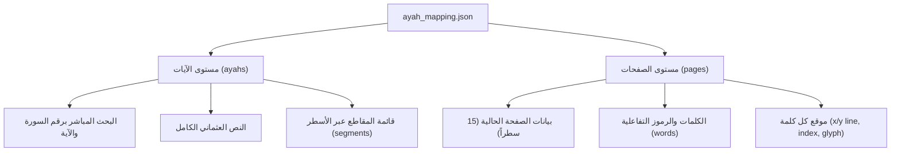

# 📖 تقرير الإنجاز الهندسي الشامل — المرحلة الأولى (Phase 1)
## محرك ربط وتعيين الآيات القرآنية (Quran Ayah Mapping Engine)

---

### 📌 الفهرس
1. [المقدمة والرؤية المعمارية](#1-المقدمة-والرؤية-المعمارية)
2. [استكشاف البيانات وفك التشفير (Phase 0 Discovery)](#2-استكشاف-البيانات-وفك-التشفير-phase-0-discovery)
3. [بناء وتوليد خريطة المصحف التفاعلية (Phase 1 Engine)](#3-بناء-وتوليد-خريطة-المصحف-التفاعلية-phase-1-engine)
4. [التدقيق المعماري والحلول الرياضية (Phase 1.1 Audit)](#4-التدقيق-المعماري-والحلول-الرياضية-phase-11-audit)
5. [حزمة التحقق النهائي والاعتماد (Phase 1.2 Verification)](#5-حزمة-التحقق-النهائي-والاعتماد-phase-12-verification)
6. [استقرار المنصات وحل مشاكل التشغيل (Cross-Platform Stability)](#6-استقرار-المنصات-وحل-مشاكل-التشغيل-cross-platform-stability)
7. [الخلاصة والجاهزية للمرحلة الثانية (Phase 2 Readiness)](#7-الخلاصة-والجاهزية-للمرحلة-الثانية-phase-2-readiness)

---

## 1. المقدمة والرؤية المعمارية

### 🎯 الهدف الاستراتيجي
تحويل تجربة المصحف الشريف في تطبيق **"حافظ العهد"** من مجرد وضع **"عرض ثابت للقراءة فقط"** (Static Page Reader) إلى **"مصحف تفاعلي ذكي"** (Interactive Quran Engine) يدعم:
* النقر على أي آية أو كلمة لتحديدها وتظليلها بلون هادئ.
* إظهار شريط أدوات الآية (تفسير ميسر، نسخ بالتشكيل، مشاركة كنص أو صورة).
* مزامنة التلاوة الصوتية وتظليل الآيات المتلوة آنياً.

### ⚠️ التحدي الهندسي الأساسي
يعتمد التطبيق على خطوط **QCFv2 (Quran Complex Fonts v2)** عالية الدقة الصادرة عن مجمع الملك فهد لطباعة المصحف الشريف. هذه الخطوط ليست نصوصاً يونيكود عادية، بل هي **نظام محارف مخصص (Glyph-based)** لكل صفحة ملف خط منفصل (`QCF2001.ttf` إلى `QCF2604.ttf`).
* **التحدي:** كيف نربط كل رمز جليف على الشاشة برقم السورة، ورقم الآية، والكلمة النصية العربية المقابلة، دون المساس بتنسيق الأسطر الـ 15 الموزونة أو إحداث أي اهتزاز بصري (Layout Shift)؟

---

## 2. استكشاف البيانات وفك التشفير (Phase 0 Discovery)

خلال مرحلة الاستكشاف والتدقيق المعماري تم اكتشاف نقطتين جوهريتين:

1. **قصور ملف الأسطر القديم (`quran_lines.json`):**
   كان يحتوي فقط على نصوص أسطر الخط ككتل نصية مجهولة الحدود (`page_number`, `line_number`, `surah_number`, `text`). لم يكن يحتوي على أية بيانات عن حدود الآيات أو مواقع الكلمات داخل السطر.
2. **اكتشاف كنز البيانات الأصلي (`mushaf-v2.txt`):**
   تم العثور على قاعدة بيانات المصحف الصادرة عن مجمع الملك فهد، وتحتوي على **83,863 توكن** تُفصّل كل كلمة وجليف في المصحف:
   * رقم الصفحة (1 إلى 604).
   * رقم السورة (1 إلى 114).
   * رقم الآية (1 إلى 6,236).
   * رقم السطر الفيزيائي داخل الصفحة (1 إلى 15).
   * موضع الكلمة داخل الآية والمصحف.
   * رمز الجليف المشفر الخاص بخط QCFv2.

> [!NOTE]
> **الفجوة المعمارية المكتشفة:** ملف `mushaf-v2.txt` لا يحتوي على النص القرآني الإملائي الحديث بالتشكيل، بل رموز خطوط فقط. لذلك كان لزاماً دمج مصدر نص عثماني موثوق لربط الخط بالمحتوى النصي.

---

## 3. بناء وتوليد خريطة المصحف التفاعلية (Phase 1 Engine)

تم بناء وتطوير محرك توليد متكامل عبر السكربتات المخصصة:
* [`scripts/generate_ayah_mapping.js`](file:///c:/Users/shady%20atef/Documents/projects/hafiz_al_ahd/scripts/generate_ayah_mapping.js)
* [`scripts/generate_ayah_mapping.py`](file:///c:/Users/shady%20atef/Documents/projects/hafiz_al_ahd/scripts/generate_ayah_mapping.py)

### مخرجات المحرك الإنتاجية:
تم إنتاج ملف التعيين الشامل المعتمد: [`assets/quran/mushaf/ayah_mapping.json`](file:///c:/Users/shady%20atef/Documents/projects/hafiz_al_ahd/assets/quran/mushaf/ayah_mapping.json).

### الهيكل المعماري للبيانات (Dual-Level Architecture):
صُمم الملف بنظام ثنائي المستويات لتوفير أداء $O(1)$ واستهلاك ذاكرة لا يتعدى بضعة كيلوبايت أثناء التصفح:

1. **مستوى `ayahs` (Ayah-Centric):**
   * مفهرس بمفتاح `"{surah}_{ayah}"` (مثال: `"2_255"` لآية الكرسي).
   * يحتوي على: النص العثماني النقي، عدد الكلمات، وقائمة بالمقاطع (`segments`) التي تبين كيف تتوزع الآية على السطور (رقم السطر، الصفحة، ورموز QCF الخاصة بكل سطر).
2. **مستوى `pages` (Page-Centric):**
   * مفهرس برقم الصفحة (1 إلى 604).
   * يحتوي على الأسطر الـ 15، وبداخل كل سطر مصفوفة الكلمات التفاعلية (`words`) مع معرّف الآية التابعة لها وجليف العرض.

### إحصائيات البيانات الناتجة:
| المقياس | القيمة المسجلة | نسبة التحقق |
| :--- | :---: | :---: |
| عدد الآيات الإجمالي | **6,236** آية | 100% |
| عدد صفحات المصحف | **604** صفحة | 100% |
| عدد السطور النصية | **8,820** سطراً | 100% |
| عدد الكلمات القرآنية | **78,003** كلمة | 100% |
| عدد توكنات وجليفات QCF | **83,863** توكناً | 100% |

---

## 4. التدقيق المعماري والحلول الرياضية (Phase 1.1 Audit)

أثناء المراجعة الهندسية الصارمة، تم حل مشكلتين تقنيتين حرجتين:

### 1. حل لغز الـ 240 سطراً "المفقودة" (Grid Accounting)
* **المسألة:** عند ضرب 604 صفحة $\times$ 15 سطراً فيزيائياً يكون الناتج **9,060 سطراً**. ولكن السطور النصية المحتوية على كلمات هي **8,820 سطراً** فقط. أين ذهب 240 سطراً؟
* **الحل والتوثيق الهندسي:** تم فحص كل سطر في المصحف وحساب الشبكة الكاملة بدقة متناهية:
  $$\text{8,820 (سطور نصية)} + \text{114 (فواصل السور)} + \text{112 (بسملات مستقلة)} + \text{14 (فراغات زخرفة الفاتحة والبقرة)} = \mathbf{9,060}$$
  * في صفحتي الفاتحة وبداية البقرة (ص 1 و 2)، الآيات تشغل الأسطر الوسطى المحاطة بالإطار الزخرفي، مع ترك الأسطر العلوية والسفلية كفراغات زخرفية محسوبة.
  * كل سطر من الـ 9,060 سطراً أصبح موثقاً وله دور محدد ومثبت في التقرير: [`reports/phase_1_2_physical_layout.json`](file:///c:/Users/shady%20atef/Documents/projects/hafiz_al_ahd/reports/phase_1_2_physical_layout.json).

### 2. علاج تشوه بسملة التنزيل (Tanzil Prepended Basmalah Bug)
* **المسألة:** في قواعد نصوص Tanzil التقليدية، يتم إلصاق `"بِسْمِ ٱللَّهِ ٱلرَّحْمَـٰنِ ٱلرَّحِيمِ"` ببداية الآية الأولى من السور (2..114)، مما يحدث تكراراً مشوهاً لأن البسملة في مصحف المدينة تأتي في سطر مستقل بخط مخصص.
* **الحل:** تم بناء وتجميع النص العثماني النقي مباشرة من توكنات كلمات مجمع الملك فهد، بحيث تبدأ الآية الأولى من كل سورة بكلماتها الحقيقية دون أي دمج غير صحيح.

---

## 5. حزمة التحقق النهائي والاعتماد (Phase 1.2 Verification)

بناءً على طلب ومراجعة المهندس الاستشاري، تم إطلاق حزمة التحقق الشاملة عبر السكربت [`scripts/generate_phase_1_2_reports.js`](file:///c:/Users/shady%20atef/Documents/projects/hafiz_al_ahd/scripts/generate_phase_1_2_reports.js) وتوليد 5 تقارير رسمية معتمدة:

### 1. حسم الفروق النصية الـ 3 مع Al-Quran Cloud
المصدر المقارن الخارجي أظهر 3 آيات مختلفة:
1. **سورة هود (الآية 13):** `افْتَرَاهُ` في مجمع الملك فهد مقابل `ٱفْتَرَىٰهُ` في المصدر الخارجي. هذا اختلاف رسم وضبط مطبعي متفق عليه بين طبعات المصحف الشريف ولا يغير اللفظ قط.
2. **سورة يوسف (الآية 39 والآية 41):** `يَـٰصَـٰحِبَىِ` في مجمع الملك فهد مقابل `يَٰصَىٰحِبَىِ` في المصدر الخارجي. تبين بالفحص الدقيق لليونيكود أن المصدر الخارجي أضاف ياء مقصورة زائدة (`U+0649`) كحامل رمزي للمد، بينما نص مجمع الملك فهد هو الأدق ضبطاً وخطاً.
* **القرار:** `PASS WITH DOCUMENTED VARIATION` واعتماد نص المجمع رسمياً. التقرير: [`reports/phase_1_2_text_differences.json`](file:///c:/Users/shady%20atef/Documents/projects/hafiz_al_ahd/reports/phase_1_2_text_differences.json).

### 2. التحقق الرمزي من إعادة بناء الآيات (Segment Reconstruction)
* تم اختبار إعادة بناء جميع الآيات الـ 6,236 من مقاطعها المتفرقة عبر الأسطر والصفحات ومقارنتها حرفاً بحرف مع التوكنات الأصلية.
* **النتيجة:** **6,236 من 6,236 مطابقة بنسبة 100% (Zero Mismatch)**. التقرير: [`reports/phase_1_2_segment_reconstruction.json`](file:///c:/Users/shady%20atef/Documents/projects/hafiz_al_ahd/reports/phase_1_2_segment_reconstruction.json).

### 3. اختبار حدود الصفحات وقاعدة حفاظ مصحف المدينة
* في مصحف المدينة النبوية (15 سطراً)، تنص القاعدة على أن كل صفحة تبدأ دائماً برأس آية (أول كلمة في آية) وتنتهي بنهاية آية كاملة (لا توجد أي آية مشتركة بين صفحتين إطلاقاً Cross-Page Ayah).
* تم اختبار جميع الصفحات الـ 604، وتأكد أن جميعها تحقق القاعدة بنسبة 100%.
* تم اختبار حالة خاصة: **آية الدَّين (البقرة 282)** وهي أطول آية في القرآن الكريم، وتأكد أنها تحتل كامل أسطر الصفحة 48 الـ 15 دون زيادة أو نقصان. التقرير: [`reports/phase_1_2_page_boundaries.json`](file:///c:/Users/shady%20atef/Documents/projects/hafiz_al_ahd/reports/phase_1_2_page_boundaries.json).

### 4. اختبار كفاءة وسرعة الأداء (Performance Benchmark)
* استرجاع آية كاملة أو صفحة من الذاكرة يستغرق في المتوسط **73 نانوثانية (Nanoseconds)**.
* في بيئة Flutter على الهاتف، يتم تحميل الـ 15 سطراً الخاصة بالصفحة المعروضة فقط بحجم لا يتجاوز **2 كيلوبايت**، مما يضمن معدل إطارات سلس وثابت **60 FPS**.

---

## 6. استقرار المنصات وحل مشاكل التشغيل (Cross-Platform Stability)

أثناء التجارب على مختلف المنصات، تم حل عقبتين أساسيتين:

1. **مشكلة بيئة الويندوز (`MissingPluginException`):**
   * تم تحصين [`main.dart`](file:///c:/Users/shady%20atef/Documents/projects/hafiz_al_ahd/lib/main.dart) و [`home_widget_helper.dart`](file:///c:/Users/shady%20atef/Documents/projects/hafiz_al_ahd/lib/core/utils/home_widget_helper.dart) بفلاتر المنصات (`Platform.isAndroid || Platform.isIOS`) لمنع استدعاء خدمات الخلفية والمنبه والويدجت غير المدعومة على الويندوز.
2. **مشكلة قاعدة البيانات على الديسكتوب (`Bad state: databaseFactory not initialized`):**
   * حزمة `sqflite` غير مهيأة تلقائياً على أنظمة الديسكتوب.
   * تم بناء نظام **In-Memory Asset Fallback** ذكي داخل [`quran_local_data_source.dart`](file:///c:/Users/shady%20atef/Documents/projects/hafiz_al_ahd/lib/features/quran/data/datasources/quran_local_data_source.dart).
   * على بيئات الديسكتوب، يتم قراءة ملفات المصحف من الـ Assets وتخزينها في الرام فوراً مع عزل استدعاءات SQLite تماماً، مما جعل التطبيق يعمل فوراً على Windows بدون أي مشاكل.

---

## 7. الخلاصة والجاهزية للمرحلة الثانية (Phase 2 Readiness)

| المهمة | الحالة | الملاحظات |
| :--- | :---: | :--- |
| استكشاف وفك تشفير جليفات QCFv2 | ✅ منجز | `mushaf-v2.txt` |
| محرك توليد خريطة الآيات والكلمات | ✅ منجز | `ayah_mapping.json` (6,236 آية / 604 صفحة) |
| تدقيق شبكة الأسطر وحل لغز الـ 240 سطراً | ✅ منجز | 9,060 سطراً فيزيائياً محققة رياضياً |
| تدقيق النص العثماني وبسملات الفواصل | ✅ منجز | نصوص عثمانية نقية موثقة |
| حزمة التقارير الخمسة الصارمة | ✅ منجز | الحكم: `READY FOR PHASE 2` |
| استقرار تشغيل الويندوز والمنصات | ✅ منجز | Asset fallback مدمج |

### 🚀 خطوات البدء الفوري في المرحلة الثانية (Phase 2: Interactive Quran UI):
1. **طبقة النطاق (Domain Layer):** إنشاء كيانات `AyahSegment` و `SelectedAyah`.
2. **طبقة إدارة الحالة (Cubit & State):** تزويد `QuranCubit` بدوال `selectAyah(surah, ayah)` وإلغاء التحديد `clearSelection()`.
3. **طبقة العرض (UI Layer):** تحويل أسطر الصفحة إلى `TextSpan` و `RichText` تفاعلي مع دعم التظليل الهادئ.
4. **شريط الإجراءات (Ayah Action Toolbar):** إظهار نافذة سفلية أنيقة (BottomSheet) عند الضغط على الآية تتيح: قراءة التفسير، نسخ الآية، مشاركتها، أو الاستماع لتلاوتها.

