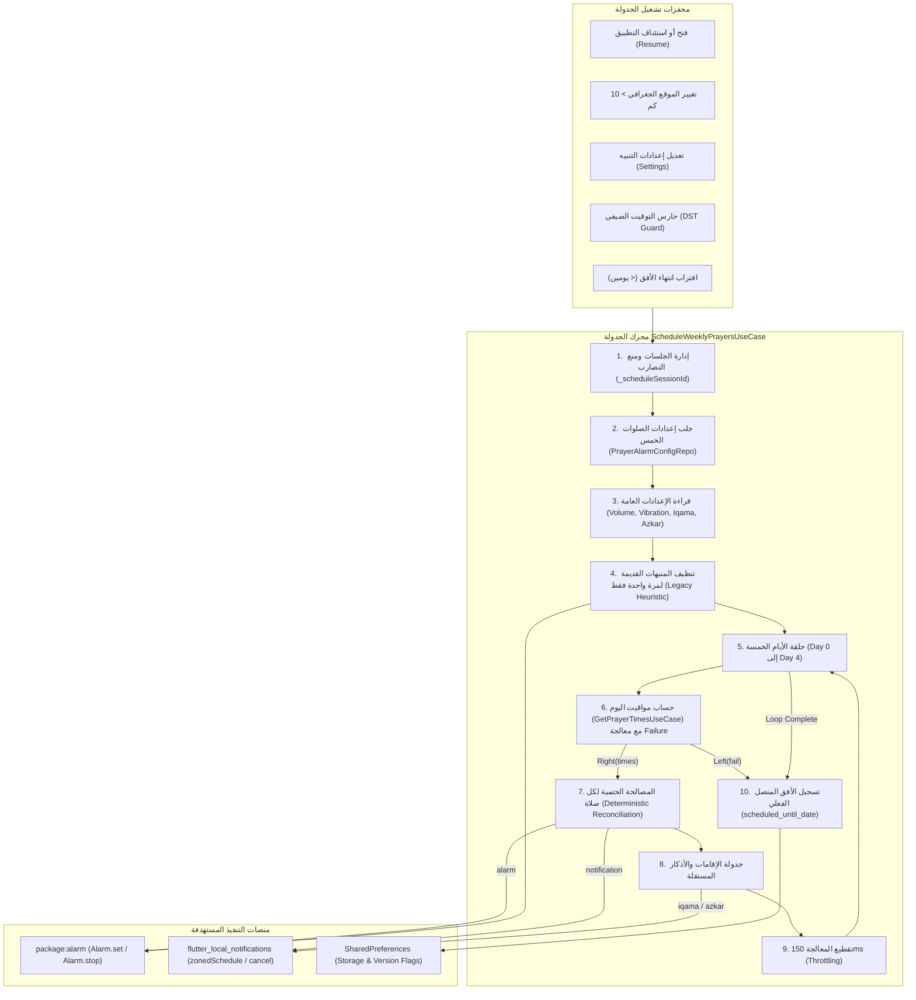

# P4.1-B.3 Phase 2A — Scheduler Integration Design Specification
**Project:** Hafiz Al-Ahd (حافظ العهد)  
**Branch:** `feature/p4.1-independent-alarms-adhan`  
**Phase:** P4.1-B.3 — Phase 2A.1 Consolidated Architecture Specification  
**Status:** Frozen Master Architectural Design Document — **STRICT STOP GATE**  

---

## 1. Architecture Invariants

The following rules represent inviolable engineering invariants governing prayer scheduling:
1. **Total Prayer Independence:** Each of the 5 daily prayers (`fajr`, `dhuhr`, `asr`, `maghrib`, `isha`) operates under its own distinct configuration (`PrayerAlarmType: alarm, notification, off`). Modifying one prayer's alert mode has zero side effects on any other prayer.
2. **Channel Medium Separation:**
   - `alarm`: Full-screen wakeup alert with continuous audio via `package:alarm`.
   - `notification`: Standard system tray chime/heads-up notification via `flutter_local_notifications`.
   - `off`: Complete alert suppression for that specific prayer (no alarm, no notification).
3. **Targeted Cancellation Invariant:** `Alarm.stopAll()` and `flutterLocalNotificationsPlugin.cancelAll()` are **strictly prohibited** in all scheduling, rescheduling, and migration code paths. Every cancellation must target a discrete, proven event ID.
4. **Best-Effort Active Audio Protection:** The scheduler never terminates an actively playing Adhan audio stream. The protection mechanism is officially classified as **`Best-effort Active Alarm Protection — Not Atomic Guarantee`** due to cross-process platform channel boundaries.
5. **Subsystem Independence:** Iqama reminders, Post-prayer Azkar, Morning Azkar (linked to Fajr), and Evening Azkar (linked to Asr) operate under their own preferences (`isIqamaEnabled`, `isAzkarReminderEnabled`) and are never cancelled or disabled simply because an Adhan is configured as `off`.
6. **Global Legacy Settings Preservation:** Master volume (`adhan_volume`), vibration toggle (`isAdhanVibrationEnabled`), and specialized sound files (`fajr_azan.mp3` vs `adhan.mp3`) remain 100% active and respected.
7. **Strict Error Propagation & Horizon Integrity:** No exceptions or failure responses (`Left(Failure)`) may be swallowed. Any failure halts the contiguous horizon and strictly bounds `scheduled_until_date`.

---

## 2. Scheduler Dependency Map & Execution Pipeline

---

## 3. Corrected 12-State Scheduling Decision Matrix

### Transition Nomenclature:
- **Notification ➡️ Alarm:** Existing event is a Notification; Desired config is Alarm.
- **Alarm ➡️ Notification:** Existing event is an Alarm; Desired config is Notification.

### Comprehensive Operational Matrix:

| Case | Desired Config | Alarm State | Notif State | Action Required | Cancellation Timing | Ringing Alarm Handling | Temporal Guard (±15s) |
|:---:|:---:|:---:|:---:|---|---|---|---|
| **1** | `alarm` | absent | absent | Schedule new Alarm | None | N/A | Normal schedule |
| **2** | `alarm` | present | absent | In-place refresh (`Alarm.set`) | None | Ringing audio preserved | In-place update safe |
| **3** | `alarm` | absent | present | **Notification ➡️ Alarm** | Cancel Notif **after** Alarm verifies | N/A | Alarm scheduled |
| **4** | `alarm` | present | present *(Dirty)* | In-place refresh Alarm; cancel stray Notif | Cancel Notif **after** refreshed Alarm verifies Level 1+2 | Preserve ringing Alarm; defer stop | Cancel Notif only after Alarm verifies |
| **5** | `notification` | absent | absent | Schedule new Notif (`zonedSchedule`) | None | N/A | Normal schedule |
| **6** | `notification` | present | absent | **Alarm ➡️ Notification** | Cancel Alarm **after** Notif verifies Level 1+2 | **Preserve Ringing**; defer stop | **Preserve Alarm**; do not stop |
| **7** | `notification` | absent | present | In-place refresh (`zonedSchedule`) | None | N/A | Overwrite in Android |
| **8** | `notification` | present | present *(Dirty)* | In-place refresh Notif; cancel stray Alarm | Cancel Alarm **after** refreshed Notif verifies Level 1+2 | **Preserve Ringing**; defer stop | **Preserve Alarm**; do not stop |
| **9** | `off` | absent | absent | No-op | None | N/A | No-op |
| **10** | `off` | present | absent | Targeted cancel Alarm | Immediate targeted stop | **Preserve Ringing**; do not stop | **Preserve Alarm**; do not stop |
| **11** | `off` | absent | present | Targeted cancel Notif | Immediate `cancel(notifId)` | N/A | Immediate cancel |
| **12** | `off` | present | present *(Dirty)* | Cancel Notif + Targeted cancel Alarm | Immediate targeted cleanup | **Preserve Ringing**; cancel Notif | **Preserve Alarm**; cancel Notif |

---

## 4. Notification Ownership, `cancelAlarmSafely` & Legacy FLN Contract

1. **Boundary Decoupling:** `package:alarm` and `flutter_local_notifications` share no IDs, no lifecycle, and no shared state.
2. **`cancelAlarmSafely` Contract:**
   - Signature: `Future<bool> cancelAlarmSafely(int id, {DateTime? expectedScheduledTime, String? expectedAssetAudioPath})`
   - **Step 1:** Query `Alarm.getAlarm(id)`. If `null`, returns `true` (idempotent success).
   - **Step 2:** Ownership Verification: Checks ID in $24\text{M}..99\text{M}$ AND audio asset matches prayer audio. If mismatched, **aborts immediately** (returns `false`).
   - **Step 3:** Scheduled timestamp resolved: `scheduledTime = expectedScheduledTime ?? alarm.dateTime`.
   - **Step 4:** Active ringing check: If `await Alarm.isRinging(id) == true`, **aborts cancellation** (audio protected; returns `false`).
   - **Step 5:** Temporal guard check: If $|\text{now} - \text{scheduledTime}| \le 15\text{s}$, **aborts cancellation** (returns `false`).
   - **Step 6:** Executes targeted `Alarm.stop(id)`.
3. **Legacy FLN Across Reboot (Verified Manifest Evidence):**
   - `AndroidManifest.xml` registers `com.dexterous.flutterlocalnotifications.ScheduledNotificationBootReceiver` with `RECEIVE_BOOT_COMPLETED`.
   - On reboot, FLN automatically purges expired notifications and re-arms future ones.
   - Targeted cleanup queries `pendingNotificationRequests()`, matching legacy IDs ($< 1000$) with prefixes `adhan_simple_`, `iqama_`, `azkar_` and cancels them specifically without touching persistent widgets.
   - Classified as **Residual Legacy Behavior** with $\le 5$-day natural expiration horizon.

---

## 5. Active Alarm Protection Specification

- **Official Name:** `Best-effort Active Alarm Protection — Not Atomic Guarantee`.
- **Temporal Guard Formula:**
  $$\text{TemporalGuardWindow}(T_{\text{scheduled}}) = [T_{\text{scheduled}} - 15\text{s}, \; T_{\text{scheduled}} + 15\text{s}]$$
- Destructive `Alarm.stop(id)` calls are strictly blocked if:
  1. `await Alarm.isRinging(id) == true`, OR
  2. $|\text{DateTime.now}() - T_{\text{scheduled}}| \le 15\text{ seconds}$.

---

## 6. Scheduling Verification Contract

The engine enforces Level 1 + Level 2 verification before committing transitions:
1. **Level 1 (API Success):** `await Alarm.set(...)` returns `true`; `await zonedSchedule(...)` completes without exception.
2. **Level 2 (Registry Proof):** `Alarm.getAlarm(id) != null` with matching timestamp; `pendingNotificationRequests()` contains the target ID.
3. **Level 3 (Platform Acceptance):** Android `AlarmManager` exact alarm accepted.
4. **Level 4 (User Delivery):** Observed post-facto; cannot be proven during scheduling.

---

## 7. Deterministic Calendar ID Mapping

### Frozen Formula:
$$\mathbf{ID} = (\text{year} \pmod{100}) \times 1,000,000 + (\text{month} \times 10,000) + (\text{day} \times 100) + (\text{prayerIndex} \times 10) + \text{typeOffset}$$

- **Supported Span:** `2024` to `2099` (ID Range: `24,010,100` to `99,123,149`).
- **Capacity Utilization:** $< 4.62\%$ of signed 32-bit `int`.
- **Prayer Indices:** Fajr (`0`), Dhuhr (`1`), Asr (`2`), Maghrib (`3`), Isha (`4`).
- **Type Offsets:**
  - `0`: Adhan Alarm (`package:alarm`)
  - `1`: Adhan Notification (`FLN`)
  - `2`: Iqama Notification (`FLN`)
  - `3`: Post-Prayer Azkar Notification (`FLN`)
  - `4`: Morning Azkar Notification (`FLN`, explicitly bound to Fajr `P=0`)
  - `5`: Evening Azkar Notification (`FLN`, explicitly bound to Asr `P=2`)
  - `6..9`: Reserved Future Expansions

---

## 8. Same-ID vs. Different-ID Mechanics

1. **Same-ID In-Place Replacement (e.g. Alarm ➡️ Alarm):**
   - Calling `Alarm.set()` with the identical ID updates the trigger timestamp in Android's `AlarmManager` via `PendingIntent.FLAG_UPDATE_CURRENT`.
   - Never interrupts an active ringing `MediaPlayer`.
2. **Different-ID Transition (e.g. Notification ➡️ Alarm or Alarm ➡️ Notification):**
   - **Step 1:** Schedule the replacement event with its new deterministic ID.
   - **Step 2:** Verify Level 1 + Level 2 registration of the new event.
   - **Step 3:** Cancel the obsolete event using targeted cancellation (subject to active ringing and temporal guard checks).
   - If Step 1 or 2 fails, Step 3 is **aborted**, preserving the existing alert.

---

## 9. Idempotent Reconciliation & Partial Failure Recovery

- The scheduler reconciles device state against the 5-Tier Source of Truth:
  1. User Configuration Repository (`PrayerAlarmConfigRepository`).
  2. Astronomical Calculations (`GetPrayerTimesUseCase`).
  3. Deterministic Identity Formula (`CalendarAlarmIdContract`).
  4. Backend Registries (`Alarm.getAlarms()`, `pendingNotificationRequests()`).
  5. Cache (`scheduled_until_date`) as horizon throttle only.
- Repeated runs converge monotonically without duplicate alerts or state regression.

---

## 10. `scheduled_until_date` Contract

- Defined strictly as the **latest contiguous calendar day** where:
  1. Astronomical calculation succeeded (`Right(prayerTimes)`).
  2. All 5 daily prayers were reconciled according to their respective configurations (`alarm`, `notification`, or `off`).
  3. All required events were created and verified (Level 1 + 2).
  4. Enabled Iqama and Azkar subsystems were processed and verified.
  5. Zero unhandled failures remain.
- A day does **NOT** require 5 alarms if prayers are configured as `notification` or `off`.
- If Day 0 fails: No completion date is written to storage.
- If Day $k$ fails: The horizon strictly caps at Day $k-1$.
- Cache is **never** proof of event existence; mid-day recovery reconciles from partial state on next run.
- SharedPreferences is updated once at the end of the session.

---

## 11. Legacy Cleanup Contract & Ringing Exemption Policy

- Governed by the **Conservative Ownership Heuristic** (5 checks: not reserved 888/999/8888, ID in `1..100`, audio asset matches, title matches, not ringing/guarded).
- Tripartite state classification:
  1. **Successfully Stopped:** Future non-ringing alarm cancelled.
  2. **Intentionally Exempted (Ringing):** Alarm is actively ringing in user's ear; playback protected; NOT treated as a failure; marker writing deferred until playback ends.
  3. **Failed Cancellation:** Platform channel error on non-ringing alarm; marker NOT written; retry next session.
- Marker `legacy_prayer_alarms_cleaned_v1 = true` is committed permanently once all legacy alarms are confirmed stopped and no active playback remains.

---

## 12. Explicit Platform Limitations & Unresolved Risks

1. **Android Cross-Process IPC Asynchrony:** There is no cross-process mutex between Dart and Android's native `AlarmManagerService`. The $\pm 15$s Temporal Guard provides best-effort mitigation.
2. **OEM Aggressive Battery Optimization:** Custom Android skins (MIUI/HyperOS, EMUI, ColorOS) may defer exact alarms if the app is placed in strict battery saver mode, despite `exactAllowWhileIdle`.
3. **Daylight Saving Time Edge Cases:** When clocks jump $\pm 1$ hour, standard calculation handles offsets, but in-flight scheduled alarms must be reconciled by the app's existing DST guard.

