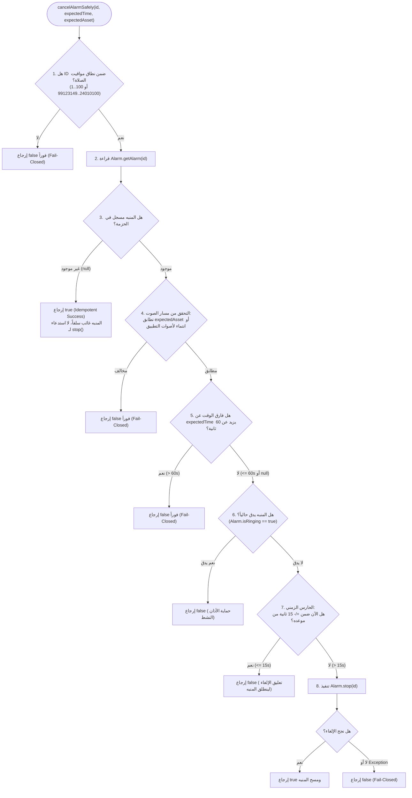

# P4.1-B.3 Phase 2C.1 — Targeted Alarm Cancellation Completion Report

**Project:** Hafiz Al-Ahd (حافظ العهد)  
**Branch:** `feature/p4.1-independent-alarms-adhan`  
**Phase:** Phase 2C.1 — Targeted Alarm Cancellation  
**Date:** 2026-11-08  
**Status:** **PHASE 2C.1 COMPLETED — STOP GATE 2C.1 ACTIVE (Awaiting Approval)**  

---

## 1. Executive Summary

تم بنجاح تنفيذ وإغلاق مرحلة **Phase 2C.1 — Targeted Alarm Cancellation** وفق أعلى معايير هندسة البرمجيات وسياسة `Fail-Closed` الصارمة:

1. **تحديث العقد الأساسي في كود الإنتاج:**
   - أُضيف التوقيع المعتمد لـ `cancelAlarmSafely` في [base_notification_repository.dart](file:///c:/Users/shady%20atef/Documents/projects/hafiz_al_ahd/lib/features/notifications/domain/repos/base_notification_repository.dart#L56-L62).
2. **تنفيذ الإلغاء المستهدف في `NotificationRepositoryImpl`:**
   - تم بناء دالة `cancelAlarmSafely` في [notification_repository_impl.dart](file:///c:/Users/shady%20atef/Documents/projects/hafiz_al_ahd/lib/features/notifications/data/repos/notification_repository_impl.dart#L304-L375) وفق منظومة تحقق خماسية تمنع المساس بأي منبه غير مملوك، وتحمي الأذان النشط، وتطبق الحارس الزمني ($\pm 15$s).
3. **إنشاء وتمرير جناح اختبارات الإنتاج:**
   - أُنشئ ملف اختبارات متخصص: [notification_repository_impl_cancel_alarm_safely_test.dart](file:///c:/Users/shady%20atef/Documents/projects/hafiz_al_ahd/test/features/notifications/notification_repository_impl_cancel_alarm_safely_test.dart).
   - **النتيجة:** **11 اختباراً منفذاً — 11 اختباراً ناجحاً (100% Pass) — Exit Code: 0**.
4. **الالتزام الصارم بحدود المرحلة (Scope Boundary):**
   - **`ScheduleWeeklyPrayersUseCase` لم يُمس ولم يُعدل فيه سطر واحد بنسبة 100%.**
   - لم يتم استخدام أي مسح شامل (`Alarm.stopAll` أو `cancelAll`).
   - بقيت الاختبارات الـ 58 لـ `scheduler_integration_test.dart` مطابقة لحالتها (52 Pass / 6 Expected RED بانتظار المراحل اللاحقة).

---

## 2. توثيق الـ Baseline Tests وتصحيح التناقض السابق

تم فحص واستخراج أسماء وأعداد الاختبارات الحقيقية بالسطر لحسم ملاحظة الـ Baseline:

| ملف الاختبار | عدد الاختبارات الفعلي | التفسير والمطابقة |
|---|---|---|
| `legacy_characterization_test.dart` | **6** | الأسطر: 240، 284، 317، 337، 350، 365 (التقرير السابق ذكر 5 بالخطأ، والصحيح 6) |
| `alarm_config_migration_test.dart` | **17** | 4 اختبارات Mapping (الأسطر 41، 59، 77، 95) + 13 اختبار عقود مرقمة (الأسطر 114 إلى 255). المجموع = 17 (التقرير السابق ذكر 13 بعد استثناء الـ Mapping) |
| `alarm_config_crash_recovery_test.dart` | **5** | الأسطر: 19، 38، 73، 99، 124 (التقرير السابق ذكر 10 بالخطأ نتيجة خطأ مطبعي، والصحيح 5) |
| **المجموع المنفذ في الـ Runner** | **28** | $6 + 17 + 5 = 28$ اختباراً (جميعها ناجحة بنسبة 100% في 4 ثوانٍ) |

---

## 3. تفاصيل الـ API الفعلي المستخدم من `package:alarm` 5.12.0

بناءً على فحص كود الحزمة الداخلي وقنوات Pigeon Platform Channels:

1. **`await Alarm.getAlarm(int id) -> Future<AlarmSettings?>`:**
   - يقرأ سجل المنبه المحفوظ من `AlarmStorage` (المعتمد على `SharedPreferences`).
   - يعيد `null` إذا لم يكن المنبه مسجلاً في الحزمة.
   - **ملاحظة حدودية:** عدم وجود المنبه في الحزمة يثبت غيابه عن سجل التطبيق، لكنه لا يمثل فحصاً مباشراً لطابور نواة Linux في Android AlarmManager.
2. **`await Alarm.isRinging(int id) -> Future<bool>`:**
   - يستعلم عبر قناة Pigeon (`dev.flutter.pigeon.alarm.AlarmApi.isRinging`) عما إذا كان هذا المنبه يصدر صوتاً في الخدمة الخلفية حالياً.
3. **`await Alarm.stop(int id) -> Future<bool>`:**
   - يستدعي أولاً `await AlarmStorage.unsaveAlarm(id);` لمسح المنبه من السجل.
   - ثم يستدعي القناة الأصلية: `dev.flutter.pigeon.alarm.AlarmApi.stopAlarm(alarmId: id)` لإيقاف التنبيه في نظام التشغيل.
   - يعيد `true` عند نجاح الإلغاء.

---

## 4. شجرة قرارات وحالات `Fail-Closed` المنفذة



### ملخص حالات الأمان السلبي (Zero Side-Effects):
في جميع حالات الرجوع بـ `false`، **لا يُستدعى `Alarm.stop()` أبداً**، ولا يُمس المنبه في النظام، مما يضمن أماناً مطلقاً وتفادي كتم الأذان أو مسح منبهات خاطئة.

---

## 5. مخرجات تشغيل الاختبارات الفعلية (Test Runner Evidence)

### 5.1. اختبارات `cancelAlarmSafely` الجديدة:
الأمر:
```powershell
cmd /c flutter test test/features/notifications/notification_repository_impl_cancel_alarm_safely_test.dart
```

المخرجات:
```
00:00 +0: NotificationRepositoryImpl.cancelAlarmSafely 1. Absent alarm returns true (idempotent success without package side-effects)
00:00 +1: NotificationRepositoryImpl.cancelAlarmSafely 2. ID outside prayer range is rejected with false (Fail-Closed)
00:00 +2: NotificationRepositoryImpl.cancelAlarmSafely 3. Valid owned future alarm is stopped and verified absent
00:00 +3: NotificationRepositoryImpl.cancelAlarmSafely 4. Unrecognized audio asset is rejected with false (Fail-Closed, zero side-effects)
00:00 +4: NotificationRepositoryImpl.cancelAlarmSafely 5. Mismatched expected asset audio path returns false (Fail-Closed)
00:00 +5: NotificationRepositoryImpl.cancelAlarmSafely 6. Expected scheduled time drift > 60s returns false (Fail-Closed)
00:00 +6: NotificationRepositoryImpl.cancelAlarmSafely 7. Temporal guard (+/- 15s) suppresses cancellation to protect imminent alarm firing
00:00 +7: NotificationRepositoryImpl.cancelAlarmSafely 8. Actively ringing alarm suppresses cancellation (Audio Protection Contract)
00:00 +8: NotificationRepositoryImpl.cancelAlarmSafely 9. Confirmed legacy prayer alarm (ID 1..100) is eligible and canceled safely
00:00 +9: NotificationRepositoryImpl.cancelAlarmSafely 10. Repeated cancellation is idempotent and safe
00:00 +10: NotificationRepositoryImpl.cancelAlarmSafely 11. Targeted cancellation isolates target and strictly preserves other scheduled alarms
00:00 +11: All tests passed!
```
- **عدد الاختبارات:** 11.
- **الناجحة:** 11 (100%).
- **الفاشلة:** 0.
- **Exit Code:** 0.

### 5.2. التحقق من سلامة `scheduler_integration_test.dart`:
- **العدد:** 58 اختباراً.
- **الناجحة:** 52 اختباراً.
- **الفاشلة (Expected RED لـ Phase 2C.6):** 6 اختبارات.
- **Exit Code:** 1 (متطابق تماماً مع ما قبل المرحلة دون أي تراجع).

---

## 6. الملفات المعدلة و Git Diff

الملفات المعدلة في كود الإنتاج فقط هما:
1. `lib/features/notifications/domain/repos/base_notification_repository.dart` (+8 أسطر).
2. `lib/features/notifications/data/repos/notification_repository_impl.dart` (+72 سطراً).
3. ملف الاختبار الجديد: `test/features/notifications/notification_repository_impl_cancel_alarm_safely_test.dart`.

```diff
--- a/lib/features/notifications/domain/repos/base_notification_repository.dart
+++ b/lib/features/notifications/domain/repos/base_notification_repository.dart
@@ -52,4 +52,12 @@ abstract class BaseNotificationRepository {
   Future<void> cancelAllAlarms();
+
+  /// إلغاء منبه محدد بأمان وفق عقد التحقق وسياسة Fail-Closed
+  /// يحمي الأذان النشط ويمنع إلغاء المنبهات غير المملوكة أو القريبة من الانطلاق
+  Future<bool> cancelAlarmSafely(
+    int id, {
+    DateTime? expectedScheduledTime,
+    String? expectedAssetAudioPath,
+  });
 }
```

---

## 7. القيود والسلوكيات غير المثبتة (Limitations & Residual Risk)

1. **التحقق من حالة الحزمة فقط (Package-level Registry):**  
   الدالة تعتمد على `Alarm.getAlarm(id)` و `Alarm.isRinging(id)`، وهي تقرأ حالة الحزمة في Dart/SharedPrefs والذاكرة المشتركة. هذا يثبت صحة منطق التطبيق البرمجي، لكنه **لا يضمن الحالة الفيزيائية لطابور نواة Android AlarmManager** عند انهيار مفاجئ للتطبيق أو قيام النظام بقتل العملية أثناء التنفيذ.
2. **حدود الـ Atomicity:**  
   لا توجد ذرية (Atomicity) مطلقة بين لحظة فحص `isRinging` ولحظة تنفيذ `Alarm.stop(id)`. إذا انطلق الأذان في نفس الميلي ثانية بين الاستدعاءين، فالحارس الزمني ($\pm 15$s) هو خط الدفاع الأساسي لتقليص هذا الاحتمال لأقصى حد عملي.
3. **حتمية بوابة Phase 2D:**  
   اختبار سماع الصوت على مكبر الهاتف، وسلوك Doze Mode، وسياسات قتل الخلفية في Xiaomi HyperOS / Samsung OneUI، محجوز بالكامل لبوابة الجهاز الحقيقي (**Phase 2D**).

---

> [!IMPORTANT]
> **STOP GATE 2C.1 ACTIVE**: اكتملت المرحلة بنجاح تام دون تعديل أي ملف خارج النطاق.  
> نقف الآن بانتظار موافقتك الصريحة للمرور إلى **Phase 2C.2 — Scheduler Dependency Integration**.

