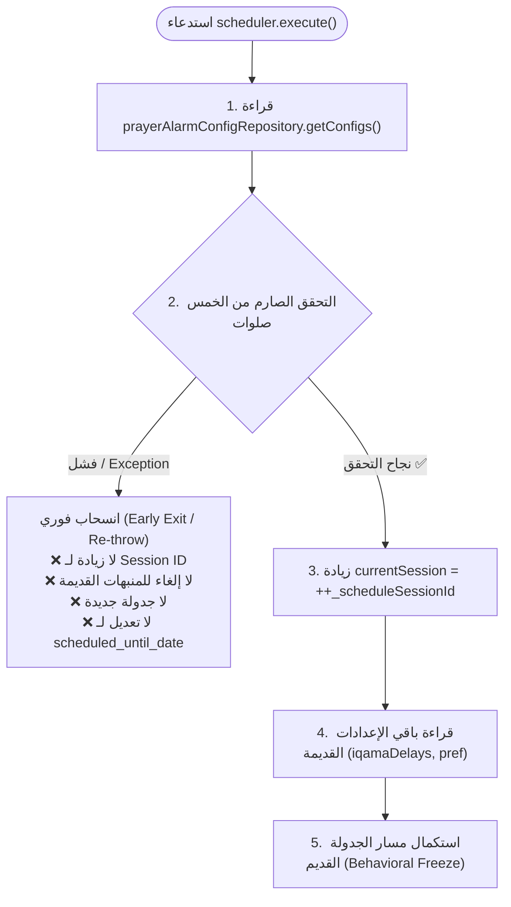

# P4.1-B.3 Phase 2C.2.3.0 — Contract Inspection & Validation Specification

**Project:** Hafiz Al-Ahd (حافظ العهد)  
**Branch:** `feature/p4.1-independent-alarms-adhan`  
**Phase:** Phase 2C.2.3.0 — Contract Inspection & Pre-Implementation Alignment  
**Date:** 2026-11-08  
**Status:** **INSPECTION COMPLETE — STOP GATE 2C.2.3.0 ACTIVE (Awaiting Execution Approval)**  

---

## 1. Executive Summary & Purpose

تنفيذاً للشرط الصارم في **Phase 2C.2.3.0 (STOP GATE 2C.2.3.0)**، قمنا بفحص معماري شامل لطبقة الـ Config Repository والـ Entities المعنية، لتحديد العقود البرمجية الفعلية (Actual Signatures & Behavior) قبل كتابة كود التحقق (Validation Logic) أو تعديل `ScheduleWeeklyPrayersUseCase`.

> [!IMPORTANT]
> **اكتشاف جوهري من الفحص:**  
> واجهة المستودع `BasePrayerAlarmConfigRepository.getConfigs()` تعيد **`Future<Map<PrayerId, PrayerAlarmConfig>>`** وليس `List`.  
> هذا التمييز جوهري في تصميم قواعد التحقق (Validation Rules) وضمان اكتمال الصلوات الخمس وعدم حدوث تضارب في المفاتيح.

---

## 2. توثيق العقود الفعلية (Actual Contract Definitions)

### 2.1. واجهة المستودع: `BasePrayerAlarmConfigRepository`
الملف: [`lib/features/notifications/domain/repos/prayer_alarm_config_repository.dart`](file:///c:/Users/shady%20atef/Documents/projects/hafiz_al_ahd/lib/features/notifications/domain/repos/prayer_alarm_config_repository.dart)

```dart
abstract class BasePrayerAlarmConfigRepository {
  /// Retrieves configurations for all five prayers.
  /// If not yet migrated or initialized, performs migration or provides safe defaults.
  Future<Map<PrayerId, PrayerAlarmConfig>> getConfigs();

  /// Retrieves the configuration for a specific prayer.
  Future<PrayerAlarmConfig> getConfig(PrayerId prayerId);

  /// Persists the configuration for a single prayer.
  Future<void> saveConfig(PrayerAlarmConfig config);

  /// Persists configurations for all five prayers in a single payload.
  Future<void> saveAllConfigs(Map<PrayerId, PrayerAlarmConfig> configs);

  /// Runs the versioned migration if `prayer_alarm_config_version` is missing or outdated.
  Future<bool> migrateLegacyConfigsIfNeeded();

  /// Gets the current migration version (0 if not migrated).
  Future<int> getMigrationVersion();
}
```

- **التوقيع الدقيق للدالة المستهدفة:**
  ```dart
  Future<Map<PrayerId, PrayerAlarmConfig>> getConfigs();
  ```
- **نوع القيمة المرجعة:** `Map<PrayerId, PrayerAlarmConfig>` (وليس `List<PrayerAlarmConfig>`).

---

### 2.2. الكيان: `PrayerAlarmConfig`
الملف: [`lib/features/notifications/domain/entities/prayer_alarm_config.dart`](file:///c:/Users/shady%20atef/Documents/projects/hafiz_al_ahd/lib/features/notifications/domain/entities/prayer_alarm_config.dart#L52-L88)

- كائن غير قابل للتعديل (`@immutable`).
- الحقول:
  ```dart
  final PrayerId prayerId;
  final PrayerAlarmType alarmType;
  ```
- يدعم `copyWith` و `operator ==` و `hashCode`.

---

### 2.3. الـ Enums: `PrayerId` و `PrayerAlarmType`
الملف: [`lib/features/notifications/domain/entities/prayer_alarm_config.dart`](file:///c:/Users/shady%20atef/Documents/projects/hafiz_al_ahd/lib/features/notifications/domain/entities/prayer_alarm_config.dart#L3-L50)

#### أ) `PrayerId`:
```dart
enum PrayerId {
  fajr,
  dhuhr,
  asr,
  maghrib,
  isha;
  
  String get key => name;
  static PrayerId? fromKey(String? key);
}
```
- عدد القيم الإلزامية: **5 فقط** (`PrayerId.values.length == 5`).
- لا يشمل `shurooq` لأن الشروق ليس صلاة مفروضة في عقد التنبيهات.

#### ب) `PrayerAlarmType`:
```dart
enum PrayerAlarmType {
  alarm,         // Full-screen intent alarm with audio playback
  notification,  // High-priority notification with sound
  off;           // Disabled
  
  String get key => name;
  static PrayerAlarmType fromKey(String? key, {PrayerAlarmType fallback = PrayerAlarmType.alarm});
}
```

---

## 3. سلوك الـ Repository الفعلي تحت حالات الفشل والبيانات الشاذة

تم فحص كود التنفيذ في [`PrayerAlarmConfigLocalDataSourceImpl`](file:///c:/Users/shady%20atef/Documents/projects/hafiz_al_ahd/lib/features/notifications/data/datasources/prayer_alarm_config_local_data_source.dart):

| الحالة (Edge Case) | السلوك الفعلي لـ `PrayerAlarmConfigLocalDataSourceImpl` | ما يجب أن يفعله `ScheduleWeeklyPrayersUseCase` (Validation Layer) |
|---|---|---|
| **فشل القراءة أو رمي Exception** | يرمي الـ Exception إلى المستدعي دون كتمانه | **التقاط أو ترك الـ Exception للانسحاب الفوري (Fail-Safe Early Exit) دون أي أثر جانبي** |
| **JSON تالف (Corrupted JSON)** | يلتقط الـ FormatException ويتراجع لقراءة المفاتيح الفردية | في حال فشل التراجع ورمي خطأ، ينسحب الـ Scheduler فوراً |
| **غياب إعداد صلاة (Missing Prayer)** | محلياً يملأه بـ `fallback: alarm`، لكن في Fakes أو Repositories أخرى قد تعيد Map ناقصة أو فارغة | **يرفض الخريطة: يجب احتواء جميع المفاتيح الخمسة `fajr, dhuhr, asr, maghrib, isha` وإلا يُرمى Exception فوراً** |
| **تكرار إعدادات الصلاة (Duplicate Configs)** | الـ `Map` تمنع تكرار المفاتيح لغوياً، ولكن قد يحتوي الـ Map على تضارب مثل: `{PrayerId.fajr: Config(prayerId: PrayerId.dhuhr)}` | **التحقق من التطابق الهوياتي: `entry.key == entry.value.prayerId` و `map.length == 5`** |
| **قيم Enum غير صالحة أو Null** | محلياً `fromKey` ترجع fallback، لكن في Fakes/Mocks قد تكون القيمة `null` | **التحقق الصارم: رفض أي `null` أو قيمة خارج قيم الـ Enum المعروفة** |
| **بيانات إضافية غير متوقعة (Unexpected Keys)** | قد تحتوي الـ Map على مفاتيح غريبة لو تم تمرير Mock غير منضبط | **رفض أي Map يزيد طولها عن 5 أو تحتوي مفاتيح خارج `PrayerId.values`** |

---

## 4. فحص ترتيب التنفيذ الحالي والآثار الجانبية (Side Effects Analysis)

### 4.1. الكود الحالي لـ `ScheduleWeeklyPrayersUseCase.execute`
الملف: [`lib/features/notifications/domain/usecases/schedule_weekly_prayers_usecase.dart`](file:///c:/Users/shady%20atef/Documents/projects/hafiz_al_ahd/lib/features/notifications/domain/usecases/schedule_weekly_prayers_usecase.dart#L32-L50)

```dart
  Future<void> execute(double lat, double lng, String city, [String? country]) async {
    // 1. إدارة التضارب (Race Conditions)
    final int currentSession = ++_scheduleSessionId; // ⚠️ أول أثر جانبي: إبطال الجلسات السابقة!

    // 2. قراءة الإعدادات
    final iqamaDelays = await getIqamaDelaysUseCase.execute();
    final adhanVolume = pref.getDouble('adhan_volume') ?? 1.0;
    ...

    // 3. مسح الإشعارات القديمة
    await notificationRepository.cancelAllAlarms();              // ⚠️ أثر جانبي تدميري!
    await notificationRepository.cancelActivePrayerNotification(); // ⚠️ أثر جانبي تدميري!
```

### 4.2. تحديد أول Side Effect فعلي
- **الأثر الجانبي الأول:** زيادة `_scheduleSessionId` في السطر 34، مما يؤدي لإلغاء أي جلسة جارية أخرى.
- **الأثر الجانبي الثاني:** استدعاء `cancelAllAlarms()` و `cancelActivePrayerNotification()` في السطرين 46 و 47.

### 4.3. الترتيب المعماري الصارم الجديد (Strict Pre-Check Execution Order)
لضمان **Zero Scheduling / Cancellation Side Effects** عند حدوث أي خطأ في الإعدادات:


---

## 5. مواصفات خوارزمية التحقق (Validation Algorithm Specification)

ستُنفذ دالة مساعدة معزولة ومحمية داخل الـ Use Case:
```dart
Map<PrayerId, PrayerAlarmConfig> _validateConfigs(Map<PrayerId, PrayerAlarmConfig>? rawConfigs) {
  if (rawConfigs == null || rawConfigs.isEmpty) {
    throw StateError("Prayer alarm configurations map cannot be null or empty.");
  }

  if (rawConfigs.length != PrayerId.values.length) {
    throw StateError(
      "Incomplete or oversized prayer configurations. Expected exactly 5, received ${rawConfigs.length}.",
    );
  }

  for (final prayerId in PrayerId.values) {
    if (!rawConfigs.containsKey(prayerId)) {
      throw StateError("Missing configuration for mandatory prayer: ${prayerId.key}");
    }

    final config = rawConfigs[prayerId];
    if (config == null) {
      throw StateError("Configuration for prayer ${prayerId.key} cannot be null.");
    }

    if (config.prayerId != prayerId) {
      throw StateError(
        "Mismatched PrayerId for ${prayerId.key}: key indicates ${prayerId.key} but entity holds ${config.prayerId.key}.",
      );
    }

    // Ensure alarmType is a valid non-null PrayerAlarmType enum
    if (!PrayerAlarmType.values.contains(config.alarmType)) {
      throw StateError("Invalid alarm type for prayer ${prayerId.key}: ${config.alarmType}");
    }
  }

  return rawConfigs;
}
```

---

## 6. استراتيجية إدارة الأخطاء (Error Handling Strategy)

1. **نمط الأخطاء (Exception Pattern):**
   - في حال فشل قراءة الـ Repository (سواء رمى `Exception` أو `Error`)، يُسمح للخطأ بالصعود أو يُعاد رميه (`rethrow`) دون ابتلاعه بصمت.
   - في حال فشل الـ Validation، يتم رمي `StateError` أو `ArgumentError` مع رسالة تفصيلية واضحة.
2. **منع الـ Fallback الصامت:**
   - يمنع منعاً باتاً الرجوع إلى `adhanStyle` في حال فشل قراءة أو التحقق من `prayerAlarmConfigRepository`.
   - يمنع منعاً باتاً استخدام إعدادات افتراضية صامتة في حالة الفشل.
3. **تطابق العقود مع الـ Cubit:**
   - الـ Cubit في [`prayer_times_cubit.dart:139`](file:///c:/Users/shady%20atef/Documents/projects/hafiz_al_ahd/lib/features/home/presentation/cubit/prayer_times_cubit/prayer_times_cubit.dart#L139) مغلف بالفعل بـ `try { ... } catch (e) { ... }`، وبالتالي فإن رمي الاستثناء عند الفشل متوافق بنسبة 100% مع البنية التحتية للمشروع.

---

> [!IMPORTANT]
> **STOP GATE 2C.2.3.0 ACTIVE**  
> تم فحص وتوثيق العقود الفعلية ومواصفات التحقق بالكامل.  
> ننتظر موافقتك على وثيقة الفحص قبل الانتقال لكتابة كود التحقق في **Phase 2C.2.3.1**.
