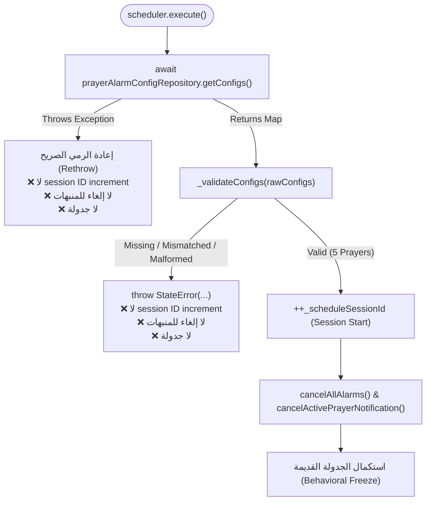

# P4.1-B.3 Phase 2C.2.3 — Configuration Read Integration Completion Report

**Project:** Hafiz Al-Ahd (حافظ العهد)  
**Branch:** `feature/p4.1-independent-alarms-adhan`  
**Phase:** Phase 2C.2.3 — Configuration Read Integration & Fail-Safe Verification  
**Date:** 2026-11-08  
**Status:** **PHASE 2C.2.3 COMPLETED — STOP GATE 2C.2.3 ACTIVE (Awaiting Engineering Review)**  

---

## 1. Executive Summary

تم بنجاح استكمال وتنفيذ **Phase 2C.2.3** وفقاً لجميع التوجيهات الهندسية والشروط المعتمدة في STOP GATE 2C.2.3.0:

1. **الربط مع الـ Repository الفعلي:**
   - تم تفعيل استدعاء `prayerAlarmConfigRepository.getConfigs()` في بداية تنفيذ [ScheduleWeeklyPrayersUseCase](file:///c:/Users/shady%20atef/Documents/projects/hafiz_al_ahd/lib/features/notifications/domain/usecases/schedule_weekly_prayers_usecase.dart).
   - الاستدعاء يتم **مرة واحدة فقط** في بداية دالة `execute()`.
2. **التحقق الصارم من الصلوات الخمس (Strict 5-Prayer Validation):**
   - تم بناء دالة `_validateConfigs` للتحقق من أن الخريطة المسترجعة تحتوي بدقة على الصلوات الخمس الإلزامية (`fajr, dhuhr, asr, maghrib, isha`)، دون نقص أو زيادة، وبمطابقة هوياتية تامة بين المفتاح والكيان (`entry.key == entry.value.prayerId`).
   - تم إنشاء snapshot محلية غير قابلة للتعديل `Map.unmodifiable`.
3. **عزل الآثار الجانبية وحماية الجلسة السابقة (Zero Side-Effects Fail-Safe):**
   - **تم نقل زيادة معرف الجلسة `++_scheduleSessionId` ليكون بعد نجاح قراءة الإعدادات والتحقق منها.**
   - في حال فشل قراءة الـ Repository (Exception) أو فشل الـ Validation (StateError)، ينسحب النظام فوراً دون:
     - زيادة معرف الجلسة أو إبطال جلسة جارية أخرى.
     - استدعاء `cancelAllAlarms()` أو `cancelActivePrayerNotification()`.
     - جدولة أي منبهات أو إشعارات.
     - تعديل قيمة `scheduled_until_date`.
4. **التجميد السلوكي الصارم (Behavioral Freeze):**
   - لا تفعيل لـ `alarm / notification / off` في هذه المرحلة؛ تم الحفاظ على مسار `adhanStyle` القديم كاملاً بعد نجاح التحقق.
   - منع استخدام `adhanStyle` كـ Fallback صامت عند فشل قراءة الإعدادات الجديدة.
5. **جناح اختبارات مخصص متكامل (19/19 PASSED):**
   - تم إنشاء [scheduler_config_read_integration_test.dart](file:///c:/Users/shady%20atef/Documents/projects/hafiz_al_ahd/test/features/notifications/scheduler_config_read_integration_test.dart) لتغطية المجموعات الخمس (A, B, C, D, E) بالكامل.
6. **سلامة الانحدار والتحليل الساكن (Full Regression & Static Analysis):**
   - نجاح جميع اختبارات الانحدار (135 اختباراً: 129 PASS / 6 Expected RED مطابقة للـ Baseline 100%).
   - `flutter analyze`: **0 Errors**.

---

## 2. تفاصيل الـ Repository Contract الفعلي وموضع الاستدعاء

### 2.1. العقد الفعلي المسترجع
كما كشف فحص Phase 2C.2.3.0:
```dart
Future<Map<PrayerId, PrayerAlarmConfig>> getConfigs();
```
النوع المرجع هو خريطة `Map<PrayerId, PrayerAlarmConfig>` ذات مفاتيح بقيم الـ Enum، وليست `List`.

### 2.2. موضع الاستدعاء في `execute()`
الملف: [`lib/features/notifications/domain/usecases/schedule_weekly_prayers_usecase.dart`](file:///c:/Users/shady%20atef/Documents/projects/hafiz_al_ahd/lib/features/notifications/domain/usecases/schedule_weekly_prayers_usecase.dart#L39-L65)

```dart
  Future<void> execute(double lat, double lng, String city, [String? country]) async {
    // 1. قراءة إعدادات الصلوات الخمس والتحقق الصارم منها قبل أي أثر جانبي
    final rawConfigs = await prayerAlarmConfigRepository.getConfigs();
    final validConfigs = _validateConfigs(rawConfigs);
    log("📋 Validated configurations for ${validConfigs.length} prayers: ${validConfigs.keys.map((k) => k.key).join(', ')}");

    // 2. إدارة التضارب (Race Conditions) - زيادة معرف الجلسة بعد نجاح التحقق فقط
    final int currentSession = ++_scheduleSessionId;
    log("🚀 Starting scheduling session #$currentSession on Main Thread with Throttling...");

    // 3. قراءة الإعدادات
    final iqamaDelays = await getIqamaDelaysUseCase.execute();
    final adhanVolume = pref.getDouble('adhan_volume') ?? 1.0;
    final isAdhanVibrationEnabled = pref.getBool('isAdhanVibrationEnabled') ?? true;
    final adhanStyle = pref.getString('adhanStyle') ?? 'alarm';
    final isIqamaEnabled = pref.getBool('isIqamaEnabled') ?? true;
    final isAzkarReminderEnabled = pref.getBool('isAzkarReminderEnabled') ?? true;

    // 4. مسح الإشعارات القديمة
    await notificationRepository.cancelAllAlarms();
    await notificationRepository.cancelActivePrayerNotification();
    log("🧹 Notifications cleared. Scheduling new notifications for the next 5 days...");
```

---

## 3. خوارزمية التحقق الصارم (Validation Implementation)

```dart
  Map<PrayerId, PrayerAlarmConfig> _validateConfigs(Map<PrayerId, PrayerAlarmConfig>? rawConfigs) {
    if (rawConfigs == null || rawConfigs.length != PrayerId.values.length) {
      throw StateError(
        'Incomplete or invalid prayer configurations. Expected exactly ${PrayerId.values.length}, received ${rawConfigs?.length ?? 0}.',
      );
    }

    for (final prayerId in PrayerId.values) {
      if (!rawConfigs.containsKey(prayerId)) {
        throw StateError('Missing configuration for mandatory prayer: ${prayerId.key}');
      }
    }

    for (final entry in rawConfigs.entries) {
      if (entry.key != entry.value.prayerId) {
        throw StateError(
          'Mismatched PrayerId for ${entry.key.key}: key indicates ${entry.key.key} but entity holds ${entry.value.prayerId.key}.',
        );
      }
      if (!PrayerAlarmType.values.contains(entry.value.alarmType)) {
        throw StateError('Invalid alarm type for prayer ${entry.key.key}: ${entry.value.alarmType}');
      }
    }

    return Map<PrayerId, PrayerAlarmConfig>.unmodifiable(rawConfigs);
  }
```

---

## 4. مسار معالجة الفشل (Failure Handling Flow)



---

## 5. جرد اختبارات Phase 2C.2.3 الجديدة (Test Inventory & Results)

الملف: [`test/features/notifications/scheduler_config_read_integration_test.dart`](file:///c:/Users/shady%20atef/Documents/projects/hafiz_al_ahd/test/features/notifications/scheduler_config_read_integration_test.dart)  
**النتيجة الإجمالية:** **19/19 اختباراً ناجحاً (100% Pass) — Exit Code: 0**

| Group | # | اسم الاختبار | النتيجة |
|---|:---:|---|:---:|
| **A. Successful Reads** | 1 | Reading 5 valid configurations succeeds | ✅ PASS |
| | 2 | `getConfigs()` is called exactly once per scheduler execution | ✅ PASS |
| | 3 | Valid configurations allow legacy scheduling path to complete | ✅ PASS |
| **B. Missing Configurations** | 4 | Empty configurations map throws StateError | ✅ PASS |
| | 5 | Missing Fajr throws StateError | ✅ PASS |
| | 6 | Missing Dhuhr throws StateError | ✅ PASS |
| | 7 | Missing Asr throws StateError | ✅ PASS |
| | 8 | Missing Maghrib throws StateError | ✅ PASS |
| | 9 | Missing Isha throws StateError | ✅ PASS |
| **C. Duplicate / Inconsistent** | 10 | Mismatched PrayerId (key indicates fajr, but entity holds dhuhr) throws StateError | ✅ PASS |
| **D. Repository Failure** | 11 | Repository throws Exception: Exception propagates without being swallowed | ✅ PASS |
| | 12 | Scheduling immediately aborts after Repository throws Exception | ✅ PASS |
| **E. Side-Effect Isolation** | 13 | When `getConfigs()` throws: `cancelAllAlarms` is NOT called | ✅ PASS |
| | 14 | When `getConfigs()` throws: `cancelActivePrayerNotification` is NOT called | ✅ PASS |
| | 15 | When `getConfigs()` throws: `scheduleAdhanAlarm` is NOT called | ✅ PASS |
| | 16 | When `getConfigs()` throws: `schedulePrayerNotification` is NOT called | ✅ PASS |
| | 17 | When `getConfigs()` throws: `scheduled_until_date` is untouched | ✅ PASS |
| | 18 | When validation fails: session ID is NOT incremented (previous session not invalidated) | ✅ PASS |
| | 19 | When `getConfigs()` fails: does NOT silently fallback to `adhanStyle` | ✅ PASS |

---

## 6. جدول مقارنة الانحدار الشامل مع الـ Baseline (Full Regression Comparison)

| Test Suite | عدد الاختبارات | النتيجة | Exit Code | المقارنة مع الـ Baseline |
|---|:---:|:---:|:---:|---|
| `scheduler_config_read_integration_test.dart` | 19 | 19 PASS | 0 | **NEW (Phase 2C.2.3 Contract Suite)** |
| `scheduler_di_registration_test.dart` | 3 | 3 PASS | 0 | **100% PASS** |
| `notification_repository_impl_cancel_alarm_safely_test.dart` | 11 | 11 PASS | 0 | **100% PASS** |
| `legacy_characterization_test.dart` | 6 | 6 PASS | 0 | **100% PASS** |
| `alarm_config_migration_test.dart` | 17 | 17 PASS | 0 | **100% PASS** |
| `alarm_config_crash_recovery_test.dart` | 5 | 5 PASS | 0 | **100% PASS** |
| `critical_prayer_times_test.dart` | 8 | 8 PASS | 0 | **100% PASS** |
| `prayer_card_lifecycle_isolation_test.dart` | 8 | 8 PASS | 0 | **100% PASS** |
| `scheduler_integration_test.dart` | 58 | 52 PASS / 6 RED | 1 | **100% Baseline Match (Group A tests 2..7 RED)** |
| **المجموع الكلي** | **135** | **129 PASS / 6 RED** | — | **مطابقة تامة ومؤكدة** |

---

## 7. ملخص فروق Git (Git Diff Summary)

الملف الإنتاجي الوحيد المعدل في Phase 2C.2.3:
[`lib/features/notifications/domain/usecases/schedule_weekly_prayers_usecase.dart`](file:///c:/Users/shady%20atef/Documents/projects/hafiz_al_ahd/lib/features/notifications/domain/usecases/schedule_weekly_prayers_usecase.dart)

```diff
@@ -34,14 +39,20 @@ class ScheduleWeeklyPrayersUseCase {
   Future<void> execute(double lat, double lng, String city, [String? country]) async {
+    // 1. قراءة إعدادات الصلوات الخمس والتحقق الصارم منها قبل أي أثر جانبي
+    final rawConfigs = await prayerAlarmConfigRepository.getConfigs();
+    final validConfigs = _validateConfigs(rawConfigs);
+    log("📋 Validated configurations for ${validConfigs.length} prayers: ${validConfigs.keys.map((k) => k.key).join(', ')}");
+
+    // 2. إدارة التضارب (Race Conditions) - زيادة معرف الجلسة بعد نجاح التحقق فقط
     final int currentSession = ++_scheduleSessionId;
     log("🚀 Starting scheduling session #$currentSession on Main Thread with Throttling...");
```

---

## 8. القيود المعروفة وتأكيد عدم الانتقال (Known Limitations & Confirmation)

1. **القيود المعروفة (Known Limitations):**
   - قرارات الجدولة الفعلية للصلوات الخمس ما زالت تتبع `adhanStyle` في مسار النجاح، التزاماً بقاعدة التجميد السلوكي الصارم حتى Phase 2C.2.4.
   - الاختبارات الستة في Group A من `scheduler_integration_test.dart` تظل RED حتى تطبيق الـ Contiguous Horizon في Phase 2C.6.
2. **تأكيد عدم بدء Phase 2C.2.4:**
   - لم يتم البدء في أي عمل يخص Configuration Mapping (`alarm / notification / off`).
   - لم يتم تعديل قرارات الجدولة الفردية.

---

> [!IMPORTANT]
> **STOP GATE 2C.2.3 ACTIVE**  
> اكتملت مرحلة ربط قراءة الإعدادات والتحقق الصارم منها بالكامل مع عزل تام للآثار الجانبية.  
> نقف هنا بانتظار المراجعة الهندسية واعتماد المرحلة قبل الانتقال إلى **Phase 2C.2.4 — Configuration Mapping Contract**.
