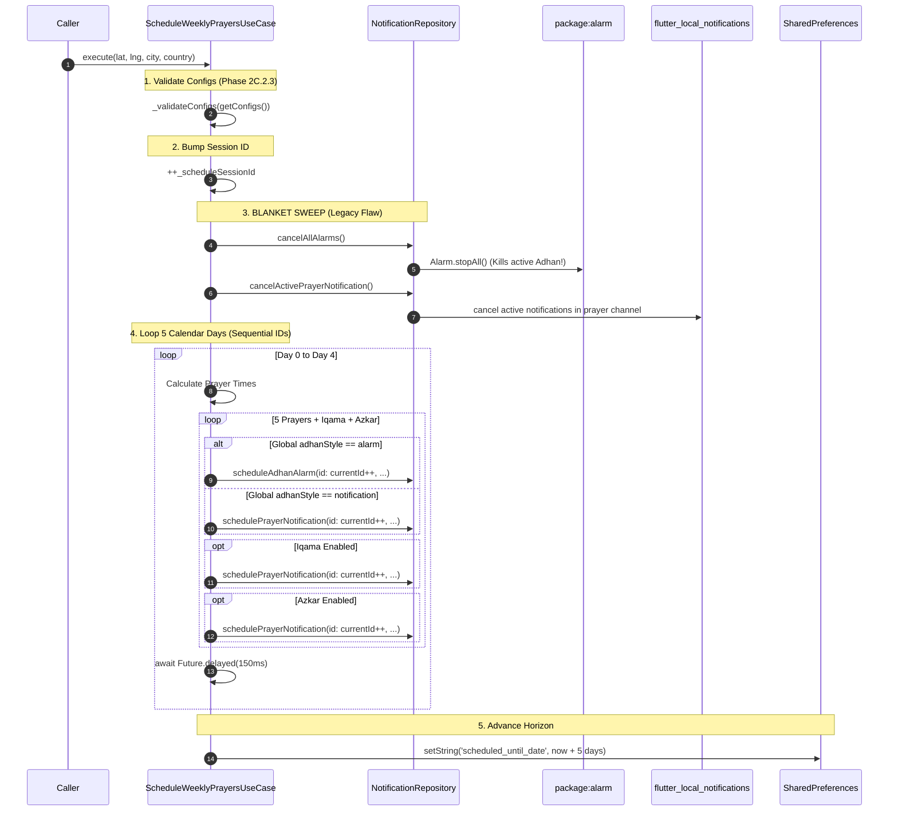
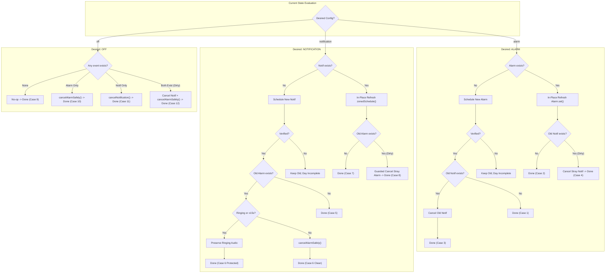

# P4.1-B.3 — Phase 2C.4.0 Architecture Inspection & Reconciliation Design Closure
## Production Independent Scheduling & Targeted Reconciliation Architecture

**Project:** Hafiz Al-Ahd (حافظ العهد)  
**Branch:** `feature/p4.1-independent-alarms-adhan`  
**Phase:** Phase 2C.4.0  
**Type:** Architecture Inspection & Reconciliation Design Closure  
**Status:** PROPOSED & INSPECTED — AWAITING DESIGN REVIEW APPROVAL  
**Execution Timestamp:** 2026-11-08  

---

## 1. Executive Summary & Objective

The objective of **Phase 2C.4.0** is to close the architectural design for transitioning `ScheduleWeeklyPrayersUseCase` from the legacy monolithic model (global `adhanStyle` + `cancelAllAlarms()` blanket sweep + sequential integer IDs) to a **production-grade independent scheduling and targeted reconciliation engine**.

This phase executes an in-depth codebase inspection and establishes the definitive operational contracts for:
1. **Event Ownership:** Segregating `package:alarm`, `flutter_local_notifications` (FLN), and Android native services.
2. **12-Case Transition Matrix:** Mapping every combination of desired configuration (`alarm`, `notification`, `off`) and existing runtime state (`absent`, `present`).
3. **Targeted Reconciliation:** Eliminating `Alarm.stopAll()` and `cancelAllNotifications()`, enforcing **Schedule New $\to$ Verify $\to$ Cancel Old** and in-place replacement.
4. **Active Audio & Temporal Protection:** Ensuring actively playing Adhan audio is never cut off and imminent alarms ($\pm 15\text{s}$) are never cancelled.
5. **Contiguous Scheduling Horizon:** Preserving `scheduled_until_date` as an unbroken chain of successfully scheduled days.
6. **Production-Path Test Strategy:** Defining the verification baseline for Phase 2C.4.1 before touching production code.

> [!IMPORTANT]
> **Strict Phase Boundary:** Zero production code is modified in Phase 2C.4.0. This is an architectural inspection and contract closure document.

---

## 2. Current Production Scheduling Flow Inspection

A line-by-line inspection of [`ScheduleWeeklyPrayersUseCase`](file:///c:/Users/shady%20atef/Documents/projects/hafiz_al_ahd/lib/features/notifications/domain/usecases/schedule_weekly_prayers_usecase.dart) and [`SchedulePrayerUseCase`](file:///c:/Users/shady%20atef/Documents/projects/hafiz_al_ahd/lib/features/notifications/domain/usecases/schedule_prayer_usecase.dart) reveals the following architecture:

### 2.1 Sequence of the Current Legacy Flow

### 2.2 Critical Deficiencies Identified in the Current Flow

1. **Destructive Blanket Sweep (`cancelAllAlarms()` at Line 59):**
   - Calls `Alarm.stopAll()`, terminating **all** alarms indiscriminately.
   - If the user opens the app while an Adhan is actively reciting, the Adhan audio is **instantly severed**.
   - If a non-prayer alarm existed in `package:alarm`, it is wiped out.
2. **Global Monolithic Configuration (`adhanStyle` at Lines 54, 118, 134):**
   - Reads a single string `pref.getString('adhanStyle') ?? 'alarm'`.
   - Forces all 5 prayers to share the exact same alert mode. The 5 per-prayer configs validated at line 43 are currently ignored.
3. **Sequential Non-Deterministic IDs (`int notificationId = 1; currentId++` at Lines 63, 138, 149, 165, 185, 212):**
   - IDs are incremented linearly (`1, 2, 3, ...`).
   - The same prayer on the same day gets completely different IDs across rescheduling sessions depending on how many past prayers were skipped or which auxiliary reminders were enabled.
   - It is impossible to update or cancel an individual prayer without wiping out all other scheduled events.
4. **Interleaved Auxiliary Coupling:**
   - Iqama and Azkar share the same sequential ID counter (`currentId++`) with prayer alerts.
   - An error in scheduling an Azkar reminder halts or shifts the ID sequence for subsequent days.
5. **False Horizon Advancement (`scheduled_until_date` at Line 106):**
   - If Day 0 fails (e.g. calculation returns `Left(failure)`), the loop silently ignores it (`result.fold((_) async {}, ...)`) and still unconditionally sets `scheduled_until_date = now + 5 days`.

---

## 3. Comprehensive Event Ownership Inventory & Subsystem Boundaries

Every scheduled event in the application belongs to a distinct subsystem with explicit lifecycle ownership:

| Event Type | Owning Subsystem | Platform Mechanism (Android) | Identity Space | Creation Source | Cancellation Source |
|---|---|---|---|---|---|
| **Prayer Adhan Alarm** | `package:alarm` | `AlarmManager` + Foreground `AndroidAlarmService` + MediaPlayer | Deterministic: `...0` (`24010100 .. 99123140`) | `ScheduleWeeklyPrayersUseCase` via `scheduleAdhanAlarm()` | `cancelAlarmSafely()` (Level 2 verified, active audio guard) |
| **Prayer Notification** | `flutter_local_notifications` (FLN) | `NotificationManager` + exact `AlarmManager` chime | Deterministic: `...1` (`24010101 .. 99123141`) | `ScheduleWeeklyPrayersUseCase` via `schedulePrayerNotification()` | `cancelNotification(id)` (FLN `cancel(id)`) |
| **Iqama Notification** | `flutter_local_notifications` (FLN) | `NotificationManager` + exact `AlarmManager` chime | Deterministic: `...2` (`24010102 .. 99123142`) | `ScheduleWeeklyPrayersUseCase` via `schedulePrayerNotification()` | `cancelNotification(id)` |
| **Post-Prayer Azkar** | `flutter_local_notifications` (FLN) | `NotificationManager` + exact `AlarmManager` chime | Deterministic: `...3` (`24010103 .. 99123143`) | `ScheduleWeeklyPrayersUseCase` via `schedulePrayerNotification()` | `cancelNotification(id)` |
| **Morning Azkar** | `flutter_local_notifications` (FLN) | `NotificationManager` + exact `AlarmManager` chime | Deterministic: `...4` (Fajr index `0`) | `ScheduleWeeklyPrayersUseCase` via `schedulePrayerNotification()` | `cancelNotification(id)` |
| **Evening Azkar** | `flutter_local_notifications` (FLN) | `NotificationManager` + exact `AlarmManager` chime | Deterministic: `...5` (Asr index `2`) | `ScheduleWeeklyPrayersUseCase` via `schedulePrayerNotification()` | `cancelNotification(id)` |
| **Sticky Live Countdown** | `FlutterBackgroundService` | Native Foreground Service notification | Reserved ID: `8888` | `showStickyNotification()` | Service termination |
| **Test Alarm** | `package:alarm` | `AlarmManager` (5s test delay) | Reserved ID: `888` | Settings UI Test Trigger | `Alarm.stop(888)` |
| **Home Screen Widget** | Android AppWidget | `AppWidgetManager` RemoteViews | Reserved ID: `999` | Widget Provider | Widget lifecycle |
| **Legacy Alarms (Phase 0)** | `package:alarm` | `AlarmManager` | Sequential: `1 .. 100` | Legacy app versions | `LegacyAlarmCleanupFilter` (Phase 2C.5) |

### 3.1 Subsystem Independence Invariant
- **`package:alarm` vs `FLN` Decoupling:**  
  The two subsystems run on completely disjoint platform channels. An ID registered in `package:alarm` does **not** exist in `FLN`, and vice versa.
- **Disjoint ID Ranges:**  
  Even though the subsystems are decoupled at the OS level, `CalendarAlarmIdContract` enforces arithmetic disjointness:
  - Alarms end in `0`.
  - Notifications end in `1`.
  - Iqama ends in `2`.
  - Azkar ends in `3, 4, 5`.
  - This eliminates any risk of confusion or cross-talk in logging, debugging, or test harnesses.

---

## 4. The 12-Case Transition Matrix (Exact Operational Contract)

For any given prayer on a given calendar day, the scheduler evaluates the triplet:
$$\langle \text{Desired Config}, \text{Existing Alarm in package:alarm}, \text{Existing Notification in FLN} \rangle$$

The desired configuration is derived purely from `validConfigs[prayerId]!.decision`.

### Full 12-Case Specification Table

| Case | Desired Config | Existing Alarm | Existing Notification | 1. Schedule / Refresh Action | 2. Verification Required? | 3. Obsolete Event Cancellation | 4. Cancellation Timing | 5. Active Audio / Temporal Guard | 6. On Scheduling Failure |
|:---:|:---:|:---:|:---:|---|:---:|---|---|---|---|
| **1** | `alarm` | absent | absent | Schedule new Alarm (`alarmId`) | Yes (Level 1+2) | None | N/A | N/A | Abort prayer; mark day incomplete |
| **2** | `alarm` | present | absent | In-place refresh (`Alarm.set`) | Yes (Level 1+2) | None | N/A | Preserve ringing audio; update in-place | Keep existing Alarm; mark day incomplete |
| **3** | `alarm` | absent | present | Schedule new Alarm (`alarmId`) | Yes (Level 1+2) | Cancel Notification (`notifId`) | **Post-Verification ONLY** | N/A (Alarm was absent) | **Preserve Notification**; mark day incomplete |
| **4** | `alarm` | present | present *(Dirty)* | In-place refresh (`Alarm.set`) | Yes (Level 1+2) | Cancel stray Notification (`notifId`) | **Post-Verification ONLY** | Preserve ringing audio | Keep both; mark day incomplete |
| **5** | `notification` | absent | absent | Schedule new Notification (`notifId`) | Yes (Level 1) | None | N/A | N/A | Abort prayer; mark day incomplete |
| **6** | `notification` | present | absent | Schedule new Notification (`notifId`) | Yes (Level 1) | Cancel Alarm (`alarmId`) | **Post-Verification ONLY** | **Active audio & $\pm 15$s guard strictly enforced** | **Preserve Alarm**; mark day incomplete |
| **7** | `notification` | absent | present | In-place refresh (`zonedSchedule`) | Yes (Level 1) | None | N/A | N/A | Keep existing Notif; mark day incomplete |
| **8** | `notification` | present | present *(Dirty)* | In-place refresh (`zonedSchedule`) | Yes (Level 1) | Cancel stray Alarm (`alarmId`) | **Post-Verification ONLY** | **Active audio & $\pm 15$s guard strictly enforced** | Keep both; mark day incomplete |
| **9** | `off` | absent | absent | **None (No-op)** | No | None | N/A | N/A | N/A |
| **10** | `off` | present | absent | None | No | Cancel Alarm (`alarmId`) | **Immediate** | **Active audio & $\pm 15$s guard strictly enforced** | Keep Alarm; retry next session |
| **11** | `off` | absent | present | None | No | Cancel Notification (`notifId`) | **Immediate** | Non-ringing system chime; safe to cancel | Keep Notif; retry next session |
| **12** | `off` | present | present *(Dirty)* | None | No | Cancel Notification + Cancel Alarm | **Immediate** | Cancel Notif immediately; Guard Alarm stop | Keep remaining; retry next session |

---

## 5. Targeted Reconciliation Contract

### 5.1 Elimination of Blanket Sweeps
- **Rule 1 (Zero `Alarm.stopAll()`):** Calling `Alarm.stopAll()` is strictly forbidden in the scheduler. It terminates active playback and destroys other alarms.
- **Rule 2 (Zero `cancelAllNotifications()`):** Calling `flutterLocalNotificationsPlugin.cancelAll()` is strictly forbidden in the scheduler. It destroys sticky foreground notifications (ID 8888) and unrelated channels.

### 5.2 Transition Pattern: Schedule New $\to$ Verify $\to$ Cancel Old
When transitioning across alert types (e.g. `notification` $\to$ `alarm` or vice versa):
1. The new event is scheduled under its deterministic ID.
2. The new event is verified:
   - **Level 1 (Execution):** The underlying platform call completes without throwing an exception.
   - **Level 2 (Registry Presence):**
     - For `package:alarm`: `Alarm.getAlarm(alarmId) != null` and its registered `dateTime` matches within 60s.
     - For `FLN`: Request completed successfully.
3. **ONLY upon successful verification:** The obsolete counterpart event is targeted for cancellation via `cancelAlarmSafely()` or `cancelNotification()`.
4. **If verification fails:** The obsolete event is **never cancelled**. Both events remain registered, ensuring the user is never left without an alert.

### 5.3 In-Place Replacement Pattern
When the alert type does not change (e.g. `alarm` $\to$ `alarm` or `notification` $\to$ `notification`):
- Because the deterministic ID is derived from `date` and `prayerIndex`, the ID of the new event is **identical** to the existing event.
- Calling `Alarm.set()` or `zonedSchedule()` with an identical ID updates the Android `AlarmManager` `PendingIntent` with `FLAG_UPDATE_CURRENT`.
- No cancellation call is needed. The replacement is atomic and idempotent.

### 5.4 Active Audio Protection & Temporal Proximity Guard
Targeted cancellation of any alarm via `cancelAlarmSafely(alarmId)` enforces:
- **Audio Protection:** `await Alarm.isRinging(alarmId)`. If `true`, cancellation returns `false` and the audio is preserved.
- **Temporal Proximity Guard:** If $| \text{now} - \text{alarm.dateTime} | \le 15\text{ seconds}$, cancellation returns `false` to avoid racing with Android's alarm trigger window.
- **Non-Atomic IPC Reality:** The protection is **best-effort** across the Dart-to-Android IPC boundary. While an atomic lock is physically impossible across process boundaries on Android, the 15-second temporal buffer eliminates the common race condition window.

---

## 6. Contiguous Scheduling Horizon & `scheduled_until_date` Semantics

### 6.1 Invariant of the Contiguous Horizon
`scheduled_until_date` represents the **last contiguous calendar date** where all required events were successfully scheduled and verified.

- **Contiguous Rule:** If Day 0 succeeds, Day 1 succeeds, but Day 2 fails:
  - Scheduling terminates immediately.
  - Days 3 and 4 are **not attempted**.
  - `scheduled_until_date` is advanced to **Day 1 only**. It is NEVER advanced to Day 4 or 5.
- **Gap Prevention:** The system never creates "holes" in scheduled days.

### 6.2 Definition of "Required Events" for a Complete Day
For a calendar day $D$ to be marked complete:
1. **All 5 Prayers Reconciled:** Each of Fajr, Dhuhr, Asr, Maghrib, and Isha must reach its desired state (Alarm verified, Notification verified, or decommissioned if `off`).
2. **Iqama Handled:** If `isIqamaEnabled == true` and `iqamaDelay > 0`, the Iqama notification must be scheduled and verified.
3. **Azkar Handled:** If `isAzkarReminderEnabled == true`, post-prayer Azkar and (for Fajr/Asr) Morning/Evening Azkar must be scheduled and verified.
4. **`off` Independence:** If a prayer is configured to `off`, its prayer alert is decommissioned, but its Iqama and Azkar reminders **must still be scheduled** if enabled by the user.

---

## 7. Failure, Partial Execution & Concurrency Recovery Scenarios

| Scenario | Trigger / Root Cause | Immediate Scheduler Response | State of Registered Events | Recovery on Next Execution |
|---|---|---|---|---|
| **A. Astronomical Failure** | `getPrayerTimesUseCase` returns `Left(failure)` | Day marked incomplete; loop terminates immediately | All previously registered events untouched | Resumes from the failed day upon next run |
| **B. New Alarm Creation Fails** | Native `Alarm.set()` throws `PlatformException` | Day marked incomplete; loop terminates | Any prior notification is **preserved** | Next run retries scheduling the alarm |
| **C. Level 2 Verification Fails** | `Alarm.getAlarm(id)` returns `null` | Day marked incomplete; loop terminates | Old notification is **preserved** | Next run retries scheduling and verification |
| **D. Obsolete Cancellation Fails** | `cancelAlarmSafely` deferred (ringing or $\pm 15$s) | Day marked incomplete; proceeds with warning | Both new notification and ringing alarm exist | Next run detects dirty state (Case 8) and cleans up |
| **E. Session Invalidation** | User changes settings mid-run; new session starts | Current session detects `_scheduleSessionId != currentSession` | Terminates at current day boundary; no cache written | Newer session takes over with latest configuration |
| **F. OS Process Kill / Low Battery** | Android kills process mid-day | Dart execution halts immediately | Android `AlarmManager` retains all events registered so far | Next app startup reconciles state idempotently |

---

## 8. Production-Path Test Strategy (Phase 2C.4.1 Test Plan)

Before altering `ScheduleWeeklyPrayersUseCase` in production, Phase 2C.4.1 will construct a dedicated integration test suite: `test/features/notifications/scheduler_production_path_integration_test.dart`.

### 8.1 Testing with Controlled Stateful Fakes
- A stateful `FakeNotificationRepository` simulating both `package:alarm` and `FLN` registries with realistic latency and query capabilities.
- A stateful `FakePrayerAlarmConfigRepository` capable of updating individual prayer configs dynamically.
- Simulated clock control to test the 15-second temporal guard and active ringing states.

### 8.2 Test Group Breakdown for Phase 2C.4.1

| Test Group | Test Cases | Objective |
|---|:---:|---|
| **Group A: 12-Case Transition Matrix** | 12 tests | One dedicated test for each of the 12 transition states, verifying exact creation, update, and cancellation behavior. |
| **Group B: Targeted Reconciliation & Zero Blanket Sweep** | 4 tests | Verify `cancelAllAlarms()` and `cancelAllNotifications()` are never called; verify unrelated alarms/notifications are untouched. |
| **Group C: Active Audio & Temporal Proximity Guards** | 4 tests | Verify actively ringing alarm is never stopped; verify alarm within $\pm 15$s is preserved during transition to notification or off. |
| **Group D: Verify-Before-Cancel & Safe Failure** | 4 tests | Verify obsolete event is preserved when new event fails scheduling; verify dirty dual-state recovers cleanly. |
| **Group E: Auxiliary Decoupling (`off` Prayer Alert)** | 4 tests | Verify setting prayer to `off` cancels only the prayer alert while preserving Iqama and Azkar reminders. |
| **Group F: Concurrency Preemption & Session Safety** | 2 tests | Verify mid-run session invalidation safely aborts without advancing `scheduled_until_date`. |

---

## 9. Explicit Scope Boundaries & Final Design Decisions

### 9.1 Out-of-Scope Constraints
1. **No Android Native Changes:** No Java/Kotlin modifications, no changes to `AndroidManifest.xml` receivers.
2. **No Audio / Vibration Preferences Alteration:** `adhan_volume`, `isAdhanVibrationEnabled`, and sound assets remain untouched.
3. **No Iqama / Azkar Business Logic Alteration:** Auxiliary notification timing and delays remain identical to existing logic.
4. **No Git Commits or Releases:** All work is confined to the active feature branch with explicit user approval gates.

### 9.2 Architectural Design Decisions Approved in Phase 2C.4.0
- **Decision 1:** Eliminate `cancelAllAlarms()` and `cancelActivePrayerNotification()` from `ScheduleWeeklyPrayersUseCase`.
- **Decision 2:** Replace the sequential counter `notificationId = 1` with `CalendarAlarmIdContract`.
- **Decision 3:** Read individual prayer decisions from `validConfigs[prayerId]!.decision` instead of global `pref.getString('adhanStyle')`.
- **Decision 4:** Implement targeted reconciliation across the full 12-case transition matrix with strict Verify-Before-Cancel.
- **Decision 5:** Keep `SchedulePrayerUseCase` as a legacy pass-through until Phase 2C.6, routing weekly scheduling directly through `notificationRepository` targeted methods.

---

## 10. Gate Status & Recommendation

- **Phase 2C.4.0:** **INSPECTION & DESIGN CLOSURE COMPLETED.**
- **Next Phase:** **Phase 2C.4.1 (Production-Path Test Matrix & Verification Baseline)** — Awaiting explicit user approval to begin authoring the test matrix.

