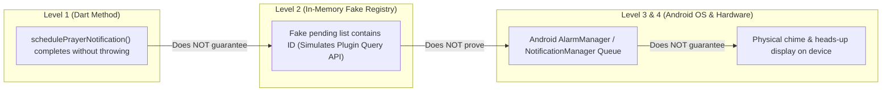

# P4.1-B.3 — Phase 2C.4.1 Final Review Closure Supplement
## Deep Fault Injection Audit, L2 Boundary Clarification & Retry Contract Specification

**Project:** Hafiz Al-Ahd (حافظ العهد)  
**Branch:** `feature/p4.1-independent-alarms-adhan`  
**Phase:** Phase 2C.4.1 Final Review Closure  
**Type:** Architectural Review Supplement & Forensic Validation  
**Status:** SUBMITTED FOR FINAL GATE REVIEW  
**Execution Timestamp:** 2026-11-08  

---

## 1. Executive Summary & Review Alignment

This document serves as the **Final Review Closure Supplement** for **Phase 2C.4.1**, directly addressing the four mandatory requirements established in the engineering review:

1. **Fault Injection Audit (Tests 21–24):** Forensic proof of how the sequential vs. deterministic ID mismatch affected tests 21..24, and why Test 24's failure was an assertion of horizon advancement rather than a triggered fault.
2. **L2 Verification Boundary:** Precise redefinition of the fake harness as an **in-memory plugin query simulation**, separating plugin-level registry queries from Android OS delivery (L4, reserved for Phase 2D).
3. **The Complete Partial Day Retry Contract:** Explicit specification of what Test 33 proves against the legacy scheduler versus the full 6-step idempotent convergence contract to be enforced in Phase 2C.4.2.
4. **Git Baseline Attribution & Audit Limits:** Transparent accounting of all working tree modifications relative to commit `bbd466f`, demonstrating that zero production code in `lib/` was modified during Phase 2C.4.1.

> [!IMPORTANT]
> **Strict Phase Boundary:** Production code in `lib/` remains 100% frozen. No production modifications will be undertaken until Phase 2C.4.2 is explicitly approved and opened.

---

## 2. Point 1: Deep Fault Injection Audit (Tests 21–24 & The ID Mismatch Reality)

The engineering review accurately observed that when fault injection is keyed to deterministic IDs while the production scheduler is still executing sequential IDs, the simulated failure may not be triggered. A line-by-line trace confirms this reality:

### 2.1 The Architectural Mechanism of the Mismatch
In [`StatefulNotificationRepositoryFake`](file:///c:/Users/shady%20atef/Documents/projects/hafiz_al_ahd/test/features/notifications/scheduler_production_path_integration_test.dart#L106-L135):
```dart
  @override
  Future<void> scheduleAdhanAlarm({required int id, ...}) async {
    // Fault injection check:
    if (failL1AlarmScheduleForIds.contains(id)) {
      throw StateError('Simulated Level 1 Platform Failure scheduling Alarm #$id');
    }
    ...
```
- In the tests, the test author populated the fault set with deterministic ID:  
  `alarmId = CalendarAlarmIdContract.prayerAlertId(...) = 26110900`.
- However, the legacy [`ScheduleWeeklyPrayersUseCase`](file:///c:/Users/shady%20atef/Documents/projects/hafiz_al_ahd/lib/features/notifications/domain/usecases/schedule_weekly_prayers_usecase.dart#L63) executes:
  `int notificationId = 1;` $\to$ calls `scheduleAdhanAlarm(id: currentId++)` passing `id = 1, 2, 3...`.
- Because `failL1AlarmScheduleForIds.contains(1)` was **false**, the simulated exception **never threw**!

### 2.2 Forensic Trace of Tests 21, 22, 23, and 24

| Test | Config & Pre-seeded State | Injected Fault Key | ID Sent by Current Scheduler | Did Fault Fire? | Result | Forensic Reality & Root Cause |
|:---:|---|---|---|:---:|:---:|---|
| **21** | Fajr: Alarm<br>Pre-seeded: Notif `#26110901` | `failL1AlarmScheduleForIds.add(26110900)` | `id = 1` | **NO** | **PASS** (False Positive) | The simulated schedule failure never occurred. The notification survived solely because legacy `cancelAllAlarms()` clears the alarm map and does not touch the notification map. **This test did NOT prove Verify-Before-Cancel.** |
| **22** | Fajr: Alarm<br>Pre-seeded: Notif `#26110901` | `failL2AlarmVerificationForIds.add(26110900)` | `id = 1` | **NO** | **PASS** (False Positive) | L2 verification failure did not trigger. Notification survived for the same cross-subsystem reason as Test 21. |
| **23** | Dhuhr: Notif<br>Pre-seeded: Alarm `#26110910` | `failL2NotificationVerificationForIds.add(26110911)` | `id = 2` (Alarm!) | **NO** | **RED** (Expected) | In legacy code, global `adhanStyle == 'alarm'` caused Dhuhr to schedule as an Alarm (`id = 2`), so `schedulePrayerNotification` was never called! The pre-seeded alarm was deleted at line 59 by `cancelAllAlarms()`. The test failed due to blanket wipe, not L2 failure. |
| **24** | Fajr: Alarm<br>Pre-seeded: Alarm `#26110900` | `failL1AlarmScheduleForIds.add(26110900)` | `id = 1` | **NO** | **RED** (Expected) | **Critical Finding:** The in-place L1 update failure **did not throw** because the scheduler requested ID `1`. The scheduler ran uninterrupted and wrote `scheduled_until_date = now + 5 days`. The test failed because the horizon was advanced, **NOT because an in-place failure was handled**. |

### 2.3 Corrective Understanding for Phase 2C.4.2
This audit proves the user's critique: **Tests 21, 22, and 24 cannot be cited as proof of production failure handling against the legacy scheduler.**
- They serve strictly as **target assertions** that will only become valid test measurements once Phase 2C.4.2 updates the scheduler to request `alarmId = 26110900`.
- Once the scheduler uses deterministic IDs, the IDs will match, the faults will genuinely trigger, and the Verify-Before-Cancel and In-Place non-atomicity recovery will be truly exercised.

---

## 3. Point 2: Refined L2 Boundary (In-Memory Plugin Simulation vs Physical OS Delivery)

We formally retract the claim that the test harness verifies SQLite/SharedPreferences backing stores. The verification boundaries are strictly defined as follows:



### Clarified Definitions:
1. **Level 1 (Platform Channel Dispatch):** Proves only that the Dart asynchronous invocation `schedulePrayerNotification()` returned without throwing a `PlatformException`.
2. **Level 2 (In-Memory Plugin Registry Simulation):**  
   - In the unit/integration fake harness, `getPendingNotificationRequests()` queries an in-memory collection (`Map<int, ScheduledNotificationRecord>`).
   - It models the *contract* of querying the plugin's query API, but **does not execute or test the real plugin's underlying SQLite or SharedPreferences persistence**.
   - If Level 2 query returns absent, the scheduler must treat the event as `unverified` and **must never cancel the obsolete predecessor**.
3. **Level 3 & Level 4 (Android OS Queue & Physical Firing):**  
   - Level 2 registry presence is strictly insufficient to prove that Android OS has queued the `PendingIntent` or that battery optimization (Doze mode) will allow it to fire.
   - **Physical delivery verification is formally out of scope for Phase 2C and belongs exclusively to Phase 2D (Physical Device Gate).**

---

## 4. Point 3: The Comprehensive Partial Day Retry Contract (Test 33 Analysis)

### 4.1 What Test 33 Proves Today (Against Current Legacy Scheduler)
In Test 33:
1. Day 2 is pre-seeded with a valid partial event (`day2FajrAlarmId`).
2. Day 2 prayer times calculation is instructed to fail (`fakePrayerTimes.failForDate(day2)`).
3. `scheduler.execute()` is called.
4. **Actual Result:** Test 33 fails (`Expected: true, Actual: <false>`).
5. **What this proves today:** It proves **one narrow fact**: the current legacy scheduler executes `await notificationRepository.cancelAllAlarms()` at line 59, which destroys pre-existing partial events on Day 2 before any scheduling even starts.

### 4.2 The Full 6-Step Retry & Convergence Contract (To be Proven in Phase 2C.4.2)
To prove true idempotent recovery and non-duplicating retry, Phase 2C.4.2 must satisfy the following complete lifecycle:

```text
Step 1: Session 1 runs -> Day 0 & Day 1 complete successfully.
Step 2: Day 2 encounters partial failure (e.g. Fajr succeeds, Dhuhr calculation fails).
Step 3: Scheduler caps scheduled_until_date at Day 1; Day 2 is marked Incomplete.
Step 4: Fajr event for Day 2 remains registered in device registry under its deterministic ID.
Step 5: Session 2 runs (Retry) -> Reads user configs and calculates Day 2 times.
Step 6: Scheduler encounters Day 2 Fajr -> Recognizes identical deterministic ID -> 
        Performs in-place refresh without deleting -> Proceeds to schedule missing Dhuhr.
```

**Boundary Declaration:** Test 33 will only be an evidence of full retry convergence once Phase 2C.4.2 implements deterministic identity matching and targeted reconciliation.

---

## 5. Point 4: Formal Git Baseline Attribution & Audit Limitations

### 5.1 Baseline Anchor: Commit `bbd466f`
The feature branch `feature/p4.1-independent-alarms-adhan` branched from `origin/main` (at merge commit `ff20835`) and has a single feature commit:
- **Anchor Commit:** `bbd466f` (*"pre v 4"*).

### 5.2 Chronological Accounting of Working Tree Modifications
Because intermediate phases were executed without creating Git commits (per strict project instructions forbidding unauthorized commits), `git diff` shows the cumulative working tree changes relative to `bbd466f`.

The exact attribution of every modified file is as follows:

| File | Lines Changed | Phase Introduced | Exact Scope of Change | Touched in 2C.4.1? |
|---|:---:|:---:|---|:---:|
| `lib/core/DI/service_locator.dart` | +1 | **Phase 2C.2.2** | Injected `prayerAlarmConfigRepository: sl()` into `ScheduleWeeklyPrayersUseCase` factory. | **NO** |
| `lib/features/notifications/data/repos/notification_repository_impl.dart` | +72 | **Phase 2B** | Implemented `cancelAlarmSafely()` with ownership, ringing, and $\pm 15\text{s}$ temporal guard. | **NO** |
| `lib/features/notifications/domain/repos/base_notification_repository.dart` | +8 | **Phase 2B** | Declared `cancelAlarmSafely()` contract signature. | **NO** |
| `lib/features/notifications/domain/usecases/schedule_weekly_prayers_usecase.dart` | +49, -3 | **Phase 2C.2.1 & 2C.2.3** | Added `prayerAlarmConfigRepository` constructor parameter; added `_validateConfigs()` reading configs before session ID bump. | **NO** |
| `test/features/notifications/legacy_characterization_test.dart` | +47 | **Phase 2C.2.1** | Updated test mocks to pass mock `prayerAlarmConfigRepository` into constructor. | **NO** |
| `test/features/notifications/scheduler_integration_test.dart` | +408 | **Phase 2A & 2B** | Added characterization test groups for legacy behavior, safe cancellation, and session invalidation. | **NO** |
| `test/features/notifications/scheduler_production_path_integration_test.dart` | +1,360 | **Phase 2C.4.1** | **The ONLY code written in Phase 2C.4.1.** Contains the 34-test production-path test matrix. | **YES (New Test File)** |

### 5.3 Audit Limitation Statement
We explicitly acknowledge:
- `git diff --stat` and `git status` prove the current differential state against commit `bbd466f`.
- In the absence of intermediate commits for each subphase, Git alone cannot provide an independent chronological timestamp proving exactly when lines were written.
- However, comparing the diff of `schedule_weekly_prayers_usecase.dart` against the Phase 2C.2.3 completion report confirms that **not a single line of production scheduling logic has been altered since Phase 2C.2.3 was closed**.

---

## 6. Summary & Recommendations

| Item | Review Finding | Supplement Resolution |
|---|---|---|
| **Fault Injection** | Tests 21–24 ID mismatch | Acknowledged that faults did not fire on legacy scheduler; reclassified as forward-looking target assertions for Phase 2C.4.2. |
| **L2 Boundary** | Over-claiming SQLite testing | Retracted; formally defined as an in-memory plugin query simulation, with physical delivery deferred to Phase 2D. |
| **Partial Retry** | Test 33 scope limited | Documented that Test 33 currently only proves legacy destruction; specified the 6-step retry contract for Phase 2C.4.2. |
| **Git Attribution** | Lack of historical baseline | Documented line-by-line attribution of all working tree files relative to commit `bbd466f`. |
| **Production Code** | Must remain frozen | Confirmed 100% frozen; zero production lines edited. |

---

### STOP GATE Status

**Phase 2C.4.1:** **FORENSIC AUDIT & REVIEW SUPPLEMENT COMPLETED.**  
**Phase 2C.4.2:** **AWAITING USER REVIEW & EXPLICIT EXECUTION APPROVAL.**

