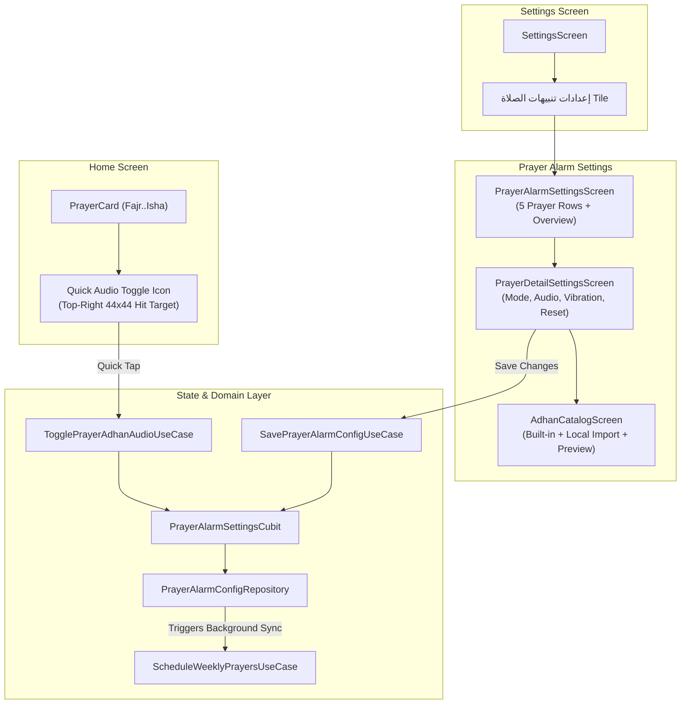
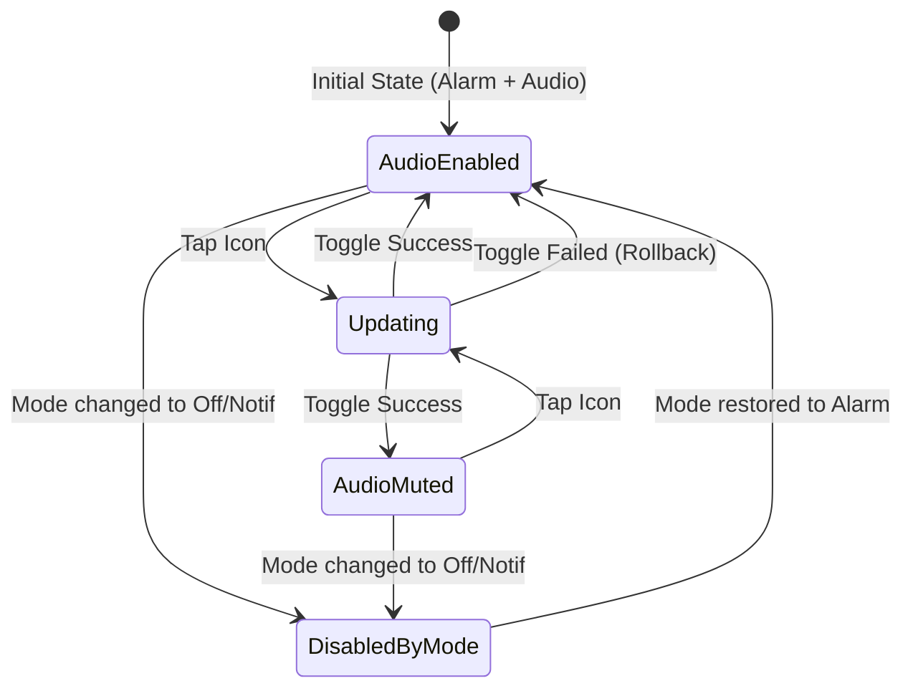

# P4.1-C — Independent Prayer Alarms UI & User Controls
## Complete UI, UX, Domain Integration & Production Readiness Plan

**Feature Branch:** `feature/p4.1-independent-alarms-adhan`  
**Document Version:** 1.0.0  
**Status:** PLAN — READY FOR ENGINEERING REVIEW (STOP GATE C.0)  
**Implementation Authorization:** NOT AUTHORIZED  
**Commit / Merge / Release / Deploy:** NOT AUTHORIZED

---

## 1. Executive Goal Description

The objective of **Phase P4.1-C** is to elevate the robust, dual-device verified independent prayer scheduling engine (developed and proven across Phases 2A through 2D) into a cohesive, user-facing feature. Users must be able to configure and control each of the five daily prayers (`Fajr`, `Dhuhr`, `Asr`, `Maghrib`, `Isha`) independently through:

1. **Home Prayer Cards — Quick Controls:** A responsive, accessible Quick Audio Control (Mute / Unmute) on each home prayer card for instantaneous sound toggling without leaving the home screen.
2. **Prayer Alarm Settings — Detailed Controls:** A dedicated settings hub allowing per-prayer selection of:
   - Alert Mode: `Alarm` (full-screen intent + sound), `Notification` (audible alert banner), or `Off` (disabled).
   - Audio Preferences: Adhan Mute/Unmute, Muezzin selection (built-in catalog & local audio import), Volume slider, and Audio Preview.
   - Vibration Preferences: Enable/Disable vibration, vibration preview.
   - Individual Prayer Reset: Resetting a single prayer back to factory defaults without affecting any other prayer.
3. **Domain & Scheduling Integration:** Seamlessly propagating user configuration changes to persistent storage (`SharedPreferences`), the reactive UI layer, and the two-phase scheduling reconciler (`ScheduleWeeklyPrayersUseCase`) while strictly preserving existing calendar alarm contracts and non-interference guarantees.

---

## 2. Baseline Architecture Inspection (Phase P4.1-C.0 Findings)

### 2.1 Home Screen & Prayer Card Layout
- **File:** `lib/features/home/presentation/widgets/prayer_card_widget.dart`
- **Current Tree:** `PrayerCard` is a `StatefulWidget` wrapped in `BlocBuilder<TimeCubit, DateTime>`. It uses an outer `AnimatedContainer` enclosing a `Stack`:
  - `Center`: Contains a `Flex` displaying the prayer icon, prayer name, and formatted prayer time.
  - `Positioned(top: 6, left: 8)`: Displays the floating `NextPrayerTimer` capsule when `isNextPrayer == true`.
  - **Identified Injection Point:** In RTL (Arabic layout), `top: 6, right: 8` is completely unoccupied across both standard 2-column grid and wide 1-column layouts. Placing a compact `IconButton` (with a 44x44 minimum hit target for accessibility) at `top: 6, right: 8` integrates seamlessly without altering card aspect ratios or conflicting with text scaling.
  - **Sunrise Handling:** `prayer_times_grid.dart` includes Sunrise (`الشروق`, `prayerId: null`). Because Sunrise is not an obligatory prayer and does not have an Adhan, the Quick Audio Control is automatically suppressed for Sunrise.

### 2.2 Existing Settings Architecture
- **File:** `lib/features/settings/presentation/screens/settings_screen.dart`
- **Current Tree:** A 2,195-line `StatefulWidget` organized into grouped cards:
  - `إعدادات الإشعارات` currently contains:
    - Switch for `_isAdhanVibrationEnabled`.
    - InkWell tile `طريقة تنبيه الأذان` (`_showAdhanStyleDialog`), which mutates a single global `_adhanStyle` preference ('alarm', 'notification', 'none').
- **Proposed Integration:**
  - Modernize `طريقة تنبيه الأذان` into a navigation entry tile: **"إعدادات تنبيهات الصلاة"** (Prayer Alarm Settings), displaying a dynamic subtitle summarizing active per-prayer modes (e.g., `مخصص لكل صلاة • أذان، إشعار، كتم`).
  - Tapping navigates to a new dedicated screen: `PrayerAlarmSettingsScreen`.

### 2.3 Domain Model & Persistence Mapping
- **Current Entity:** `lib/features/notifications/domain/entities/prayer_alarm_config.dart`
  - Defines `PrayerId` (`fajr`, `dhuhr`, `asr`, `maghrib`, `isha`).
  - Defines `PrayerAlarmType` (`alarm`, `notification`, `off`).
  - `PrayerAlarmConfig`: Holds `prayerId` and `alarmType`.
- **Model Evolution for P4.1-C:**
  Expand `PrayerAlarmConfig` and `PrayerAlarmConfigModel` with non-breaking, backwards-compatible fields:
  ```dart
  class PrayerAlarmConfig {
    final PrayerId prayerId;
    final PrayerAlarmType alarmType;
    final bool isAudioEnabled;       // Mute / Unmute state (default: true)
    final String? soundAsset;         // Path to sound (assets/sounds/... or local file)
    final bool? isVibrationEnabled;   // Per-prayer vibration (null = use global default)
    final double? volume;             // Per-prayer volume (null = use global default)
  }
  ```
- **Local Data Source:** `PrayerAlarmConfigLocalDataSourceImpl`
  - Already manages `prayer_alarm_config_version` and atomic JSON serialization (`prayer_alarm_configs_json`).
  - Version will be bumped from `1` to `2` with safe, additive defaults for all five prayers, guaranteeing 100% preservation of existing configurations.

### 2.4 Scheduling & Reconciliation Integration
- **File:** `lib/features/notifications/domain/usecases/schedule_weekly_prayers_usecase.dart`
- **Alarm Scheduling:**
  - When `config.alarmType == PrayerAlarmType.alarm`:
    - If `config.isAudioEnabled == false` (Muted), `volume: 0.0` is passed to `scheduleAdhanAlarm()`.
    - `package:alarm` sets `volume: 0.0` with `fadeDuration: 1ms`, producing an alarm that launches `AdhanScreen` with vibration (if enabled) but with zero acoustic output.
    - `verifyAlarm()` validates `expectedVolume: 0.0`. When the user toggles mute, reconciliation detects the volume property mismatch, triggers safe two-phase cancellation and re-scheduling without modifying other prayers.
  - Imminent alarm protection ($< 15$s or currently ringing) remains fully enforced.

---

## 3. User Review Required

> [!IMPORTANT]
> **Key Architectural Decisions for User Approval:**
> 1. **Per-Prayer Mute Semantics:** Mute is defined as `volume = 0.0` on the Alarm. The alarm still rings, wakes the device, displays the full-screen intent, and vibrates (if enabled), but plays completely silently. It does *not* alter the alarm mode to `Notification` or `Off`.
> 2. **Legacy `adhanStyle` Setting Deprecation:** The global `_adhanStyle` preference in `settings_screen.dart` will be superseded by the granular per-prayer settings. A one-time migration will initialize per-prayer configs from the legacy global setting.
> 3. **Audio Import Isolation:** User-imported audio files will be copied into app-private storage (`getApplicationDocumentsDirectory()/adhan_sounds/`), sanitized, and validated. They will never reference volatile system picker URIs.

---

## 4. Open Questions

> [!NOTE]
> 1. **Haptic Feedback on Quick Toggle:** Should tapping the Quick Audio Control on the Home Prayer Card emit a short haptic feedback (`HapticFeedback.lightImpact()`) alongside visual state update? *(Recommended: Yes)*
> 2. **Built-in Muezzin Catalog:** The app currently bundles `fajr_azan.mp3` and `adhan.mp3`. Should additional bundled Adhan sounds (e.g. Makkah, Madinah, Al-Aqsa, Abdulbasit) be added to the catalog, or start with bundled assets + user file picker? *(Recommended: Start with bundled assets + user file import in Phase P4.1-C.5)*

---

## 5. UI/UX Architecture & Interaction Design



### 5.1 Quick Audio Control State Machine


---

## 6. Proposed Changes & Implementation Phases

The execution is organized into distinct phases with strict Stop Gates:

```
Phase P4.1-C.0: Baseline & Architecture Inspection ──► (Current Gate - Review Plan)
Phase P4.1-C.1: UI Contracts & Configuration Design
Phase P4.1-C.2: Home Prayer Cards Quick Toggle
Phase P4.1-C.3: Prayer Alarm Settings Main Screen
Phase P4.1-C.4: Prayer-Specific Settings Screen
Phase P4.1-C.5: Audio Catalog & User Audio Import
Phase P4.1-C.6: Runtime Audio & Vibration Integration
Phase P4.1-C.7: End-to-End Functional Verification
Phase P4.1-C.8: Dual-Device UI & Responsive Validation
Phase P4.1-C.9: Final Evidence Bundle & Gate Closure
```

### 6.1 Component: Domain & Data Layer (`lib/features/notifications/`)

#### [MODIFY] `lib/features/notifications/domain/entities/prayer_alarm_config.dart`
- Add `isAudioEnabled` (bool, default `true`).
- Add `soundAsset` (String?, optional custom sound path).
- Add `isVibrationEnabled` (bool?, optional per-prayer vibration override).
- Add `volume` (double?, optional per-prayer volume override).
- Update `copyWith`, `operator==`, and `hashCode`.

#### [MODIFY] `lib/features/notifications/data/models/prayer_alarm_config_model.dart`
- Update `fromJson` and `toJson` to serialize and deserialize the new fields with safe backwards-compatible defaults.

#### [MODIFY] `lib/features/notifications/data/datasources/prayer_alarm_config_local_data_source.dart`
- Advance `currentVersion` from `1` to `2`.
- Update individual key helpers:
  - `alarmAudioEnabledKey(prayerKey) => 'prayer_alarm_audio_$prayerKey'`
  - `alarmVibrationKey(prayerKey) => 'prayer_alarm_vibration_$prayerKey'`
- Implement migration v2 preserving all existing v1 configurations while seeding `isAudioEnabled: true`.

#### [NEW] `lib/features/notifications/domain/usecases/toggle_prayer_audio_usecase.dart`
- Dedicated, single-purpose use case for fast, isolated toggling of `isAudioEnabled` for a single prayer.

---

### 6.2 Component: State Management (`lib/features/notifications/presentation/cubit/`)

#### [NEW] `lib/features/notifications/presentation/cubit/prayer_alarm_settings_cubit.dart`
#### [NEW] `lib/features/notifications/presentation/cubit/prayer_alarm_settings_state.dart`
- Manages loaded configurations for all 5 prayers.
- Supports granular per-prayer updating states (`updatingPrayerId`) to ensure zero cross-prayer UI flicker.
- Handles audio preview lifecycle with automatic stop on cubit disposal.

---

### 6.3 Component: Home Quick Controls (`lib/features/home/presentation/`)

#### [MODIFY] `lib/features/home/presentation/widgets/prayer_card_widget.dart`
- Add optional `PrayerAlarmConfig? alarmConfig` and `VoidCallback? onAudioToggle` parameters.
- Add `Positioned(top: 6, right: 8)` audio control widget:
  - When `alarmConfig.alarmType == PrayerAlarmType.alarm`:
    - Shows `Icons.volume_up_rounded` (enabled) or `Icons.volume_off_rounded` (muted).
  - When `alarmConfig.alarmType == PrayerAlarmType.notification`:
    - Shows `Icons.notifications_active_outlined` (muted visual, disabled tap with tooltip).
  - When `alarmConfig.alarmType == PrayerAlarmType.off`:
    - Shows `Icons.notifications_off_outlined` (disabled visual).
  - When updating: shows a micro `CircularProgressIndicator` (size 14).
  - Minimum hit area: `44x44` dp with accessibility semantic label (e.g. `كتم صوت أذان الفجر`).

#### [MODIFY] `lib/features/home/presentation/widgets/prayer_times_grid.dart`
- Bind `PrayerAlarmSettingsCubit` to inject per-prayer alarm configurations into each `PrayerCard`.

---

### 6.4 Component: Settings Screens (`lib/features/settings/presentation/screens/`)

#### [MODIFY] `lib/features/settings/presentation/screens/settings_screen.dart`
- Replace legacy global `_showAdhanStyleDialog` tile with navigation tile to `PrayerAlarmSettingsScreen`.

#### [NEW] `lib/features/settings/presentation/screens/prayer_alarm_settings_screen.dart`
- Master screen listing all 5 daily prayers in clean cards showing:
  - Prayer Arabic name and canonical icon.
  - Current mode badge (`منبه كامل`, `إشعار فقط`, `معطل`).
  - Audio status badge (`مفعل` / `مكتوم`).
  - Vibration status badge (`مفعل` / `معطل`).
  - Chevron navigating to detail screen.

#### [NEW] `lib/features/settings/presentation/screens/prayer_detail_settings_screen.dart`
- Detailed control screen for a single selected prayer:
  - **Section 1: Mode Selector:** Radio list tiles for `Alarm`, `Notification`, and `Off`.
  - **Section 2: Adhan Audio Settings:** (Visible only when Mode is Alarm):
    - Switch for Audio Mute/Unmute.
    - Sound Selector tile (opens Catalog).
    - Volume Slider (with live percentage).
  - **Section 3: Vibration Settings:** Switch for vibration.
  - **Section 4: Reset Button:** Resets this prayer to factory defaults.

#### [NEW] `lib/features/settings/presentation/screens/adhan_catalog_screen.dart`
- Catalog screen listing:
  - Built-in Adhan tracks (`أذان الفجر`, `الأذان العام`).
  - Custom imported tracks section.
  - Live Audio Preview button with play/stop toggle.
  - "استيراد ملف صوتي" button invoking local file picker.

---

### 6.5 Component: Audio Engine & Storage Service (`lib/core/services/`)

#### [NEW] `lib/core/services/custom_audio_storage_service.dart`
- Manages app-owned custom audio directory:
  - Validates file extensions (`.mp3`, `.wav`, `.m4a`).
  - Enforces file size limits ($\le 15$ MB).
  - Copies selected file into `getApplicationDocumentsDirectory()/adhan_sounds/` with sanitized UUID filenames.
  - Provides metadata listing and deletion utilities.

---

## 7. Verification Plan

### 7.1 Automated Testing Matrix
1. **Domain & Entity Unit Tests (`test/features/notifications/domain/`):**
   - Verify `PrayerAlarmConfig` instantiation, equality, and `copyWith` with new fields.
   - Verify `TogglePrayerAudioUseCase` modifies only target prayer.
   - Verify `PrayerAlarmConfigLocalDataSource` migration from v1 to v2.
   - Verify corrupted JSON fallback to multi-key storage.
2. **Cubit Unit Tests (`test/features/notifications/presentation/`):**
   - Verify `PrayerAlarmSettingsCubit` loading, toggling, optimistic rollback on failure, and audio preview stop.
3. **Widget Tests (`test/features/home/presentation/widgets/`):**
   - Test `PrayerCard` renders volume active icon when enabled.
   - Test `PrayerCard` renders volume off icon when muted.
   - Test tap invokes toggle callback without opening settings.
   - Test Sunrise card suppresses audio control icon.
   - Verify semantic accessibility labels in Arabic.
4. **Settings Widget Tests (`test/features/settings/presentation/`):**
   - Test `PrayerAlarmSettingsScreen` lists 5 prayers with correct badges.
   - Test changing mode updates UI state and persistence.
   - Test reset restores defaults for target prayer only.
5. **Scheduler Integration Tests (`test/features/notifications/scheduler_integration_test.dart`):**
   - Verify muted alarm schedules with `volume = 0.0`.
   - Verify non-interference: toggling Fajr audio does not invalidate Dhuhr..Isha alarms.
   - Verify existing test suite maintains 100% pass rate.

### 7.2 Dual-Device Physical Verification
1. **Primary Device (Xiaomi Redmi Note 14 Pro+ 5G / Android 16):**
   - Quick audio toggle responsiveness on home screen.
   - Settings screen navigation, smooth animations, Arabic typography.
   - Audio preview playback and cleanup.
   - File picker import of local audio file.
2. **Secondary Device (Samsung Galaxy Tab A7 LTE / Android 12):**
   - Tablet layout and landscape grid responsiveness.
   - One UI theme adaptation (Dark/Light mode contrast).
   - Touch target accessibility verification.

---

## 8. Risk Register & Mitigation Strategy

| # | Risk | Impact | Likelihood | Mitigation Strategy |
|---|---|:---:|:---:|---|
| **R1** | Unnecessary full-page home screen rebuilds on quick toggle | Medium | Medium | Wrap the Quick Audio Control in an isolated `BlocSelector<PrayerAlarmSettingsCubit, ...>` scoped strictly to that prayer's state. |
| **R2** | Audio Preview leaking in background after screen exit | High | Low | Implement strict `dispose()` on `AudioPlayer` inside `StatefulWidget` and `Cubit.close()`. |
| **R3** | User picks invalid/corrupted audio file or temporary cache URI | High | Medium | Copy picked file to private storage immediately, validate header/extension, and verify playable duration before saving. |
| **R4** | Volume mismatch triggers infinite reconciliation loop | High | Low | Ensure `verifyAlarm()` accurately mirrors `VolumeSettings` comparison with tolerance. |
| **R5** | Regression on existing 52 scheduler integration tests | Critical | Low | Maintain strict backwards compatibility on existing constructor arguments; run full test suite before any gate transition. |

---

## 9. Stop Gate C.0 Checklist

- [x] Baseline architecture thoroughly inspected.
- [x] Home Prayer Card layout and injection point determined (`top: 6, right: 8`).
- [x] Domain model and persistence evolution planned with backwards compatibility.
- [x] Scheduling and muting integration contract defined (`volume: 0.0` on Alarm).
- [x] Risk register and mitigations documented.
- [ ] **Engineering Review & Formal Approval of Plan (STOP GATE C.0)**.
- [ ] No production code modified (`lib/`, `android/` diff remains 0).

