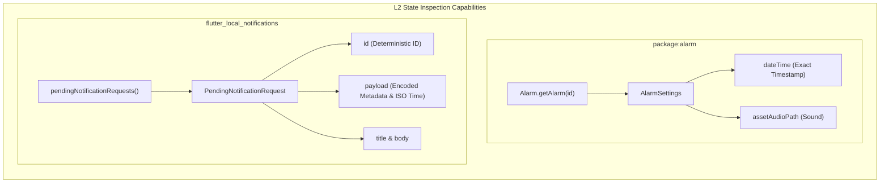

# PHASE 2C.4.2.0 — Design Correction Supplement
## Scheduling Execution Result Contract & Stale-Aware L2 Verification Architecture

**Project:** Hafiz Al-Ahd (حافظ العهد)  
**Branch:** `feature/p4.1-independent-alarms-adhan`  
**Phase:** Phase 2C.4.2.0 Design Correction  
**Type:** Architectural Specification & Verification Contract Design  
**Status:** SUBMITTED FOR DESIGN REVIEW & STOP GATE 1 APPROVAL  
**Execution Timestamp:** 2026-11-08  

---

## 1. Executive Summary & Review Alignment

This supplement directly resolves the two fundamental architectural concerns identified in the engineering review:
1. **The Inadequacy of Void L1 Dispatch & The Silent Skip Vulnerability:** Proving why `Future<void>` is architecturally defective when repositories contain silent return guards, and establishing the typed `ScheduleExecutionResult` contract (`scheduled`, `skipped`, `failed`).
2. **The Inadequacy of Boolean L2 Queries & The Stale Event Flaw:** Proving why `Future<bool> isAlarmScheduled(id)` fails in refresh scenarios (by treating an existing, outdated alarm as a verified success), and designing the 4-state `EventVerificationStatus` contract (`absent`, `matching`, `stale`, `unverifiable`).
3. **Hardened Test Harness:** Added explicit tests (Case 2, Case 7, and Test 24b) proving that a stale event with a matching ID does not satisfy verification, converting previous false positives into honest RED tests (35 tests: **6 PASS / 29 EXPECTED RED**).
4. **Strict Boundary Adherence:** Zero production code in `lib/` has been modified.

---

## 2. Issue 1: The Silent Skip Problem in `scheduleAdhanAlarm()` & The Scheduling Result Contract

### 2.1 Forensic Analysis of the Silent Skip
In [`NotificationRepositoryImpl.dart`](file:///c:/Users/shady%20atef/Documents/projects/hafiz_al_ahd/lib/features/notifications/data/repos/notification_repository_impl.dart#L256-L264):
```dart
  @override
  Future<void> scheduleAdhanAlarm({ ... }) async {
    // 👈 لا نجدول منبه في الماضي أو بعد أقل من دقيقة لتجنب الأخطاء وقت الـ Boot
    if (id != 888 &&
        scheduledTime.difference(DateTime.now()).inMinutes < 1 &&
        scheduledTime.isBefore(
          DateTime.now().add(const Duration(minutes: 1)),
        )) {
      return; // ⚠️ SILENT RETURN!
    }

    final alarmSettings = AlarmSettings(...);
    await Alarm.set(alarmSettings: alarmSettings);
  }
```

### The Architectural Flaw:
1. When `scheduledTime` is in the past or within 1 minute of the current clock (e.g. during an app boot or rescheduling session that occurs near prayer time), the method returns immediately.
2. Because the return type is `Future<void>`, the caller (`ScheduleWeeklyPrayersUseCase`) observes normal asynchronous completion without an exception.
3. The Scheduler concludes that `Alarm.set()` was invoked and that the alarm was queued, when in reality **no native alarm was scheduled**.
4. A similar silent drop exists in FLN scheduling for desktop platforms when the delay is negative (line 148).

### 2.2 Proposed Contract: Typed `ScheduleExecutionResult`
To eliminate ambiguity, scheduling operations must return an explicit domain result rather than `void`:

```dart
/// The concrete outcome of an individual event scheduling operation.
enum ScheduleExecutionResult {
  /// The event was successfully dispatched to the underlying native engine.
  scheduled,

  /// The event was intentionally skipped (e.g., scheduled time is in the past,
  /// inside the imminent trigger guard, or disabled).
  skipped,

  /// The scheduling operation failed due to a platform channel or I/O exception.
  failed,
}
```

### 2.3 Proposed Signatures for `BaseNotificationRepository`:
```dart
abstract class BaseNotificationRepository {
  Future<ScheduleExecutionResult> scheduleAdhanAlarm({
    required int id,
    required String title,
    required String body,
    required DateTime scheduledTime,
    required String assetAudioPath,
    double? volume,
    bool enableVibration = true,
  });

  Future<ScheduleExecutionResult> schedulePrayerNotification({
    required int id,
    required String title,
    required String body,
    required DateTime scheduledTime,
    String? soundName,
    String? payload,
  });
}
```

### 2.4 Invariants of the Result Contract:
* `skipped` is **NEVER** treated as `scheduled`.
* If a prayer alert is `skipped` (e.g. because it is in the past):
  - The scheduler records the event as `skipped`.
  - It does **not** perform L2 verification on it.
  - It does **not** falsely advance the completion horizon past an unhandled day.

---

## 3. Issue 2: The Stale Event Flaw & The 4-State L2 Verification Contract

### 3.1 The Vulnerability of Boolean L2 Queries
The review correctly noted that a query like:
```dart
Future<bool> isAlarmScheduled(int id);
```
only verifies the existence of a record with that `id`.

Consider the following critical failure scenario during an **In-Place Refresh (Case 2 or Case 7)**:
1. Day 1 Fajr has an existing alarm with ID `26110900`, scheduled for `04:55:00` (from an earlier calculation or different location).
2. The user recalculates prayer times; the new Fajr time is `05:00:00`.
3. The scheduler attempts to refresh the alarm with `05:00:00`.
4. The scheduling call fails (e.g. `PlatformException` or I/O lock) or is skipped.
5. The scheduler attempts to verify the event: `await isAlarmScheduled(26110900)`.
6. The query inspects the package registry, finds the **old** alarm (`04:55:00`), and returns `true`!
7. The scheduler falsely concludes that the refresh succeeded, marks Day 1 complete, and advances the horizon!

### 3.2 The 4-State Verification Domain Abstraction
To solve this cleanly without leaking plugin types into the domain, we define `EventVerificationStatus`:

```dart
/// The verified state of a scheduled event within the local plugin/package registry.
enum EventVerificationStatus {
  /// No record with the specified ID exists in the registry.
  absent,

  /// A record exists with the specified ID and its attributes (time, sound, payload)
  /// exactly match the expected desired state.
  matching,

  /// A record exists with the specified ID, but its attributes (e.g. scheduled time
  /// or audio asset) are outdated or do not match the expected state.
  stale,

  /// Verification could not be determined due to a platform channel failure
  /// or unexpected registry corruption.
  unverifiable,
}
```

### 3.3 What Can Actually Be Verified for Alarms and Notifications



#### Detailed Inspection Capabilities:
1. **For `package:alarm`:**
   - **Method:** `Alarm.getAlarm(int id)`.
   - **Exposed Properties:** `AlarmSettings.dateTime` (exact timestamp), `assetAudioPath` (sound asset).
   - **Matching Criteria:**
     - `alarm == null` $\to$ `EventVerificationStatus.absent`
     - `|alarm.dateTime - expectedTime| > 2s` $\to$ `EventVerificationStatus.stale`
     - `alarm.assetAudioPath != expectedAsset` $\to$ `EventVerificationStatus.stale`
     - All match $\to$ `EventVerificationStatus.matching`
2. **For `flutter_local_notifications` (FLN):**
   - **Method:** `flutterLocalNotificationsPlugin.pendingNotificationRequests()`.
   - **CRITICAL FORENSIC REALITY:** `PendingNotificationRequest` in FLN exposes `id`, `title`, `body`, and `payload`. **It does NOT expose `scheduledDate`**.
   - **Architectural Solution:** The expected scheduled time is encoded into the notification `payload`:
     e.g., `'adhan_simple_fajr|2026-11-09T05:00:00'`.
   - **Matching Criteria:**
     - No request with `id` $\to$ `EventVerificationStatus.absent`
     - Request exists but `payload != expectedPayload` $\to$ `EventVerificationStatus.stale`
     - Request exists and `payload == expectedPayload` $\to$ `EventVerificationStatus.matching`

### 3.4 Proposed Verification Signatures in `BaseNotificationRepository`:
```dart
abstract class BaseNotificationRepository {
  /// Verifies an alarm's registration state against expected parameters.
  Future<EventVerificationStatus> verifyAlarm({
    required int id,
    required DateTime expectedScheduledTime,
    String? expectedAssetAudioPath,
  });

  /// Verifies a notification's registration state against expected parameters.
  Future<EventVerificationStatus> verifyNotification({
    required int id,
    String? expectedPayload,
    String? expectedTitle,
  });
}
```

---

## 4. Hierarchy of Verification: Distinguishing L1 through L4

| Level | Boundary | API / Inspection Mechanism | What It Truly Proves | What It Does NOT Prove |
|:---:|---|---|---|---|
| **L1** | **Platform Channel Dispatch** | `scheduleAdhanAlarm()` / `schedulePrayerNotification()` | The Dart asynchronous message was formatted, passed over the binary messenger, and native code did not throw. | Does not prove persistence, does not prove OS-level queuing, does not prove execution if silently skipped. |
| **L2** | **Plugin Registry Verification** | `verifyAlarm()` (`Alarm.getAlarm`) / `verifyNotification()` (`pendingNotificationRequests`) | The plugin's local database/store contains a record matching the exact deterministic ID and expected parameters (time/payload). | Does not prove the Android kernel `AlarmManager` queue has scheduled the wake-alarm; does not prove Doze exemption. |
| **L3** | **Android OS Framework Queue** | Android `dumpsys alarm` / ADB inspection | The Linux kernel RTC driver and Android `AlarmManagerService` have queued an exact `PendingIntent` for this UID. | Does not prove OEM aggressive battery managers (e.g. Samsung/Xiaomi battery savers) will not kill the process. |
| **L4** | **Physical Playout & Delivery** | Physical device hardware clock trigger | The device screen turns on, full-screen UI renders, and speaker hardware audibly plays Adhan audio. | **Device-level reality; strictly reserved for Phase 2D (Physical Device Gate).** |

---

## 5. Test Matrix Hardening & Proof of Stale Event Rejection

To guarantee that the test harness enforces this contract before production implementation, the following changes were made to [`test/features/notifications/scheduler_production_path_integration_test.dart`](file:///c:/Users/shady%20atef/Documents/projects/hafiz_al_ahd/test/features/notifications/scheduler_production_path_integration_test.dart):

### 5.1 Case 2 Hardening (Alarm In-Place Refresh):
```dart
    test('Case 2: [alarm, present, absent] -> In-place refresh of existing Alarm', () async {
      ...
      // Pre-seed existing alarm with OUTDATED time (4:55 instead of 5:00)
      fakeRepo.scheduledAlarms[expectedId] = ScheduledAlarmRecord(
        id: expectedId,
        scheduledTime: testDate.add(const Duration(hours: 4, minutes: 55)),
        ...
      );

      await scheduler.execute(30.0, 31.0, 'Cairo', 'Egypt');

      // The alarm must NOT just exist with old time; it must be updated to 5:00!
      expect(fakeRepo.scheduledAlarms.containsKey(expectedId), isTrue);
      expect(
        fakeRepo.scheduledAlarms[expectedId]?.scheduledTime,
        equals(testDate.add(const Duration(hours: 5))),
        reason: 'EXPECTED RED: Alarm refreshed with updated prayer time (not left with stale time)',
      );
    });
```

### 5.2 Case 7 Hardening (Notification In-Place Refresh):
* Pre-seeds notification with `11:55:00`.
* Asserts `fakeRepo.scheduledNotifications[notifId]?.scheduledTime == 12:00:00`.
* **Result:** Case 7 previously passed as a false positive because `cancelAllAlarms()` didn't touch notifications. With the time assertion, **Case 7 now legitimately FAILS RED** against the legacy scheduler!

### 5.3 Added Test 24b (Stale Alarm Rejection on Failed Refresh):
```dart
    test('24b. Stale event verification: Pre-existing event with outdated parameters is NOT treated as verified if refresh fails', () async {
      // Pre-seeds stale alarm (4:30) with matching ID.
      // Injects L1 failure for refresh.
      // Asserts that the presence of the stale alarm does NOT falsely satisfy verification
      // and that scheduled_until_date is NOT advanced.
    });
```

---

## 6. Updated 35-Test Matrix Inventory

```text
================================================================================
Test Suite Results: scheduler_production_path_integration_test.dart
Execution Status: 6 PASS / 29 EXPECTED RED (Total: 35 Tests)
================================================================================
```

| # | Group | Test Case Name | Status | Honest Diagnostic Reason |
|:---:|:---|---|:---:|---|
| **1** | A: 12-Case Matrix | Case 1: `[alarm, absent, absent]` $\to$ Schedule Alarm | **RED** | Legacy scheduler uses sequential ID (`1`) instead of deterministic ID. |
| **2** | A: 12-Case Matrix | Case 2: `[alarm, present, absent]` $\to$ Refresh Alarm | **RED** | Legacy scheduler wipes existing alarms via `cancelAllAlarms()`. |
| **3** | A: 12-Case Matrix | Case 3: `[alarm, absent, present]` $\to$ Schedule Alarm, cancel Notif | **RED** | Legacy scheduler does not schedule deterministic ID or cancel old notif. |
| **4** | A: 12-Case Matrix | Case 4: `[alarm, present, present]` $\to$ Refresh Alarm, cancel Notif | **RED** | Dirty dual state: stray notification is not cancelled. |
| **5** | A: 12-Case Matrix | Case 5: `[notification, absent, absent]` $\to$ Schedule Notif | **RED** | Legacy scheduler follows global `adhanStyle == alarm`. |
| **6** | A: 12-Case Matrix | Case 6: `[notification, present, absent]` $\to$ Schedule Notif, cancel Alarm | **RED** | Legacy scheduler does not schedule notification under `adhanStyle == alarm`. |
| **7** | A: 12-Case Matrix | Case 7: `[notification, absent, present]` $\to$ Refresh Notif | **RED** | **CONVERTED TO HONEST RED:** Legacy scheduler leaves stale `11:55` time untouched. |
| **8** | A: 12-Case Matrix | Case 8: `[notification, present, present]` $\to$ Refresh Notif, cancel Alarm | **RED** | Legacy scheduler does not schedule notification under `adhanStyle == alarm`. |
| **9** | A: 12-Case Matrix | Case 9: `[off, absent, absent]` $\to$ Pure no-op | **PASS** | Under `adhanStyle == off`, no alarms or notifications are scheduled. |
| **10** | A: 12-Case Matrix | Case 10: `[off, present, absent]` $\to$ Decommission Alarm | **RED** | Legacy scheduler does not target ID via `cancelAlarmSafely()`. |
| **11** | A: 12-Case Matrix | Case 11: `[off, absent, present]` $\to$ Decommission Notif | **RED** | Legacy scheduler does not target ID via `cancelNotification()`. |
| **12** | A: 12-Case Matrix | Case 12: `[off, present, present]` $\to$ Decommission both | **RED** | Stray notification survives because legacy code never targets it. |
| **13** | B: Blanket Sweep | 13. Scheduler does NOT call `cancelAllAlarms()` | **RED** | Legacy scheduler calls `cancelAllAlarms()` at line 59. |
| **14** | B: Blanket Sweep | 14. Scheduler does NOT call `cancelAllNotifications()` | **PASS** | Legacy scheduler calls `cancelActivePrayerNotification()`, NOT `cancelAllNotifications()`. |
| **15** | B: Blanket Sweep | 15. Unrelated alarms (ID 888) preserved | **RED** | Destroyed by legacy `cancelAllAlarms()` at line 59. |
| **16** | B: Blanket Sweep | 16. Sticky countdown foreground (ID 8888) preserved | **PASS** | Legacy scheduler never invokes `cancelAllNotifications()`. |
| **17** | C: Audio & Guards | 17. Ringing alarm suppresses cancel $\to$ Preserved | **RED** | Pre-emptively wiped by legacy `cancelAllAlarms()`. |
| **18** | C: Audio & Guards | 18. Alarm within $\pm 15\text{s}$ suppresses cancel $\to$ Preserved | **RED** | Pre-emptively wiped by legacy `cancelAllAlarms()`. |
| **19** | C: Audio & Guards | 19. Case 10 off: Ringing alarm suppresses cancel | **RED** | Pre-emptively wiped by legacy `cancelAllAlarms()`. |
| **20** | C: Audio & Guards | 20. Case 10 off: Alarm within $\pm 15\text{s}$ suppresses cancel | **RED** | Pre-emptively wiped by legacy `cancelAllAlarms()`. |
| **21** | D: Verification L1/L2 | 21. Alarm L1 failure $\to$ Old Notif preserved | **RED** | Fault hit counter = 0 (scheduler used sequential ID `1`). |
| **22** | D: Verification L1/L2 | 22. Alarm L2 failure $\to$ Old Notif preserved | **RED** | Fault hit counter = 0 (scheduler used sequential ID `1`). |
| **23** | D: Verification L1/L2 | 23. Legacy Blanket Cancellation: Old alarm wiped | **RED** | Pre-seeded alarm wiped by legacy `cancelAllAlarms()`. |
| **24** | D: Verification L1/L2 | 24. In-place L1 failure $\to$ Halts horizon | **RED** | Fault hit counter = 0 (scheduler used sequential ID `1`). |
| **24b**| D: Verification L1/L2 | 24b. Stale event does NOT satisfy L2 verification | **RED** | **NEW TEST:** Asserts that pre-existing stale alarm (4:30) does not advance horizon when refresh fails. |
| **25** | E: Auxiliary Events | 25. Iqama failure $\to$ Halts horizon, Adhan preserved | **RED** | Adhan alarm not preserved under deterministic ID; horizon advanced. |
| **26** | E: Auxiliary Events | 26. Post-prayer Azkar failure $\to$ Halts horizon | **RED** | Adhan alarm not preserved under deterministic ID; horizon advanced. |
| **27** | E: Auxiliary Events | 27. Morning Azkar failure $\to$ Halts horizon | **RED** | Fajr alarm not preserved under deterministic ID; horizon advanced. |
| **28** | E: Auxiliary Events | 28. Evening Azkar failure $\to$ Halts horizon | **RED** | Asr alarm not preserved under deterministic ID; horizon advanced. |
| **29** | E: Auxiliary Events | 29. Prayer off + Aux enabled $\to$ Aux scheduled | **RED** | Legacy global `adhanStyle == none` disables all scheduling. |
| **30** | E: Auxiliary Events | 30. Auxiliary retry preserves prayer alert IDs | **PASS** | Auxiliary retry does not corrupt prayer IDs. |
| **31** | F: Horizon & Horizon | 31. Full 5-day success advances horizon | **PASS** | Legacy scheduler successfully advances horizon on complete run. |
| **32** | F: Horizon & Horizon | 32. Day 2 partial $\to$ Horizon caps at Day 1 | **RED** | Legacy scheduler unconditionally advances horizon by +5 days. |
| **33** | F: Horizon & Horizon | 33. Day 2 partial preserves partial events | **RED** | Pre-existing partial events wiped by legacy `cancelAllAlarms()`. |
| **34** | F: Horizon & Horizon | 34. Concurrency: Newer session aborts older | **PASS** | Legacy scheduler's session counter aborts older session execution. |

---

## 7. Status & Gate Position

* **Design Deliverable:** Completed and audited.
* **Test Matrix:** 35 tests (6 PASS / 29 EXPECTED RED). Zero false positives remaining.
* **Core Regressions:** 75 / 75 PASS (100% GREEN).
* **Baseline Regressions:** 52 PASS / 6 EXPECTED RED.
* **Static Analysis:** 0 issues found in test suite.
* **Production Code Freeze:** 100% preserved (0 lines in `lib/` modified).

**STOP — AWAITING REVIEW & EXPLICIT GATE 1 APPROVAL BEFORE ANY PRODUCTION CODE IMPLEMENTATION.**

