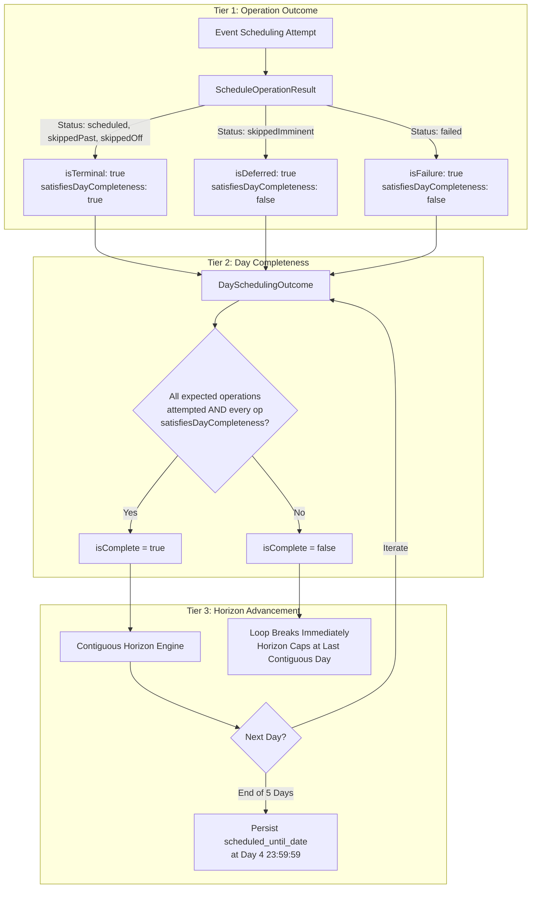

# PHASE 2C.4.2.2 — Revised Implementation Plan (Revision 2)
## Scheduling Outcome Semantics, Three-Tier Completeness & Contiguous Horizon Advancement

**Project:** Hafiz Al-Ahd (حافظ العهد)  
**Branch:** `feature/p4.1-independent-alarms-adhan`  
**Phase:** Phase 2C.4.2.2 (Revision 2)  
**Type:** Architecture Specification & Implementation Plan  
**Status:** REVISED PROPOSAL — AWAITING SUPERVISOR REVIEW & APPROVAL  
**Revision Date:** 2026-11-08  

---

## 1. Executive Summary & Review Adjustments

Following the engineering critique in **STOP GATE 3**, this revised plan addresses all five architectural requirements:

1. **Deferral of `skippedMatching`:** L2 verification is formally reserved for Phase 2C.4.2.4. `skippedMatching` is **NOT emitted** in Phase 2C.4.2.2, avoiding unverified state claims.
2. **Strict Three-Tier Separation:** Clear boundaries between **Operation Outcome** (`ScheduleOperationResult`), **Day Completeness** (`DaySchedulingOutcome`), and **Horizon Advancement** (`Contiguous Horizon Engine`).
3. **Derived Daily Completeness:** `DaySchedulingOutcome.isComplete` is strictly **derived** from its member operations with zero independent mutable booleans, eliminating logical contradictions.
4. **Rigorous Horizon Contract & Invariants:** Precise definition of `scheduled_until_date` as an inclusive end-of-day timestamp (`23:59:59`), accompanied by monotonic extension rules and stale/invalid stored value handling.
5. **Decoupling Horizon from Preservation & Test 33 Reclassification:** Clear separation between single-session non-destructive behavior (in scope) and cross-session partial-state preservation under retry (deferred to Phase 2C.4.2.3 due to legacy `cancelAllAlarms()`). Test 33 is explicitly deferred as **EXPECTED RED**, targeting **20 PASS / 16 EXPECTED RED**.
6. **Unified Imminent Guard Window:** Single unambiguous mathematical condition:
   $$\text{protected} = \text{isRinging} \;\lor\; (t \ge \text{now} - 15\text{s} \;\land\; t \le \text{now} + 60\text{s})$$

---

## 2. Three-Tier Architectural Separation



---

## 3. Tier 1: Operation Outcome Contract (`ScheduleOperationResult`)

### 3.1 Status Classification for Phase 2C.4.2.2:

| Status Enum | Technical Condition | Semantics | `isTerminal` | `satisfiesDayCompleteness` | `isDeferred` |
|---|---|---|:---:|:---:|:---:|
| **`scheduled`** | Platform method channel / repository completes successfully. | Event registered in platform. | **true** | **true** | **false** |
| **`skippedPast`** | `scheduledTime.isBefore(now)` **strictly on Day 0 (Today)**. | Past prayer today; natural historical boundary. | **true** | **true** | **false** |
| **`skippedOff`** | `config.alarmType == PrayerAlarmType.off` (or disabled auxiliary). | User intentionally disabled this alert. | **true** | **true** | **false** |
| **`skippedImminent`** | $\text{isRinging} \;\lor\; (t \ge \text{now} - 15\text{s} \;\land\; t \le \text{now} + 60\text{s})$. | Event is firing/about to fire; audio protected. | **false** | **false** | **true** |
| **`failed`** | Platform exception caught by repo, or calculation error, or future prayer in past. | Scheduling could not be performed. | **false** | **false** | **false** |

> [!IMPORTANT]
> **`skippedMatching` Deferral Policy:**  
> In Phase 2C.4.2.2, `skippedMatching` is **NOT emitted**. The scheduler performs direct dispatch. True idempotent matching requires L2 Two-Tier verification, which is strictly scheduled for **Phase 2C.4.2.4**.

### 3.2 Immutable Entity Specification:

```dart
// lib/features/notifications/domain/entities/schedule_operation_result.dart

enum ScheduleOperationStatus {
  scheduled,
  skippedPast,
  skippedOff,
  skippedMatching, // Reserved for Phase 2C.4.2.4
  skippedImminent,
  failed,
}

enum ScheduleEventType {
  prayerAlert,
  iqama,
  postPrayerAzkar,
  morningAzkar,
  eveningAzkar,
}

class ScheduleOperationResult {
  final int eventId;
  final ScheduleEventType eventType;
  final ScheduleOperationStatus status;
  final DateTime scheduledTime;
  final String? failureReason;

  const ScheduleOperationResult._({
    required this.eventId,
    required this.eventType,
    required this.status,
    required this.scheduledTime,
    this.failureReason,
  });

  const ScheduleOperationResult.scheduled({
    required int eventId,
    required ScheduleEventType eventType,
    required DateTime scheduledTime,
  }) : this._(
          eventId: eventId,
          eventType: eventType,
          status: ScheduleOperationStatus.scheduled,
          scheduledTime: scheduledTime,
        );

  const ScheduleOperationResult.skippedPast({
    required int eventId,
    required ScheduleEventType eventType,
    required DateTime scheduledTime,
  }) : this._(
          eventId: eventId,
          eventType: eventType,
          status: ScheduleOperationStatus.skippedPast,
          scheduledTime: scheduledTime,
        );

  const ScheduleOperationResult.skippedOff({
    required int eventId,
    required ScheduleEventType eventType,
    required DateTime scheduledTime,
  }) : this._(
          eventId: eventId,
          eventType: eventType,
          status: ScheduleOperationStatus.skippedOff,
          scheduledTime: scheduledTime,
        );

  const ScheduleOperationResult.skippedImminent({
    required int eventId,
    required ScheduleEventType eventType,
    required DateTime scheduledTime,
  }) : this._(
          eventId: eventId,
          eventType: eventType,
          status: ScheduleOperationStatus.skippedImminent,
          scheduledTime: scheduledTime,
        );

  const ScheduleOperationResult.failed({
    required int eventId,
    required ScheduleEventType eventType,
    required DateTime scheduledTime,
    required String failureReason,
  }) : this._(
          eventId: eventId,
          eventType: eventType,
          status: ScheduleOperationStatus.failed,
          scheduledTime: scheduledTime,
          failureReason: failureReason,
        );

  bool get isTerminal =>
      status == ScheduleOperationStatus.scheduled ||
      status == ScheduleOperationStatus.skippedPast ||
      status == ScheduleOperationStatus.skippedOff;

  bool get satisfiesDayCompleteness => isTerminal;
  bool get isDeferred => status == ScheduleOperationStatus.skippedImminent;
  bool get isFailure => status == ScheduleOperationStatus.failed;
}
```

---

## 4. Tier 2: Day Completeness Contract (`DaySchedulingOutcome`)

### 4.1 Strict Derived Completeness:
To prevent any contradiction between the list of operations and the day's completion flag, `isComplete` is **strictly derived**:

```dart
class DaySchedulingOutcome {
  final DateTime date;
  final List<ScheduleOperationResult> operations;
  final int expectedOperationsCount;

  const DaySchedulingOutcome({
    required this.date,
    required this.operations,
    required this.expectedOperationsCount,
  });

  /// Factory for day calculation failures (e.g. getPrayerTimes returns Left)
  factory DaySchedulingOutcome.calculationFailure({
    required DateTime date,
    required String reason,
  }) {
    return DaySchedulingOutcome(
      date: date,
      operations: [
        ScheduleOperationResult.failed(
          eventId: -1,
          eventType: ScheduleEventType.prayerAlert,
          scheduledTime: date,
          failureReason: reason,
        ),
      ],
      expectedOperationsCount: 1,
    );
  }

  int get attemptedOperationsCount => operations.length;

  /// Derived invariant: Day is complete IF AND ONLY IF all expected operations
  /// were attempted and EVERY operation satisfies day completeness.
  bool get isComplete =>
      attemptedOperationsCount >= expectedOperationsCount &&
      operations.every((op) => op.satisfiesDayCompleteness);

  ScheduleOperationResult? get firstFailure =>
      operations.cast<ScheduleOperationResult?>().firstWhere(
            (op) => op != null && op.isFailure,
            orElse: () => null,
          );

  ScheduleOperationResult? get firstDeferredOperation =>
      operations.cast<ScheduleOperationResult?>().firstWhere(
            (op) => op != null && op.isDeferred,
            orElse: () => null,
          );
}
```

---

## 5. Tier 3: Horizon Contract & Contiguous Advancement Engine

### 5.1 Definition of `scheduled_until_date`:
- It is an **INCLUSIVE** timestamp representing the exact end of the last complete day in local time:
  $$\text{boundary} = \text{DateTime}(\text{date.year}, \text{date.month}, \text{date.day}, 23, 59, 59)$$
- Formatted as an ISO-8601 string (`toIso8601String()`).
- Signifies: *"All required prayer alerts and enabled auxiliary reminders up to and including 23:59:59 on this date have been fully scheduled or validly terminal-skipped."*

### 5.2 Formal Horizon Invariants:

> [!IMPORTANT]
> **Core Horizon Invariant:**  
> The Scheduler must **never advance** the persisted horizon beyond the last contiguous complete day established by the current execution, and must **never overwrite** a previously valid horizon with a boundary that falsely represents incomplete work as complete.

1. **Contiguity Invariant (Zero Gaps):**
   $$\text{Last Contiguous Day} = \max \left\{ k \in [0, 4] \;\middle|\; \forall j \in [0, k],\; \text{Day}_j\text{.isComplete} \right\}$$
   If any day $k$ is incomplete, the scheduling loop **aborts immediately**. Days $k+1 \dots 4$ are never attempted.
2. **First Day Failure (Day 0 Incomplete):**
   If Day 0 fails or is incomplete, current execution establishes $K = \text{none}$.
   - The scheduler **MUST NOT** advance or write an incomplete boundary.
   - Any previously stored valid horizon in `SharedPreferences` is **strictly preserved**.
3. **Monotonic Horizon Update Rules:**
   - Let `establishedHorizon` be the calculated boundary of Day $K$ ($23:59:59$).
   - Let `storedHorizon` be the parsed value of `pref.getString('scheduled_until_date')`.
   - If `storedHorizon` is null or invalid (unparseable, year $< 2024$):
     - If `establishedHorizon != null` $\to$ write `establishedHorizon.toIso8601String()`.
     - If `establishedHorizon == null` $\to$ do not write (remains null).
   - If `storedHorizon` is valid:
     - If `establishedHorizon != null` and `establishedHorizon.isAfter(storedHorizon)` $\to$ write `establishedHorizon.toIso8601String()`.
     - If `establishedHorizon == null` or `!establishedHorizon.isAfter(storedHorizon)` $\to$ **do not overwrite; preserve `storedHorizon`**.

---

## 6. Single-Session Non-Destructive Behavior vs. Cross-Session Preservation

### 6.1 Clear Architectural Distinction:
- **In Scope for Phase 2C.4.2.2 (Single-Session Non-Destructive Policy):**
  - If Fajr and Dhuhr are scheduled successfully on Day 2, but Asr encounters an error:
    - The use case does **NOT** invoke any compensation, deletion, or rollback logic for Day 2 Fajr and Dhuhr.
    - Day 2 is marked `isComplete == false`.
    - Horizon caps at Day 1 ($23:59:59$).
    - The session aborts cleanly without throwing unhandled exceptions.
- **Deferred to Phase 2C.4.2.3 (Cross-Session Preservation under Retry):**
  - Because lines 59–60 (`cancelAllAlarms()`) remain in `ScheduleWeeklyPrayersUseCase` throughout Phase 2C.4.2.2, calling `scheduler.execute()` on a subsequent retry will wipe all alarms before scheduling.
  - Therefore, cross-session preservation cannot pass until Phase 2C.4.2.3 replaces `cancelAllAlarms()` with targeted reconciliation.
  - **Test 33** explicitly tests this cross-session preservation and will remain **EXPECTED RED** until Phase 2C.4.2.3.

---

## 7. Auxiliary Events Decoupling Contract

1. **Independence of Primary Adhan:**
   - Failure of an auxiliary notification (Iqama, post-prayer Azkar, morning Azkar, evening Azkar) must **never trigger cancellation or rollback** of the primary prayer alert.
2. **Impact on Day Completeness:**
   - An auxiliary failure produces `ScheduleOperationResult.failed(...)`.
   - Because `satisfiesDayCompleteness == false`, the containing `DaySchedulingOutcome.isComplete` evaluates to `false`.
   - The day is marked incomplete, halting the horizon at the previous day.
   - This ensures that subsequent retry sessions will re-attempt scheduling the missing auxiliary event.

---

## 8. Unified Imminent Alarm Protection Specification

$$\text{isProtected}(t, \text{isRinging}) = \text{isRinging} \;\lor\; \left( t \ge \text{now} - 15\text{s} \;\land\; t \le \text{now} + 60\text{s} \right)$$

1. **Scope:**
   - Applies to all prayer alerts (Alarms and Notifications).
2. **Behavior in Phase 2C.4.2.2:**
   - If an event is within this window, the scheduler emits `ScheduleOperationResult.skippedImminent(...)`.
   - The event is left untouched on the platform.
   - The day is marked incomplete (`isDeferred == true` $\to$ `isComplete == false`), halting the horizon at the prior complete day.

---

## 9. Verification & Test Matrix Realignment

### 9.1 Target Transitions for Phase 2C.4.2.2:

| Test Identifier | Test Name | Expected Outcome in 2C.4.2.2 | Rationale |
|---|---|:---:|---|
| **Test 25** | Iqama scheduling failure $\to$ Day marked incomplete, Adhan alarm preserved | **GREEN** | Auxiliary failure halts horizon at Day 0, while Adhan alarm remains registered. |
| **Test 26** | Post-prayer Azkar scheduling failure $\to$ Day marked incomplete, Adhan alarm preserved | **GREEN** | Auxiliary failure halts horizon at Day 0, while Adhan alarm remains registered. |
| **Test 27** | Morning Azkar scheduling failure $\to$ Day marked incomplete, Fajr alarm preserved | **GREEN** | Auxiliary failure halts horizon at Day 0, while Fajr alarm remains registered. |
| **Test 28** | Evening Azkar scheduling failure $\to$ Day marked incomplete, Asr alarm preserved | **GREEN** | Auxiliary failure halts horizon at Day 0, while Asr alarm remains registered. |
| **Test 32** | Day 0 Complete, Day 1 Complete, Day 2 Partial/Fails $\to$ Horizon caps at Day 1 | **GREEN** | Calculation failure on Day 2 aborts 5-day loop immediately and caps horizon strictly at Day 1 ($23:59:59$). |
| **Test 33** | Day 2 partial failure preserves partial events registered on retry | **EXPECTED RED (DEFERRED)** | Requires targeted reconciliation to avoid legacy blanket wipe on retry. Reserved for Phase 2C.4.2.3. |

### 9.2 Summary of Test Suite State:

- **`scheduler_production_path_integration_test.dart`:**
  - Current: **15 PASS / 21 EXPECTED RED**
  - **Post-2C.4.2.2 Target: 20 PASS / 16 EXPECTED RED** (+5 flips to GREEN).
- **Core Regression Suite (5 files / 80 tests):**
  - Target: **80 / 80 PASS (100% GREEN)**.
- **Baseline Integration Suite (`scheduler_integration_test.dart`):**
  - Maintained at baseline status.

---

## 10. Implementation Steps (Execution Order)

1. **Step 1: Domain Entities (`lib/features/notifications/domain/entities/schedule_operation_result.dart`):**
   - Implement immutable `ScheduleOperationResult` with all required fields and getters.
   - Implement `DaySchedulingOutcome` with derived `isComplete`, `firstFailure`, and `firstDeferredOperation`.
2. **Step 2: Day Evaluation in `ScheduleWeeklyPrayersUseCase`:**
   - Update `_schedulePrayersForDay` to evaluate each prayer and auxiliary reminder, returning `DaySchedulingOutcome`.
   - Encapsulate repository calls so platform failures produce `ScheduleOperationResult.failed(...)` rather than crashing the loop.
3. **Step 3: Contiguous Horizon Advancement & Abort Loop in `execute()`:**
   - Check `outcome.isComplete` after each day.
   - If `!outcome.isComplete`, break the loop immediately; do not attempt subsequent days.
   - Compute `lastContiguousDay` and update `scheduled_until_date` adhering strictly to the Monotonic Horizon Update Rules.
4. **Step 4: Execute & Verify Test Matrix:**
   - Run `scheduler_production_path_integration_test.dart` $\to$ verify exactly **20 PASS / 16 EXPECTED RED**.
   - Run the 80-test regression suite $\to$ verify **80 / 80 PASS**.
   - Run `flutter analyze` $\to$ 0 errors.
5. **Step 5: Present Evidence at STOP GATE 3.**

---

## 11. Strict Gate Boundary

**ZERO PRODUCTION CODE MODIFICATIONS IN `lib/`** will take place until this revised plan is formally approved by the engineering supervisor.
