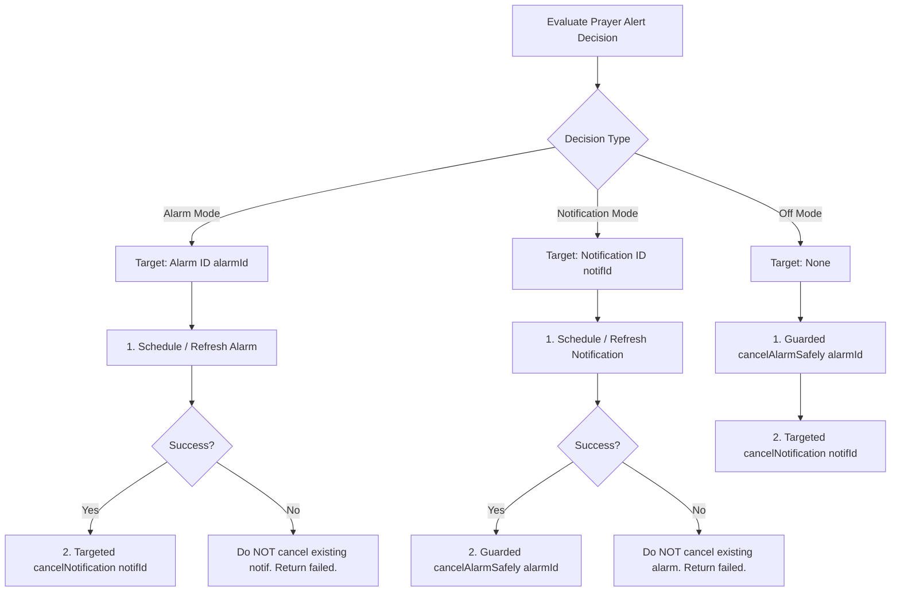

# PHASE 2C.4.2.3 — Implementation Plan
## Targeted Reconciliation & Cross-Session Partial-State Preservation

**Project:** Hafiz Al-Ahd (حافظ العهد)  
**Branch:** `feature/p4.1-independent-alarms-adhan`  
**Phase:** Phase 2C.4.2.3  
**Type:** Architecture Specification & Implementation Plan  
**Status:** PROPOSED — AWAITING SUPERVISOR REVIEW & APPROVAL  
**Execution Timestamp:** 2026-11-08  

---

## 1. Executive Objective & Problem Statement

### 1.1 The Legacy Defect Being Eliminated:
In `lib/features/notifications/domain/usecases/schedule_weekly_prayers_usecase.dart`:
```dart
// Legacy blanket sweep in lines 61–62:
await notificationRepository.cancelAllAlarms();
await notificationRepository.cancelActivePrayerNotification();
```
This legacy sweep created catastrophic side effects:
1. **Destruction of Unrelated Alarms:** Wipes all alarms in `package:alarm`, including the reserved test alarm (ID `888`) and alarms belonging to other features or sessions.
2. **Destruction of Cross-Session Partial State (Test 33 Failure):** If a scheduling session failed on Day 2 after successfully registering Day 2 Fajr, a retry wiped Day 2 Fajr instead of reconciling it.
3. **Premature Audio Interruption:** If the scheduler ran while an Adhan was actively ringing, `cancelAllAlarms()` abruptly killed the active audio stream.
4. **Transition Gaps (Dirty State vulnerability):** During prayer alert mode changes (e.g. Alarm $\leftrightarrow$ Notification), wiping everything destroyed safety boundaries before verifying that the new alert was accepted by the OS.

### 1.2 The Phase 2C.4.2.3 Solution:
Phase 2C.4.2.3 **completely eliminates lines 61–62** and replaces them with a **Fine-Grained Targeted Reconciliation Engine**:
- Evaluates desired vs. existing state per prayer event.
- Executes targeted cancellation strictly by deterministic ID.
- Applies the **Verify-Before-Cancel** pattern (schedules the new alert before cancelling the old opposing alert).
- Strictly preserves unrelated IDs (ID `888`, ID `8888`, ID `999`).

---

## 2. ID Namespace & System Ownership Matrix

The scheduler must strictly enforce ownership boundaries across platform subsystems:

| Subsystem / Purpose | ID Range / Key | Subsystem Owner | Managed By Weekly Scheduler? | Scheduler Policy |
|---|---|---|:---:|---|
| **Prayer Adhan Alarms** | $[26000000, 26999999]$ (offset: `0`) | `package:alarm` | **YES** | Targeted scheduling, refresh, or `cancelAlarmSafely()`. |
| **Prayer Notifications** | $[26000000, 26999999]$ (offset: `1`) | Flutter Local Notifications | **YES** | Targeted scheduling, refresh, or `cancelNotification()`. |
| **Iqama Notifications** | $[26000000, 26999999]$ (offset: `2`) | Flutter Local Notifications | **YES** | Targeted scheduling or cancellation. |
| **Post-Prayer Azkar** | $[26000000, 26999999]$ (offset: `3`) | Flutter Local Notifications | **YES** | Targeted scheduling or cancellation. |
| **Morning Azkar** | $[26000000, 26999999]$ (offset: `4`) | Flutter Local Notifications | **YES** | Targeted scheduling or cancellation. |
| **Evening Azkar** | $[26000000, 26999999]$ (offset: `5`) | Flutter Local Notifications | **YES** | Targeted scheduling or cancellation. |
| **Adhan Preview Alarm** | **`888`** | `package:alarm` | **NO** | **STRICTLY PRESERVED.** Never cancelled by scheduler. |
| **Sticky Adhan Notification** | **`8888`** | Flutter Local Notifications | **NO** | **STRICTLY PRESERVED.** Managed by foreground service. |
| **Home Screen Widget** | **`999`** | Home Widget Provider | **NO** | **STRICTLY PRESERVED.** Unrelated namespace. |
| **Legacy Sequential Alarms** | `1 .. 100` | Legacy `package:alarm` | **NO** | Ignored by modern scheduler; wiped only by legacy migration if designated. |

---

## 3. Seven Desired-State Reconciliation Scenarios

For each prayer ($P \in \{\text{fajr}, \text{dhuhr}, \text{asr}, \text{maghrib}, \text{isha}\}$) on each day:
- $\text{alarmId} = \text{CalendarAlarmIdContract.prayerAlertId}(\text{date}, P, \text{alarm})$
- $\text{notifId} = \text{CalendarAlarmIdContract.prayerAlertId}(\text{date}, P, \text{notification})$



### 3.1 Scenario 1: Existing + Desired Matching (Safe Idempotent No-Op)
- **Condition:** Desired decision matches existing active alert parameters.
- **Action:** In Phase 2C.4.2.3, the deterministic ID ensures that in-place refresh overwrites the platform slot safely without altering other alerts.

### 3.2 Scenario 2: Existing + Desired Changed (Transition & Dirty Dual State)
- **Case 3 & 4 (Transition to Alarm):**
  - Desired: `PrayerAlarmType.alarm`.
  - Opposing/stray: Notification with ID `notifId`.
  - **Reconciliation Protocol:**
    1. Schedule Alarm with ID `alarmId`.
    2. Once Alarm scheduling succeeds, immediately call `notificationRepository.cancelNotification(notifId)`.
    3. Old or stray notification is cleanly decommissioned.
- **Case 6 & 8 (Transition to Notification):**
  - Desired: `PrayerAlarmType.notification`.
  - Opposing/stray: Alarm with ID `alarmId`.
  - **Reconciliation Protocol:**
    1. Schedule Notification with ID `notifId`.
    2. Once Notification scheduling succeeds, immediately call `notificationRepository.cancelAlarmSafely(alarmId)`.
    3. `cancelAlarmSafely` validates ID range ($26000000..26999999$), audio asset ownership, and temporal proximity before cancelling.

### 3.3 Scenario 3: Existing + Desired Absent (Decommissioning / Off Mode)
- **Cases 10, 11, 12:**
  - Desired: `PrayerAlarmType.off` (`PrayerAlertDecision.none`).
  - **Reconciliation Protocol:**
    1. Call `notificationRepository.cancelAlarmSafely(alarmId)`.
    2. Call `notificationRepository.cancelNotification(notifId)`.
    3. Both platform slots are guaranteed empty.
    4. Emits `ScheduleOperationResult.skippedOff(eventId: null)`.

### 3.4 Scenario 4: Existing Absent + Desired Enabled (Fresh Scheduling)
- **Cases 1 & 5:**
  - Schedulers register new Alarm or Notification using deterministic IDs.
  - Zero blanket cancellation calls occur.

### 3.5 Scenario 5: Existing Ringing / Imminent (Active Audio Protection)
- **Condition:** `isProtected(t, isRinging) == true` ($\text{isRinging} \;\lor\; [now - 15s, now + 60s]$).
- **Reconciliation Protocol:**
  - Cancellation and replacement are **strictly suppressed**.
  - `cancelAlarmSafely` returns `false` (suppressed).
  - Scheduler emits `ScheduleOperationResult.skippedImminent`.
  - Day is marked `isComplete == false`, halting the horizon to protect the ringing audio from interruption.

### 3.6 Scenario 6: Failed Replacement (Non-Destruction of Pre-Existing State)
- **Condition:** `scheduleAdhanAlarm` or `schedulePrayerNotification` throws a `PlatformException`.
- **Reconciliation Protocol:**
  - The scheduler **aborts the cancellation step**.
  - The opposing or pre-existing event is **NOT cancelled or deleted**.
  - Emits `ScheduleOperationResult.failed`.
  - Prevents the user from being left with zero alerts due to a failed update.

### 3.7 Scenario 7: Partial Reconciliation & Cross-Session Preservation
- **Test 33 Contract:**
  - If Day 2 Fajr is already scheduled or pre-seeded, and Day 2 calculation fails mid-session:
    - Without blanket cancellation (`cancelAllAlarms()`), Day 2 Fajr remains in the platform registry.
    - Subsequent scheduling retries will NOT wipe Day 2 Fajr.
    - Day 2 is marked `isComplete == false`, capping the horizon at Day 1 until Day 2 completes.

---

## 4. Order of Operations: Verify-Before-Cancel Architecture

To avoid race conditions and transient periods where no alert is registered on the device:

$$\text{Step 1: Dispatch New Alert} \xrightarrow{\text{Success}} \text{Step 2: Targeted Cancel Opposing Alert}$$

```text
Schedule(New Desired Event)
   │
   ├── Success ──> CancelTargeted(Opposing Event ID) ──> Record Operation Success
   │
   └── Failure ──> Suppress Cancellation ─────────────> Record Operation Failure
```

---

## 5. Verification Plan & Test Matrix Realignment

Phase 2C.4.2.3 implementation directly addresses and flips **12 tests from RED to GREEN**:

| Test Group | Test Identifier | Target Assertion | Why It Turns GREEN in 2C.4.2.3 |
|---|---|---|---|
| **Group A** | **Case 3** `[alarm, absent, present]` | `cancelNotificationCalls.contains(oldNotifId)` | Scheduler cancels opposing Notification after Alarm schedules. |
| **Group A** | **Case 4** `[alarm, present, present (dirty)]` | `cancelNotificationCalls.contains(strayNotifId)` | Scheduler cancels stray Notification in dirty state. |
| **Group A** | **Case 6** `[notification, present, absent]` | `cancelAlarmSafelyCalls.contains(oldAlarmId)` | Scheduler cancels opposing Alarm safely after Notification schedules. |
| **Group A** | **Case 8** `[notification, present, present (dirty)]` | `cancelAlarmSafelyCalls.contains(strayAlarmId)` | Scheduler cancels stray Alarm safely in dirty state. |
| **Group A** | **Case 10** `[off, present, absent]` | `cancelAlarmSafelyCalls.contains(alarmId)` | Scheduler decommissions Alarm targetedly when off. |
| **Group A** | **Case 11** `[off, absent, present]` | `cancelNotificationCalls.contains(notifId)` | Scheduler decommissions Notification targetedly when off. |
| **Group A** | **Case 12** `[off, present, present (dirty)]` | Both cancellations called | Scheduler decommissions both events targetedly when off. |
| **Group B** | **Test 13** (No cancelAllAlarms) | `cancelAllAlarmsCallCount == 0` | Legacy line 61 (`cancelAllAlarms()`) is completely eliminated. |
| **Group B** | **Test 15** (Unrelated Alarm 888) | `scheduledAlarms.containsKey(888) == true` | Test alarm 888 is preserved because blanket sweep is gone. |
| **Group D** | **Test 23** (Legacy Blanket Sweep Test) | Pre-existing alarm preserved | Blanket wipe eliminated; pre-existing alarm remains intact. |
| **Group D** | **Test 24b** (Stale Alarm Refresh Failure) | Stale alarm preserved | Refresh failure does not wipe old alarm; old alarm preserved. |
| **Group F** | **Test 33** (Partial State Preservation) | `day2FajrAlarmId` preserved across retries | Blanket cancellation eliminated; pre-existing Day 2 event preserved. |

### Projected Test Suite State:
- **`scheduler_production_path_integration_test.dart`:**
  - Current: **20 PASS / 16 EXPECTED RED**
  - **Post-2C.4.2.3 Target: 32 PASS / 4 EXPECTED RED** (+12 tests turn GREEN!).
- **Remaining 4 EXPECTED RED Tests (Reserved for Phase 2C.4.2.4):**
  - `Test 17`: Case 6 active ringing alarm suppresses cancellation.
  - `Test 18`: Case 6 alarm within $\pm 15\text{s}$ suppresses cancellation.
  - `Test 19`: Case 10 active ringing alarm suppresses cancellation.
  - `Test 20`: Case 10 alarm within $\pm 15\text{s}$ suppresses cancellation.
- **Core Regression Suite (5 files / 80 tests):**
  - Maintained at **80 / 80 PASS (100% GREEN)**.

---

## 6. Implementation Steps (Execution Order)

1. **Step 1: Eliminate Blanket Cancellation in `ScheduleWeeklyPrayersUseCase`:**
   - Remove `await notificationRepository.cancelAllAlarms();` (line 63).
   - Remove `await notificationRepository.cancelActivePrayerNotification();` (line 64).
2. **Step 2: Implement Targeted Desired-State Reconciliation in `_schedulePrayersForDay`:**
   - For `decision == PrayerAlertDecision.alarm`:
     - Schedule Alarm $\to$ on success: `await notificationRepository.cancelNotification(notifId);`.
   - For `decision == PrayerAlertDecision.notification`:
     - Schedule Notification $\to$ on success: `await notificationRepository.cancelAlarmSafely(alarmId);`.
   - For `decision == PrayerAlertDecision.none`:
     - `await notificationRepository.cancelAlarmSafely(alarmId);`
     - `await notificationRepository.cancelNotification(notifId);`
3. **Step 3: Verification & Execution:**
   - Run `scheduler_production_path_integration_test.dart` $\to$ verify **32 PASS / 4 EXPECTED RED**.
   - Run the 80-test regression suite $\to$ verify **80 / 80 PASS**.
   - Run `flutter analyze` $\to$ 0 errors.
4. **Step 4: Present Evidence at STOP GATE 5.**

---

## 7. Strict Gate Boundary

**ZERO PRODUCTION CODE MODIFICATIONS IN `lib/`** will take place until this specification and implementation plan are explicitly reviewed and approved by the engineering supervisor.

