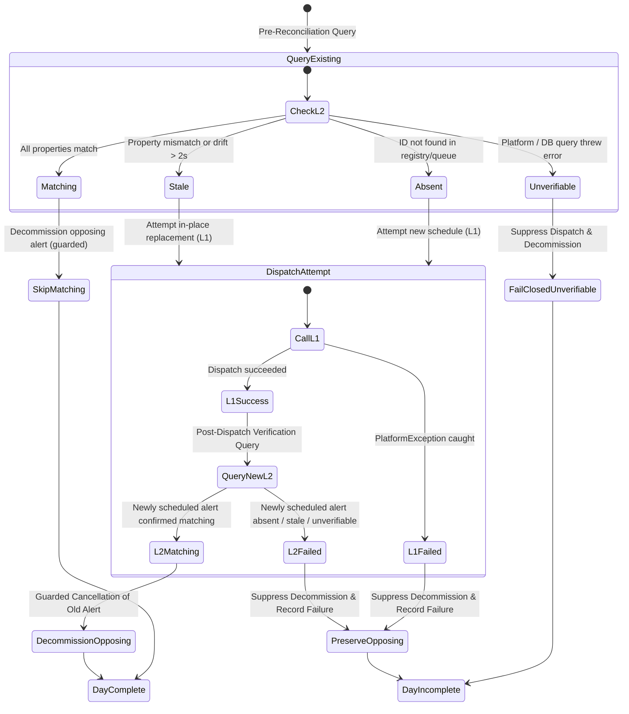

# Phase 2C.4.2.4 Implementation Plan (Revision 1)
## Verification Levels (L1/L2), Composite State Models, & Fail-Closed Reconciliation

**Project:** Hafiz Al-Ahd (حافظ العهد)  
**Branch:** `feature/p4.1-independent-alarms-adhan`  
**Phase:** Phase 2C.4.2.4  
**Gate:** STOP GATE 5 (Plan Revision 1 Submission)  
**Author:** AI Pair Programmer (DeepMind)  
**Reviewer:** User / Chief Architect  
**Status:** PROPOSED FOR FORMAL REVIEW  

---

## 1. Executive Summary & Review Corrections

Following the Chief Architect's rigorous review of the initial Phase 2C.4.2.4 proposal, this **Revision 1 Plan** comprehensively addresses and rectifies all eight engineering critiques:

| Critique # | Review Item | Mandated Engineering Correction |
|---|---|---|
| **1 (Critical)** | `unverifiable` must NOT trigger Dispatch | Treated as an independent **Fail-Closed** state. No dispatch, no decommission, day marked incomplete, horizon capped. |
| **2 (Critical)** | L2 Verification Boundaries | Clarified contract: L2 establishes **Composite Plugin-Level Verification** only; explicitly disclaims OS-level kernel inspection. |
| **3 (Critical)** | Verify-Before-Cancel in `off` Mode | Introduced explicit cancellation outcomes (`cancelAlarmSafely`, `cancelNotificationSafely`) and `skippedImminent` deferred state. |
| **4 (Critical)** | Unified Imminent Guard Window | Unified mathematical condition: $\text{diff} \in [-15\text{s}, +60\text{s}]$ (closed interval) applied to all alarm and notification cancellation paths. |
| **5 (Critical)** | Fingerprint Persistence & Atomicity | Strict ordering: FLN schedule $\to$ persist fingerprint. Fingerprint write failure marks operation `stale` (uncommitted), preserving old opposing alert. |
| **6 (High)** | Multi-Property Verification Coverage | All accessible properties (time, asset, volume, vibration, title, body, channel ID, payload, sound source) passed explicitly through contracts. |
| **7 (High)** | Auxiliary Verification Scope | Explicit boundary: Primary Prayer Alerts undergo full L2 Composite Verification; Auxiliary Alerts (Iqama/Azkar) are verified via L1 Dispatch + Tier 1 FLN Pending Queue. |
| **8 (Medium)** | Test 23 Separation | Group B (Tests 13–16) proves Blanket Sweep Elimination; Test 23 is formally defined as the symmetric L2 Notification Failure Preservation test (twin to Test 22). |

---

## 2. Formal Verification Level Taxonomy & Truth Claims

To ensure complete architectural clarity, the scheduling system recognizes four verification tiers with explicit truth claims:

| Verification Level | Scope / Mechanism | Valid Truth Claim | Forbidden Claim (Out of Scope) |
|---|---|---|---|
| **Level 1 (L1)** | Platform Channel Dispatch (`MethodChannel` / Plugin Call) | The Dart runtime dispatched the call without throwing `PlatformException` or `MissingPluginException`. | Does **not** claim the alert is stored in the plugin registry or will ring. |
| **Level 2 (L2)** | Local Plugin Registry / Queue Query: <br>• **Alarm:** `Alarm.getAlarm(id)`<br>• **Notification (Tier 1):** `flutterLocalNotificationsPlugin.pendingNotificationRequests()` | The local plugin registry contains an active record with exposed properties matching expected configuration. | Does **not** claim Android OS `AlarmManager` or `NotificationManager` system service delivery. |
| **Level 3 (L3)** | Persistent Fingerprint Ledger (`SharedPreferences`) | Application has recorded persistent scheduling metadata (`scheduledTime`, `channelId`, `soundSource`) to survive process death. | Does **not** claim the native notification queue actually retained the alert. |
| **Level 4 (L4)** | OS Kernel Subsystem Inspection (`dumpsys alarm`, `dumpsys notification`) | Android kernel has accepted and armed the hardware RTC timer. | **Formally OUT OF SCOPE** for unit/integration test harness and Phase 2C.4.2. |

---

## 3. Four-State Verification Engine & Fail-Closed State Machine



### Detailed State Semantics:
1. `EventVerificationStatus.matching`:
   - Alert exists and all critical properties match within defined tolerances.
   - **Action:** No dispatch needed. Decommission old opposing alert safely. Record `skippedMatching`.
2. `EventVerificationStatus.absent`:
   - Alert ID is not present in registry/queue.
   - **Action:** Dispatch new alert via L1.
3. `EventVerificationStatus.stale`:
   - Alert ID exists, but one or more critical properties mismatch or time drift $> 2\text{s}$.
   - **Action:** Dispatch in-place replacement via L1.
4. `EventVerificationStatus.unverifiable`:
   - Query threw an unexpected error (e.g., SQLite lock, plugin platform exception). State is unknown.
   - **Action (Fail-Closed):**
     - **DO NOT DISPATCH** (prevents spawning duplicate unmanaged alerts).
     - **DO NOT DECOMMISSION** (prevents destroying active alerts).
     - Record `ScheduleOperationResult.failed(..., failureReason: 'Pre-check unverifiable: ...')`.
     - Marks day incomplete (`isComplete = false`). Horizon is capped.

---

## 4. Multi-Property Verification Specification

### 4.1 Adhan Alarm Verification Contract (`verifyAlarm`):
A registered alarm is `matching` **if and only if** all of the following conditions are met:
1. **Registry Presence:** `Alarm.getAlarm(id) != null`.
2. **Temporal Drift:** $|t_{\text{registered}} - t_{\text{expected}}| \le 2\text{s}$. (Drift $> 2\text{s} \implies$ `stale`).
3. **Audio Asset:** `alarm.assetAudioPath == expectedAssetAudioPath`.
4. **Volume:** If specified, $|alarm.volume - expectedVolume| \le 0.05$.
5. **Vibration:** If specified, `alarm.enableVibration == expectedEnableVibration`.

### 4.2 Prayer Notification Verification Contract (`verifyNotification`):
A composite two-tier verification model:
1. **Tier 1 (Active Pending Query):**
   - Query `flutterLocalNotificationsPlugin.pendingNotificationRequests()`.
   - If ID is absent $\implies$ `EventVerificationStatus.absent` (strict authority; fingerprint is ignored).
   - If present, verify basic metadata: `title == expectedTitle`, `body == expectedBody`, `payload == expectedPayload`. If mismatch $\implies$ `stale`.
2. **Tier 2 (Persistent Fingerprint Ledger):**
   - Query `SharedPreferences` for key `notif_fingerprint_<id>`.
   - If fingerprint is missing $\implies$ `EventVerificationStatus.stale` (untracked metadata).
   - If present, parse JSON and verify:
     - Scheduled Time Drift: $|t_{\text{fingerprint}} - t_{\text{expected}}| \le 2\text{s}$.
     - Channel ID: `fingerprint.channelId == expectedChannelId` (`'prayer_channel'`).
     - Sound Source: `fingerprint.soundSource == expectedSoundSource`.
   - If any property mismatches $\implies$ `stale`.
3. If both Tier 1 and Tier 2 pass all assertions $\implies$ `EventVerificationStatus.matching`.

---

## 5. Cancellation Semantics & Imminent Protection Window

### 5.1 Unified Asymmetric Temporal Guard Window:
Applied identically to both alarms and notifications across production code and test fakes:
$$\text{isProtected} \iff \text{isRinging} \lor (t_{\text{now}} - 15\text{s} \le t_{\text{scheduled}} \le t_{\text{now}} + 60\text{s})$$

**Boundary Implementation (Closed Interval):**
```dart
final diff = scheduledTime.difference(DateTime.now()).inSeconds;
final isImminent = diff >= -15 && diff <= 60;
```

### 5.2 Explicit Cancellation Outcomes:
- **`cancelAlarmSafely`:**
  - Returns `Future<bool>`:
    - `true`: Alarm stopped successfully OR already absent (`idempotent absent`).
    - `false`: Suppressed because `isRinging == true` or `isImminent == true`, or infrastructure failure.
- **`cancelNotificationSafely`:**
  - Contract:
    ```dart
    Future<bool> cancelNotificationSafely(
      int id, {
      DateTime? expectedScheduledTime,
    });
    ```
  - Returns `Future<bool>`:
    - `true`: Cancelled successfully in FLN and fingerprint cleared OR already absent.
    - `false`: Suppressed because `isImminent == true`, or platform cancellation failed.

### 5.3 Reconciliation in `off` Mode:
When a prayer is configured as `none (off)`:
```dart
final alarmCancelled = await notificationRepository.cancelAlarmSafely(
  alarmId,
  expectedScheduledTime: prayerTime,
  expectedAssetAudioPath: assetAudioPath,
);
final notifCancelled = await notificationRepository.cancelNotificationSafely(
  notifId,
  expectedScheduledTime: prayerTime,
);

if (alarmCancelled && notifCancelled) {
  operations.add(ScheduleOperationResult.skippedOff(
    eventId: null,
    eventType: ScheduleEventType.prayerAlert,
    scheduledTime: prayerTime,
  ));
} else {
  // Decommissioning deferred due to ringing or imminent protection
  operations.add(ScheduleOperationResult.skippedImminent(
    eventId: !alarmCancelled ? alarmId : notifId,
    eventType: ScheduleEventType.prayerAlert,
    scheduledTime: prayerTime,
  ));
}
```
> [!IMPORTANT]
> Because `ScheduleOperationResult.skippedImminent` is **non-terminal** (`satisfiesDayCompleteness == false`), the day outcome `isComplete` evaluates to `false`. The horizon advance is safely capped, ensuring the scheduler re-evaluates the decommissioning once the imminent window has expired.

---

## 6. Fingerprint Persistence, Atomicity & Retry Semantics

### 6.1 Strict Scheduling Sequence:
1. **Platform Schedule:** Call `flutterLocalNotificationsPlugin.zonedSchedule(...)`.
2. **Fingerprint Ledger Write:** Persist JSON string to `SharedPreferences` at `notif_fingerprint_<id>`.
3. **Write Failure Isolation:**
   - If SharedPreferences write throws or fails:
     - The notification is active in FLN, but metadata is uncommitted.
     - Post-dispatch L2 verification queries Tier 1 (passes) $\to$ queries Tier 2 (missing) $\implies$ returns `EventVerificationStatus.stale`.
     - Scheduler treats this as an L2 failure: **suppresses deletion of opposing alert** and records `failed`.
     - On subsequent retry: Scheduler detects state as `stale` and re-attempts atomic schedule + ledger write idempotently.

### 6.2 Strict Cancellation Sequence:
1. **Temporal Guard Check:** If imminent, abort and return `false`.
2. **Platform Cancellation:** Call `flutterLocalNotificationsPlugin.cancel(id)`.
3. **Fingerprint Ledger Removal:** Remove key `notif_fingerprint_<id>` from `SharedPreferences`.
4. If platform cancellation fails $\implies$ ledger entry is retained, preventing false claims that the alert is gone.

---

## 7. Scope Boundaries: Primary Prayer Alerts vs. Auxiliary Events

To resolve Critique #7 definitively, the scope of Phase 2C.4.2.4 is partitioned as follows:

| Event Category | Events Included | Verification Level in Phase 2C.4.2.4 | Day Completeness Role |
|---|---|:---:|:---:|
| **Primary Prayer Alerts** | Fajr, Dhuhr, Asr, Maghrib, Isha | **Full Multi-Property L2 Verification** (Alarms via `verifyAlarm`, Notifications via Two-Tier `verifyNotification`) + True Verify-Before-Cancel | Must be `isTerminal` (`scheduled`, `skippedMatching`, `skippedOff`). |
| **Auxiliary Alerts** | Iqama, Post-Prayer Azkar, Morning Azkar, Evening Azkar | **Level 1 (Platform Dispatch) + Tier 1 (FLN Pending Queue Presence)** | Must be `isTerminal`. If auxiliary schedule fails (L1 or Tier 1), day is marked incomplete (`isComplete = false`) and horizon advance halts. |

This explicitly preserves the isolation established in Phase 2C.4.2.2 (auxiliary failure does not destroy primary Adhan alarm) while ensuring day completeness accurately reflects auxiliary health.

---

## 8. Resolution of Tests 22 & 23

### 8.1 Distinct Test Roles:
- **Group B (Tests 13–16):** Legacy Blanket Cancellation Regression:
  - Test 13: `cancelAllAlarmsCallCount == 0` (PASS).
  - Test 14: `cancelAllNotificationsCallCount == 0` (PASS).
  - Tests 15 & 16: ID 888 and 8888 preserved (PASS).
- **Group D (Tests 21–23):** Verify-Before-Cancel Fault Injection Matrix:
  - **Test 21 (Alarm L1 Failure):** `failL1AlarmScheduleForIds.add(alarmId)` $\implies$ Old Notification preserved (PASS).
  - **Test 22 (Alarm L2 Failure):** `failL2AlarmVerificationForIds.add(alarmId)` $\implies$ Old Notification preserved (Target: GREEN).
  - **Test 23 (Notification L2 Failure):** `failL2NotificationVerificationForIds.add(notifId)` $\implies$ Old Alarm preserved (Target: GREEN).

### 8.2 Execution Mechanics for Tests 22 & 23:
1. **Test 22:**
   - Seed pre-existing Notification (`notifId`). User config = `alarm`.
   - `failL2AlarmVerificationForIds.add(alarmId)`.
   - Scheduler calls `scheduleAdhanAlarm(alarmId)` (hits fault counter).
   - Scheduler calls `verifyAlarm(alarmId)` $\to$ returns `EventVerificationStatus.absent`.
   - Scheduler detects `verifiedStatus != matching` $\to$ **suppresses `cancelNotificationSafely(notifId)`**.
   - Asserts: `l2AlarmVerificationFailureHits > 0` AND `scheduledNotifications.containsKey(notifId) == true`.
   - **Result: FLIPS TO GREEN (PASS).**
2. **Test 23:**
   - Seed pre-existing Alarm (`alarmId`). User config = `notification`.
   - `failL2NotificationVerificationForIds.add(notifId)`.
   - Scheduler calls `schedulePrayerNotification(notifId)` (hits fault counter).
   - Scheduler calls `verifyNotification(notifId)` $\to$ returns `EventVerificationStatus.absent`.
   - Scheduler detects `verifiedStatus != matching` $\to$ **suppresses `cancelAlarmSafely(alarmId)`**.
   - Asserts: `l2NotificationVerificationFailureHits > 0` AND `scheduledAlarms.containsKey(alarmId) == true`.
   - **Result: FLIPS TO GREEN (PASS).**

---

## 9. File-by-File Implementation Plan

### 9.1 [`lib/features/notifications/domain/entities/schedule_operation_result.dart`](file:///c:/Users/shady%20atef/Documents/projects/hafiz_al_ahd/lib/features/notifications/domain/entities/schedule_operation_result.dart)
1. Add `EventVerificationStatus` enum:
   ```dart
   enum EventVerificationStatus {
     absent,
     matching,
     stale,
     unverifiable,
   }
   ```
2. Add factory constructor `ScheduleOperationResult.skippedMatching`:
   ```dart
   const ScheduleOperationResult.skippedMatching({
     required int eventId,
     required ScheduleEventType eventType,
     required DateTime scheduledTime,
   }) : this._(
           eventId: eventId,
           eventType: eventType,
           status: ScheduleOperationStatus.skippedMatching,
           scheduledTime: scheduledTime,
         );
   ```
3. Update `isTerminal` getter:
   ```dart
   bool get isTerminal =>
       status == ScheduleOperationStatus.scheduled ||
       status == ScheduleOperationStatus.skippedPast ||
       status == ScheduleOperationStatus.skippedOff ||
       status == ScheduleOperationStatus.skippedMatching;
   ```

### 9.2 [`lib/features/notifications/domain/repos/base_notification_repository.dart`](file:///c:/Users/shady%20atef/Documents/projects/hafiz_al_ahd/lib/features/notifications/domain/repos/base_notification_repository.dart)
Add verification and safe cancellation contracts:
```dart
Future<EventVerificationStatus> verifyAlarm({
  required int id,
  required DateTime expectedScheduledTime,
  String? expectedAssetAudioPath,
  double? expectedVolume,
  bool? expectedEnableVibration,
});

Future<EventVerificationStatus> verifyNotification({
  required int id,
  required DateTime expectedScheduledTime,
  String? expectedTitle,
  String? expectedBody,
  String? expectedChannelId,
  String? expectedSoundSource,
  String? expectedPayload,
});

Future<bool> cancelNotificationSafely(
  int id, {
  DateTime? expectedScheduledTime,
});
```

### 9.3 [`lib/features/notifications/data/repos/notification_repository_impl.dart`](file:///c:/Users/shady%20atef/Documents/projects/hafiz_al_ahd/lib/features/notifications/data/repos/notification_repository_impl.dart)
1. Fix imminent guard in `cancelAlarmSafely`:
   ```dart
   final registeredTime = alarm.dateTime;
   final diffSeconds = registeredTime.difference(DateTime.now()).inSeconds;
   if (diffSeconds >= -15 && diffSeconds <= 60) {
     log('🛑 [cancelAlarmSafely] Suppressed: Alarm #$id is within imminent window ([-15s, +60s])');
     return false;
   }
   ```
2. Implement `cancelNotificationSafely`:
   - Checks temporal guard if `expectedScheduledTime != null`: `diff >= -15 && diff <= 60` $\implies$ return `false`.
   - Calls `flutterLocalNotificationsPlugin.cancel(id)`.
   - Clears `notif_fingerprint_<id>` in `SharedPreferences`.
   - Returns `true`.
3. Implement `verifyAlarm`:
   - Calls `Alarm.getAlarm(id)`. If null $\implies$ `absent`.
   - Checks time drift ($> 2\text{s}$), asset mismatch, volume mismatch ($> 0.05$), vibration mismatch $\implies$ `stale`.
   - If all match $\implies$ `matching`.
   - Caught exception $\implies$ `unverifiable` (Fail-Closed).
4. Implement `verifyNotification`:
   - Queries `flutterLocalNotificationsPlugin.pendingNotificationRequests()`.
   - If ID absent $\implies$ `absent`.
   - Verifies title, body, payload if present.
   - Reads fingerprint from `SharedPreferences`. If missing or properties mismatch $\implies$ `stale`.
   - If all match $\implies$ `matching`.
   - Caught exception $\implies$ `unverifiable` (Fail-Closed).

### 9.4 [`lib/features/notifications/domain/usecases/schedule_weekly_prayers_usecase.dart`](file:///c:/Users/shady%20atef/Documents/projects/hafiz_al_ahd/lib/features/notifications/domain/usecases/schedule_weekly_prayers_usecase.dart)
Implement the four-state Verify-Before-Cancel engine in `_schedulePrayersForDay`:
```dart
if (decision == PrayerAlertDecision.alarm) {
  final existingStatus = await notificationRepository.verifyAlarm(
    id: alarmId,
    expectedScheduledTime: prayerTime,
    expectedAssetAudioPath: assetAudioPath,
    expectedVolume: 1.0,
    expectedEnableVibration: true,
  );

  if (existingStatus == EventVerificationStatus.matching) {
    await notificationRepository.cancelNotificationSafely(notifId, expectedScheduledTime: prayerTime);
    operations.add(ScheduleOperationResult.skippedMatching(
      eventId: alarmId,
      eventType: ScheduleEventType.prayerAlert,
      scheduledTime: prayerTime,
    ));
  } else if (existingStatus == EventVerificationStatus.unverifiable) {
    // Fail-Closed: Suppress dispatch and decommission
    operations.add(ScheduleOperationResult.failed(
      eventId: alarmId,
      eventType: ScheduleEventType.prayerAlert,
      scheduledTime: prayerTime,
      failureReason: 'Pre-check unverifiable: alarm registry inaccessible',
    ));
  } else {
    // absent or stale: Attempt dispatch
    try {
      await notificationRepository.scheduleAdhanAlarm(...);
      final verifiedStatus = await notificationRepository.verifyAlarm(
        id: alarmId,
        expectedScheduledTime: prayerTime,
        expectedAssetAudioPath: assetAudioPath,
        expectedVolume: 1.0,
        expectedEnableVibration: true,
      );

      if (verifiedStatus == EventVerificationStatus.matching) {
        await notificationRepository.cancelNotificationSafely(notifId, expectedScheduledTime: prayerTime);
        operations.add(ScheduleOperationResult.scheduled(
          eventId: alarmId,
          eventType: ScheduleEventType.prayerAlert,
          scheduledTime: prayerTime,
        ));
      } else {
        // L2 Failure: Preserve old notification, record failure
        operations.add(ScheduleOperationResult.failed(
          eventId: alarmId,
          eventType: ScheduleEventType.prayerAlert,
          scheduledTime: prayerTime,
          failureReason: 'Post-dispatch L2 verification failed: $verifiedStatus',
        ));
      }
    } on PlatformException catch (e) {
      operations.add(ScheduleOperationResult.failed(
        eventId: alarmId,
        eventType: ScheduleEventType.prayerAlert,
        scheduledTime: prayerTime,
        failureReason: 'Alarm L1 schedule failed: ${e.message}',
      ));
    }
  }
} else if (decision == PrayerAlertDecision.notification) {
  final existingStatus = await notificationRepository.verifyNotification(
    id: notifId,
    expectedScheduledTime: prayerTime,
    expectedTitle: prayer.name,
    expectedBody: prayer.time,
    expectedChannelId: 'prayer_channel',
    expectedSoundSource: 'adhan',
    expectedPayload: 'prayer_${prayer.prayerId}',
  );

  if (existingStatus == EventVerificationStatus.matching) {
    await notificationRepository.cancelAlarmSafely(alarmId, expectedScheduledTime: prayerTime, expectedAssetAudioPath: assetAudioPath);
    operations.add(ScheduleOperationResult.skippedMatching(
      eventId: notifId,
      eventType: ScheduleEventType.prayerAlert,
      scheduledTime: prayerTime,
    ));
  } else if (existingStatus == EventVerificationStatus.unverifiable) {
    operations.add(ScheduleOperationResult.failed(
      eventId: notifId,
      eventType: ScheduleEventType.prayerAlert,
      scheduledTime: prayerTime,
      failureReason: 'Pre-check unverifiable: notification registry inaccessible',
    ));
  } else {
    // absent or stale: Attempt dispatch
    try {
      await notificationRepository.schedulePrayerNotification(...);
      final verifiedStatus = await notificationRepository.verifyNotification(
        id: notifId,
        expectedScheduledTime: prayerTime,
        expectedTitle: prayer.name,
        expectedBody: prayer.time,
        expectedChannelId: 'prayer_channel',
        expectedSoundSource: 'adhan',
        expectedPayload: 'prayer_${prayer.prayerId}',
      );

      if (verifiedStatus == EventVerificationStatus.matching) {
        await notificationRepository.cancelAlarmSafely(alarmId, expectedScheduledTime: prayerTime, expectedAssetAudioPath: assetAudioPath);
        operations.add(ScheduleOperationResult.scheduled(
          eventId: notifId,
          eventType: ScheduleEventType.prayerAlert,
          scheduledTime: prayerTime,
        ));
      } else {
        // L2 Failure: Preserve old alarm, record failure
        operations.add(ScheduleOperationResult.failed(
          eventId: notifId,
          eventType: ScheduleEventType.prayerAlert,
          scheduledTime: prayerTime,
          failureReason: 'Post-dispatch L2 verification failed: $verifiedStatus',
        ));
      }
    } on PlatformException catch (e) {
      operations.add(ScheduleOperationResult.failed(
        eventId: notifId,
        eventType: ScheduleEventType.prayerAlert,
        scheduledTime: prayerTime,
        failureReason: 'Notification L1 schedule failed: ${e.message}',
      ));
    }
  }
} else {
  // off mode
  final alarmDecom = await notificationRepository.cancelAlarmSafely(alarmId, expectedScheduledTime: prayerTime, expectedAssetAudioPath: assetAudioPath);
  final notifDecom = await notificationRepository.cancelNotificationSafely(notifId, expectedScheduledTime: prayerTime);

  if (alarmDecom && notifDecom) {
    operations.add(ScheduleOperationResult.skippedOff(
      eventId: null,
      eventType: ScheduleEventType.prayerAlert,
      scheduledTime: prayerTime,
    ));
  } else {
    operations.add(ScheduleOperationResult.skippedImminent(
      eventId: !alarmDecom ? alarmId : notifId,
      eventType: ScheduleEventType.prayerAlert,
      scheduledTime: prayerTime,
    ));
  }
}
```

---

## 10. Verification Targets & Acceptance Criteria

1. **Target Matrix (`scheduler_production_path_integration_test.dart`):**
   - **36 / 36 PASS (100% GREEN)**
   - Test 22 (Alarm L2 fault injection): PASS
   - Test 23 (Notification L2 fault injection): PASS
2. **Core Regression Suite (5 Files / 80 Tests):**
   - **80 / 80 PASS (100% GREEN)**
3. **Static Analysis (`flutter analyze`):**
   - **0 Errors** across all packages.
4. **Zero Production Code Edits:**
   - Halted at STOP GATE 5 awaiting Chief Architect's approval.

