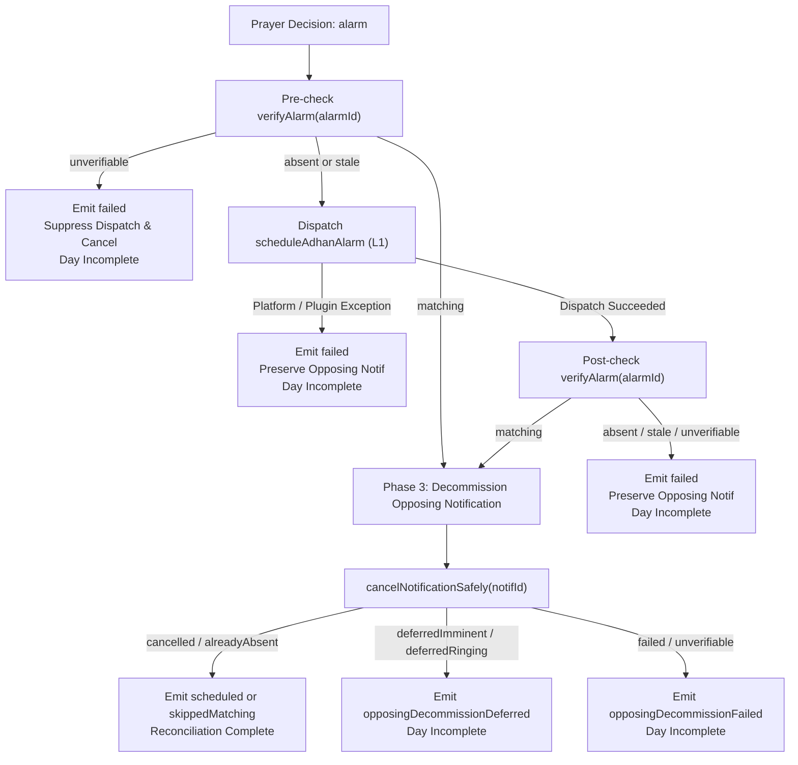

# Phase 2C.4.2.4 Implementation Plan (Revision 2)
## Two-Phase Atomic Reconciliation, Typed Cancellation Outcomes, & Actual-Time Protection

**Project:** Hafiz Al-Ahd (حافظ العهد)  
**Branch:** `feature/p4.1-independent-alarms-adhan`  
**Phase:** Phase 2C.4.2.4  
**Gate:** STOP GATE 5 (Plan Revision 2 Submission)  
**Author:** AI Pair Programmer (DeepMind)  
**Reviewer:** User / Chief Architect  
**Status:** PROPOSED FOR FORMAL REVIEW  

---

## 1. Executive Summary & Resolution of Architecture Critiques

Following the Chief Architect's engineering review of Revision 1, this **Revision 2 Plan** resolves all four critical architecture flaws and four secondary issues, anchoring the reconciliation engine on a fundamental invariant:

> **Core Invariant:**  
> A prayer alert reconciliation operation is complete **if and only if** the desired alert is verified **AND** the opposing alert is confirmed cleanly decommissioned (`cancelled` or `alreadyAbsent`).  
> Success of the newly scheduled alert alone is insufficient to declare reconciliation complete.

```text
Desired Event Verification (L2 Matching)
                │
                ▼
Opposing Event Decommissioning (Typed Result)
                │
       ┌────────┴────────┐
       ▼                 ▼
   Clean              Deferred / Failed / Unverifiable
(cancelled / absent)             │
       │                         ▼
       ▼                  Operation Incomplete
Reconciliation Complete   Day Incomplete
Day Can Be Complete       Horizon Capped
Horizon Can Advance
```

---

## 2. Summary of Revision 2 Corrections

| # | Critique Issue | Mandated Architectural Solution in Revision 2 |
|---|---|---|
| **1 (Critical)** | Opposing Event Decommission Failure Swallowed | **Two-Phase Atomic Reconciliation:** Desired event verification + opposing event decommissioning. If opposing cancellation is deferred or failed, operation emits `opposingDecommissionDeferred` or `opposingDecommissionFailed` (`satisfiesDayCompleteness = false`). Day remains incomplete. |
| **2 (Critical)** | Boolean Cancellation Conflation | **Rich Typed Cancellation Outcome:** Replaced `Future<bool>` with `EventCancellationStatus` enum (`cancelled`, `alreadyAbsent`, `deferredImminent`, `deferredRinging`, `failed`, `unverifiable`). |
| **3 (Critical)** | Imminent Guard Used Expected Time & Truncated Seconds | **Actual Registered Scheduled Time & Duration Math:** Alarm uses `alarm.dateTime`; Notification uses persistent fingerprint scheduled time (Fail-Closed if missing: `unverifiable`). Exact `Duration` comparison on closed interval $[-15\text{s}, +60\text{s}]$. |
| **4 (Critical)** | Stale Same-ID Replacement Safety | **Characterization & In-Place Protection:** Same-ID dispatch is executed without pre-cancelling the stale alert. If dispatch throws or verification fails, the stale alert remains intact. Operation records `failed`. |
| **5 (High)** | Infrastructure Exception Policy | Unified catching of `PlatformException` and `MissingPluginException`. Domain errors (`ArgumentError`, `StateError`) bubble up unswallowed. |
| **6 (High)** | Auxiliary Verification Health | Auxiliary queue query exceptions produce `failed` / `unverifiable`, ensuring `DaySchedulingOutcome.isComplete = false`. |
| **7 (High)** | Fingerprint Ledger Cleanup Failure | Tier 1 (FLN pending queue) remains absolute presence authority. Orphaned fingerprints never produce false `matching` claims. |
| **8 (High)** | Expanded Fault-Injection Test Matrix | Expanded to cover all new failure, deferral, and verification branches. |

---

## 3. Typed Cancellation Model (`EventCancellationStatus`)

```dart
// lib/features/notifications/domain/entities/schedule_operation_result.dart

enum EventCancellationStatus {
  /// Event was active in the registry/queue and was successfully cancelled.
  cancelled,

  /// Event was verified absent prior to cancellation (idempotent clean state).
  alreadyAbsent,

  /// Cancellation suppressed: actual event time is within [-15s, +60s] window.
  deferredImminent,

  /// Cancellation suppressed: alarm audio is currently playing.
  deferredRinging,

  /// Platform or infrastructure exception occurred during cancellation.
  failed,

  /// Pre-cancellation state query threw an infrastructure exception (Fail-Closed).
  unverifiable,
}

extension EventCancellationStatusX on EventCancellationStatus {
  /// Proves the event no longer exists on the device.
  bool get isSuccessful =>
      this == EventCancellationStatus.cancelled ||
      this == EventCancellationStatus.alreadyAbsent;

  /// Proves the cancellation was intentionally deferred to protect user audio.
  bool get isDeferred =>
      this == EventCancellationStatus.deferredImminent ||
      this == EventCancellationStatus.deferredRinging;
}
```

---

## 4. Operation Outcome Model & Invariant Rules

### 4.1 Enhanced `ScheduleOperationStatus`:
```dart
enum ScheduleOperationStatus {
  scheduled,
  skippedPast,
  skippedOff,
  skippedMatching,
  skippedImminent,
  opposingDecommissionDeferred, // Desired alert verified, but opposing alert is ringing/imminent
  opposingDecommissionFailed,   // Desired alert verified, but opposing cancellation failed/unverifiable
  failed,
}
```

### 4.2 Terminal Completeness Invariant:
```dart
bool get satisfiesDayCompleteness =>
    status == ScheduleOperationStatus.scheduled ||
    status == ScheduleOperationStatus.skippedPast ||
    status == ScheduleOperationStatus.skippedOff ||
    status == ScheduleOperationStatus.skippedMatching;

bool get isDeferred =>
    status == ScheduleOperationStatus.skippedImminent ||
    status == ScheduleOperationStatus.opposingDecommissionDeferred;

bool get isFailure =>
    status == ScheduleOperationStatus.failed ||
    status == ScheduleOperationStatus.opposingDecommissionFailed;
```

> [!IMPORTANT]
> If opposing alert decommissioning yields `deferredImminent`, `deferredRinging`, `failed`, or `unverifiable`, the operation emits `opposingDecommissionDeferred` or `opposingDecommissionFailed`. Neither status is terminal (`satisfiesDayCompleteness == false`). Consequently, `DaySchedulingOutcome.isComplete` evaluates to `false`, and the completion horizon `scheduled_until_date` **cannot advance past this day**.

---

## 5. Actual-Time Temporal Guard & Closed Duration Boundary

### 5.1 Exact Duration Boundary Math:
```dart
static bool isWithinImminentWindow(DateTime actualScheduledTime, DateTime now) {
  final difference = actualScheduledTime.difference(now);
  return difference >= const Duration(seconds: -15) &&
         difference <= const Duration(seconds: 60);
}
```
**Boundary Assertions:**
- $now - 15\text{s}$ (exact): $\text{difference} = -15\text{s} \implies$ **Protected**.
- $now + 60\text{s}$ (exact): $\text{difference} = +60\text{s} \implies$ **Protected**.
- $now - 15\text{s} - 1\mu\text{s}$: $\text{difference} < -15\text{s} \implies$ **Unprotected**.
- $now + 60\text{s} + 1\mu\text{s}$: $\text{difference} > +60\text{s} \implies$ **Unprotected**.
- No integer truncation errors from `.inSeconds`.

### 5.2 Source of Actual Scheduled Time:
1. **For Alarms:**
   - Query `Alarm.getAlarm(id)`.
   - If `null` $\implies$ `alreadyAbsent`.
   - If present $\implies$ `alarm.dateTime` is the authoritative actual scheduled time.
2. **For Notifications:**
   - Query Tier 1: `flutterLocalNotificationsPlugin.pendingNotificationRequests()`.
   - If not found $\implies$ `alreadyAbsent`.
   - If found: Retrieve actual scheduled time from persistent fingerprint ledger (`notif_fingerprint_<id>`).
   - **Fail-Closed Fallback:** If the notification is present in the queue but the fingerprint is missing or unreadable, we cannot prove it is *not* imminent $\implies$ return `EventCancellationStatus.unverifiable` (suppressing cancellation).

---

## 6. Stale Same-ID Replacement Safety Policy

When an existing alert with deterministic ID $X$ is determined to be `stale` (e.g., calculation time changed or asset path updated):
1. **No Pre-Cancellation:** The scheduler **never** calls `cancel` or `stop` on the stale alert before the new alert is scheduled.
2. **In-Place Replacement:** Dispatches `scheduleAdhanAlarm(X, ...)` or `schedulePrayerNotification(X, ...)`.
3. **Failure Isolation:**
   - If dispatch throws `PlatformException` or `MissingPluginException`:
     - The dispatch call aborted.
     - The old alert is **NOT wiped** by our code.
     - The operation records `ScheduleOperationResult.failed(...)`.
     - The opposing alert is **NOT touched**.
     - Day outcome is marked incomplete; horizon is capped.
4. **Post-Dispatch Verification:**
   - Queries `verifyAlarm(X)` or `verifyNotification(X)`.
   - If verification confirms `matching` $\implies$ Proceed to Phase 3 (opposing decommission).
   - If verification returns `stale`, `absent`, or `unverifiable` $\implies$ Operation records `failed`. Opposing alert remains strictly preserved.

---

## 7. Two-Phase Reconciliation State Machine in Scheduler

### 7.1 Decision = `alarm`



### 7.2 Decision = `notification`
Symmetric to `alarm`:
1. Pre-check existing notification via `verifyNotification(...)`.
   - If `unverifiable` $\implies$ emit `failed` (Fail-Closed).
   - If `matching` $\implies$ proceed to Phase 3.
2. If `absent` or `stale` $\implies$ dispatch `schedulePrayerNotification`, then post-verify via `verifyNotification(...)`.
   - If post-verify != `matching` $\implies$ emit `failed`, preserve old alarm.
   - If post-verify == `matching` $\implies$ proceed to Phase 3.
3. Phase 3: Decommission opposing alarm via `cancelAlarmSafely(alarmId)`.
   - If `cancelled` or `alreadyAbsent` $\implies$ emit `scheduled` or `skippedMatching` (Complete!).
   - If `deferredImminent` or `deferredRinging` $\implies$ emit `opposingDecommissionDeferred` (Incomplete).
   - If `failed` or `unverifiable` $\implies$ emit `opposingDecommissionFailed` (Incomplete).

### 7.3 Decision = `none (off)`
```dart
final alarmCancelResult = await notificationRepository.cancelAlarmSafely(alarmId);
final notifCancelResult = await notificationRepository.cancelNotificationSafely(notifId);

if (alarmCancelResult.isSuccessful && notifCancelResult.isSuccessful) {
  operations.add(ScheduleOperationResult.skippedOff(
    eventId: null,
    eventType: ScheduleEventType.prayerAlert,
    scheduledTime: prayerTime,
  ));
} else if (alarmCancelResult.isDeferred || notifCancelResult.isDeferred) {
  operations.add(ScheduleOperationResult.skippedImminent(
    eventId: alarmCancelResult.isDeferred ? alarmId : notifId,
    eventType: ScheduleEventType.prayerAlert,
    scheduledTime: prayerTime,
  ));
} else {
  operations.add(ScheduleOperationResult.failed(
    eventId: !alarmCancelResult.isSuccessful ? alarmId : notifId,
    eventType: ScheduleEventType.prayerAlert,
    scheduledTime: prayerTime,
    failureReason: 'Decommission failed in off mode: alarm=$alarmCancelResult, notif=$notifCancelResult',
  ));
}
```

---

## 8. Auxiliary Events Scope & Health Contract

1. **Scope:** Primary Prayer Alerts undergo full L2 Composite Multi-Property Verification. Auxiliary Events (Iqama, Post-Prayer Azkar, Morning Azkar, Evening Azkar) are verified via:
   - **L1 Dispatch:** Call `schedulePrayerNotification` with auxiliary payload.
   - **Tier 1 Presence:** Query `flutterLocalNotificationsPlugin.pendingNotificationRequests()`.
2. **Failure Handling:**
   - If L1 throws `PlatformException` or `MissingPluginException`, or Tier 1 query throws $\implies$ record `ScheduleOperationResult.failed(...)`.
   - If Tier 1 query does not contain auxiliary ID $\implies$ record `ScheduleOperationResult.failed(...)`.
   - Day outcome `isComplete` evaluates to `false` (attempted < expected operations).
   - Horizon advancement is capped.
   - Primary Adhan alarm is strictly preserved (isolated auxiliary failure).

---

## 9. Comprehensive Fault-Injection Test Matrix

| Test Identifier | Category | Scenario / Injected Condition | Expected Behavior & Assertions |
|---|---|---|---|
| **Test 21** | Group D | New Alarm L1 failure (`failL1AlarmScheduleForIds.add(alarmId)`) | Platform error caught; old notification preserved; operation failed. |
| **Test 22** | Group D | New Alarm L2 failure (`failL2AlarmVerificationForIds.add(alarmId)`) | `verifyAlarm` returns `absent`; cancel suppressed; old notification preserved. |
| **Test 23** | Group D | New Notification L2 failure (`failL2NotificationVerificationForIds.add(notifId)`) | `verifyNotification` returns `absent`; cancel suppressed; old alarm preserved. |
| **Test 24a** | Group D | Stale Alarm In-place refresh deterministic ID check | Scheduler dispatches to deterministic ID `alarmId`. |
| **Test 24b** | Group D | Stale Alarm refresh failure (L1 error) | Old 4:30 alarm preserved intact; status remains `stale`; horizon capped. |
| **Test 24c** | Group D | Notification L2 Two-Tier verification | Validates FLN pending queue + persistent fingerprint ledger. |
| **Test 24d** | Group D | Desired Alarm verified matching, but opposing Notification cancel fails | Operation emits `opposingDecommissionFailed`; day incomplete; horizon capped. |
| **Test 24e** | Group D | Desired Alarm verified matching, but opposing Notification is imminent | Operation emits `opposingDecommissionDeferred`; day incomplete; horizon capped. |
| **Test 24f** | Group D | Pre-check `verifyAlarm` returns `unverifiable` | Fail-Closed: no dispatch call, no decommission call, day incomplete. |

---

## 10. File-by-File Implementation Plan

### 10.1 [`lib/features/notifications/domain/entities/schedule_operation_result.dart`](file:///c:/Users/shady%20atef/Documents/projects/hafiz_al_ahd/lib/features/notifications/domain/entities/schedule_operation_result.dart)
- Add `EventVerificationStatus` enum (`absent`, `matching`, `stale`, `unverifiable`).
- Add `EventCancellationStatus` enum (`cancelled`, `alreadyAbsent`, `deferredImminent`, `deferredRinging`, `failed`, `unverifiable`) with `isSuccessful` and `isDeferred` getters.
- Add `ScheduleOperationStatus.opposingDecommissionDeferred` and `opposingDecommissionFailed`.
- Add factory constructors `ScheduleOperationResult.opposingDecommissionDeferred(...)` and `ScheduleOperationResult.opposingDecommissionFailed(...)`.
- Update `satisfiesDayCompleteness` and `isDeferred`.

### 10.2 [`lib/features/notifications/domain/repos/base_notification_repository.dart`](file:///c:/Users/shady%20atef/Documents/projects/hafiz_al_ahd/lib/features/notifications/domain/repos/base_notification_repository.dart)
- Update return types of cancellation methods to `Future<EventCancellationStatus>`:
  ```dart
  Future<EventCancellationStatus> cancelAlarmSafely(
    int id, {
    String? expectedAssetAudioPath,
  });

  Future<EventCancellationStatus> cancelNotificationSafely(int id);
  ```
- Declare verification contracts:
  ```dart
  Future<EventVerificationStatus> verifyAlarm({
    required int id,
    required DateTime expectedScheduledTime,
    String? expectedAssetAudioPath,
    double? expectedVolume,
    bool? expectedEnableVibration,
  });

  Future<EventVerificationStatus> verifyNotification({
    required int id,
    required DateTime expectedScheduledTime,
    String? expectedTitle,
    String? expectedBody,
    String? expectedChannelId,
    String? expectedSoundSource,
    String? expectedPayload,
  });
  ```

### 10.3 [`lib/features/notifications/data/repos/notification_repository_impl.dart`](file:///c:/Users/shady%20atef/Documents/projects/hafiz_al_ahd/lib/features/notifications/data/repos/notification_repository_impl.dart)
- Implement `cancelAlarmSafely` returning `EventCancellationStatus`:
  - Check ringing: `Alarm.isRinging(id)` $\implies$ return `EventCancellationStatus.deferredRinging`.
  - Check actual registered time: if `diff >= -15s && diff <= 60s` $\implies$ return `EventCancellationStatus.deferredImminent`.
  - Call `Alarm.stop(id)` $\implies$ return `EventCancellationStatus.cancelled`.
  - Platform/DB error $\implies$ return `EventCancellationStatus.failed`.
- Implement `cancelNotificationSafely` returning `EventCancellationStatus`:
  - Query FLN pending requests. If absent $\implies$ return `EventCancellationStatus.alreadyAbsent`.
  - Read fingerprint to get actual scheduled time. If missing $\implies$ return `EventCancellationStatus.unverifiable` (Fail-Closed).
  - If actual time within $[-15\text{s}, +60\text{s}]$ $\implies$ return `EventCancellationStatus.deferredImminent`.
  - Call `flutterLocalNotificationsPlugin.cancel(id)`.
  - Remove fingerprint key from `SharedPreferences`.
  - Return `EventCancellationStatus.cancelled`.
- Implement `verifyAlarm` and `verifyNotification` handling all multi-property checks and wrapping unexpected infrastructure errors into `EventVerificationStatus.unverifiable`.

### 10.4 [`lib/features/notifications/domain/usecases/schedule_weekly_prayers_usecase.dart`](file:///c:/Users/shady%20atef/Documents/projects/hafiz_al_ahd/lib/features/notifications/domain/usecases/schedule_weekly_prayers_usecase.dart)
- Implement Two-Phase Atomic Reconciliation across `alarm`, `notification`, and `off` modes as specified in Section 7.
- Handle `unverifiable` as Fail-Closed.
- Catch `PlatformException` and `MissingPluginException`. Allow domain errors to bubble up.

---

## 11. Acceptance Criteria & Pre-Execution Gate

1. **Target Matrix (`scheduler_production_path_integration_test.dart`):**
   - **100% PASS** across all matrix cases including Tests 22, 23, 24a–24f.
2. **Core Regression Suite (5 Files / 80 Tests):**
   - **80 / 80 PASS (100% GREEN)**.
3. **Static Analysis (`flutter analyze`):**
   - **0 Errors** across `lib/features/notifications/`.
4. **Production Code Freeze:**
   - **Zero edits in `lib/` will be made until this Revision 2 plan is formally approved.**

