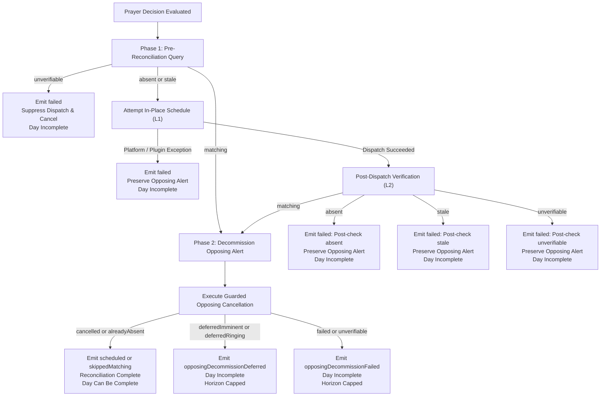

# Phase 2C.4.2.4 Implementation Plan (Revision 3)
## Two-Phase Atomic Reconciliation, Fail-Closed Verification, & Strict Evidence Boundaries

**Project:** Hafiz Al-Ahd (حافظ العهد)  
**Branch:** `feature/p4.1-independent-alarms-adhan`  
**Phase:** Phase 2C.4.2.4  
**Gate:** STOP GATE 5 (Plan Revision 3 Submission)  
**Author:** AI Pair Programmer (DeepMind)  
**Reviewer:** User / Chief Architect  
**Status:** PROPOSED FOR FORMAL REVIEW  

---

## 1. Executive Summary & Resolution of Revision 2 Critiques

Following the Chief Architect's thorough review of Revision 2, this **Revision 3 Plan** resolves the four critical blockers and all secondary requirements, establishing a fail-closed reconciliation engine that strictly bounds its truth claims to verifiable evidence:

| # | Architecture Issue | Resolution in Revision 3 |
|---|---|---|
| **1 (Critical)** | Notification Actual-Time Evidence Contract | Acknowledged that `SharedPreferences` fingerprint is **application-side metadata**, not independent OS kernel proof. Bound via `schedulingInstanceId`. If pending request exists but fingerprint is missing/unreadable, cancellation fails closed as `EventCancellationStatus.unverifiable` (suppressing cancellation). |
| **2 (Critical)** | Same-ID Replacement Safety | Formally characterized in-place replacement behavior. If dispatch throws or post-verification is not `matching`, operation fails closed. Opposing alert is **never** decommissioned, serving as a redundant safety lifeboat. |
| **3 (Critical)** | Disentangling `absent` vs `unverifiable` | Explicitly partitioned: `absent` = query confirms record missing; `unverifiable` = query threw infrastructure exception. Both suppress opposing decommission, but emit distinct diagnostic outcomes. |
| **4 (High)** | Off-Mode Precedence | Strict aggregate precedence: $\text{Failed / Unverifiable} > \text{Deferred} > \text{Clean}$. Infrastructure failure is never hidden behind a deferral. |
| **5 (High)** | Fingerprint Cleanup Recovery | Tier 1 (FLN queue) is absolute authority for existence. Orphaned fingerprints without pending requests return `absent`. Cleanup failure returns `failed`. |
| **6 (High)** | Domain Exception Policy | Catch blocks restricted strictly to `PlatformException` and `MissingPluginException`. `ArgumentError` and `StateError` bubble up unswallowed. |
| **7 (High)** | Expanded Fault Matrix | Expanded to include Tests 22a/b, 23a/b, and 24a through 24p covering all failure, deferral, and precedence paths. |

---

## 2. Evidence Boundaries & Truth Claims

```text
┌─────────────────────────────────────────────────────────────────────────────┐
│ Level 1: Platform Channel Dispatch (L1)                                      │
│ • Truth Claim: MethodChannel call returned without platform exception.      │
│ • Limitation: Does NOT prove storage in plugin registry or OS armed timer.  │
├─────────────────────────────────────────────────────────────────────────────┤
│ Level 2: Local Plugin Registry / Queue Query (L2)                           │
│ • Alarm Truth Claim: Alarm.getAlarm(id) returned matching record in SQLite. │
│ • Notification Tier 1 Claim: FLN pendingNotificationRequests() has ID.      │
│ • Notification Tier 2 Claim: App SharedPreferences has matching fingerprint. │
│ • Limitation: Application-side metadata only; does NOT inspect Android OS   │
│   AlarmManager / NotificationManager kernel system services (L4).           │
└─────────────────────────────────────────────────────────────────────────────┘
```

### 2.1 Notification Fingerprint Integrity & Version Binding:
Each fingerprint payload stored in `SharedPreferences` at `notif_fingerprint_<id>` contains:
```json
{
  "id": 26110901,
  "schedulingInstanceId": "26110901_20261109T050000_1731109200000",
  "scheduledTimeIso": "2026-11-09T05:00:00.000",
  "channelId": "prayer_channel",
  "soundSource": "adhan",
  "title": "الفجر",
  "body": "05:00"
}
```
- **Stale Fingerprint Shield:** If `pendingNotificationRequests()` contains the ID, but the fingerprint is missing, unparseable, or its `schedulingInstanceId` does not match the active session, the notification is classified as `EventVerificationStatus.stale`.
- **Imminent Guard Fail-Closed Policy:** In `cancelNotificationSafely`, if Tier 1 finds the notification present but Tier 2 fingerprint is missing, we **cannot prove** the notification is not imminent $\implies$ cancellation is suppressed, returning `EventCancellationStatus.unverifiable`.

---

## 3. The Two-Phase Atomic Reconciliation Invariant



### Invariant Definition:
A prayer alert reconciliation operation is complete (`satisfiesDayCompleteness == true`) **if and only if**:
1. The desired alert is verified as `EventVerificationStatus.matching`.
2. The opposing alert is verified as cleanly decommissioned (`EventCancellationStatus.cancelled` or `EventCancellationStatus.alreadyAbsent`).

If condition 1 fails $\implies$ opposing decommission is aborted (opposing alert preserved as lifeboat). Operation records `failed`.  
If condition 2 fails $\implies$ operation records `opposingDecommissionDeferred` or `opposingDecommissionFailed`. Day outcome is incomplete (`DaySchedulingOutcome.isComplete == false`).

---

## 4. Cancellation Model & Actual-Time Temporal Guard

### 4.1 Typed Cancellation Status:
```dart
// lib/features/notifications/domain/entities/schedule_operation_result.dart

enum EventCancellationStatus {
  cancelled,        // Event was active in registry/queue and successfully cancelled
  alreadyAbsent,    // Event was verified absent prior to cancellation (idempotent clean)
  deferredImminent, // Cancellation suppressed: actual time within [-15s, +60s]
  deferredRinging,  // Cancellation suppressed: alarm is actively playing audio
  failed,           // PlatformException or MissingPluginException during cancellation
  unverifiable,     // Pre-cancellation query threw exception or metadata unreadable
}

extension EventCancellationStatusX on EventCancellationStatus {
  bool get isSuccessful =>
      this == EventCancellationStatus.cancelled ||
      this == EventCancellationStatus.alreadyAbsent;

  bool get isDeferred =>
      this == EventCancellationStatus.deferredImminent ||
      this == EventCancellationStatus.deferredRinging;
}
```

### 4.2 Exact Duration Boundary Math (No Integer Truncation):
```dart
static bool isWithinImminentWindow(DateTime actualScheduledTime, DateTime now) {
  final difference = actualScheduledTime.difference(now);
  return difference >= const Duration(seconds: -15) &&
         difference <= const Duration(seconds: 60);
}
```
- Exactly $-15\text{s}$: **Protected**
- Exactly $+60\text{s}$: **Protected**
- $-15\text{s} - 1\mu\text{s}$: **Unprotected**
- $+60\text{s} + 1\mu\text{s}$: **Unprotected**

### 4.3 Actual Scheduled Time Source:
- **Alarm:** `alarm.dateTime` from `Alarm.getAlarm(id)`.
- **Notification:** `fingerprint.scheduledTime` from `SharedPreferences`. If missing $\implies$ `EventCancellationStatus.unverifiable`.

---

## 5. Same-ID Replacement Characterization & Safety Strategy

### 5.1 Plugin Behavior Under Same-ID Dispatch:
1. `package:alarm`: `Alarm.set()` replaces the record with the same ID. If the native Android call throws `PlatformException`, SQLite state could be inconsistent.
2. `flutter_local_notifications`: `zonedSchedule()` calls Android `AlarmManager.setExactAndAllowWhileIdle()` via `PendingIntent.FLAG_UPDATE_CURRENT`.
3. **Safety Strategy:**
   - The scheduler **never** deletes the existing stale alert prior to dispatch.
   - Dispatch is executed directly with the deterministic ID.
   - If dispatch throws $\implies$ caught, operation marked `failed`. Opposing alert preserved.
   - Post-verification runs immediately:
     - Only if post-verification confirms `matching` is the opposing alert decommissioned.
     - If post-verification returns `absent`, `stale`, or `unverifiable` $\implies$ operation marked `failed`. Opposing alert preserved.
   - The opposing alert acts as a fail-safe redundant alert, ensuring zero alert dropouts even during partial replacement failure.

---

## 6. Precedence Rules in `off` Mode

When a prayer is configured as `none (off)`, both the alarm and notification must be decommissioned. The aggregate outcome enforces strict failure precedence:

$$\text{Failed / Unverifiable} > \text{Deferred} > \text{Clean}$$

```dart
final alarmResult = await notificationRepository.cancelAlarmSafely(alarmId);
final notifResult = await notificationRepository.cancelNotificationSafely(notifId);

if (alarmResult.isSuccessful && notifResult.isSuccessful) {
  operations.add(ScheduleOperationResult.skippedOff(
    eventId: null,
    eventType: ScheduleEventType.prayerAlert,
    scheduledTime: prayerTime,
  ));
} else if (alarmResult == EventCancellationStatus.failed ||
           alarmResult == EventCancellationStatus.unverifiable ||
           notifResult == EventCancellationStatus.failed ||
           notifResult == EventCancellationStatus.unverifiable) {
  // Infrastructure failure takes strict precedence over deferrals!
  operations.add(ScheduleOperationResult.failed(
    eventId: !alarmResult.isSuccessful ? alarmId : notifId,
    eventType: ScheduleEventType.prayerAlert,
    scheduledTime: prayerTime,
    failureReason: 'Off decommission failed: alarm=$alarmResult, notif=$notifResult',
  ));
} else {
  // Deferred due to ringing or imminent guard
  operations.add(ScheduleOperationResult.skippedImminent(
    eventId: alarmResult.isDeferred ? alarmId : notifId,
    eventType: ScheduleEventType.prayerAlert,
    scheduledTime: prayerTime,
  ));
}
```

---

## 7. Fingerprint Cleanup Recovery & Orphan Handling

1. **Cancellation Flow:**
   ```dart
   // Step 1: Cancel in FLN native queue
   await flutterLocalNotificationsPlugin.cancel(id);
   // Step 2: Remove persistent fingerprint
   try {
     await prefs.remove('notif_fingerprint_$id');
   } catch (e) {
     log('⚠️ Fingerprint cleanup failed for #$id: $e');
     return EventCancellationStatus.failed;
   }
   return EventCancellationStatus.cancelled;
   ```
2. **Orphaned Fingerprint Resilience:**
   - `verifyNotification` enforces Tier 1 (FLN queue) as the primary gatekeeper.
   - If Tier 1 is absent, `verifyNotification` returns `absent` immediately without reading the fingerprint. An orphaned fingerprint never causes a false `matching` claim.
   - On retry, `cancelNotificationSafely` sees Tier 1 is absent $\implies$ cleans up orphaned fingerprint $\implies$ returns `alreadyAbsent`.

---

## 8. Domain vs. Infrastructure Exception Boundary

In strict compliance with Phase 2C.4.2.2:
- **Infrastructure Exceptions:** `PlatformException`, `MissingPluginException` are caught, logged, and converted to `EventVerificationStatus.unverifiable` or `ScheduleOperationResult.failed`.
- **Domain Exceptions:** `ArgumentError`, `RangeError`, `StateError` are **never caught**. They bubble up unswallowed to surface programming contract violations.

---

## 9. Comprehensive 18-Case Fault-Injection Matrix

| Test ID | Category | Scenario / Injected Fault | Expected Scheduler Behavior & Assertions |
|---|---|---|---|
| **Test 21** | Group D | Alarm L1 dispatch failure (`failL1AlarmScheduleForIds.add(alarmId)`) | Platform error caught; old notification preserved; operation failed. |
| **Test 22a** | Group D | Alarm L2 post-check returns `absent` | Old notification strictly preserved; operation failed; horizon capped. |
| **Test 22b** | Group D | Alarm L2 post-check throws $\implies$ `unverifiable` | Old notification strictly preserved; operation failed; horizon capped. |
| **Test 23a** | Group D | Notification L2 post-check returns `absent` | Old alarm strictly preserved; operation failed; horizon capped. |
| **Test 23b** | Group D | Notification L2 post-check throws $\implies$ `unverifiable` | Old alarm strictly preserved; operation failed; horizon capped. |
| **Test 24a** | Group D | Stale Alarm in-place refresh dispatches deterministic ID | Scheduler dispatches to deterministic ID `alarmId`. |
| **Test 24b** | Group D | Stale Alarm refresh failure (L1 error) | Old 4:30 alarm preserved intact; status remains `stale`; horizon capped. |
| **Test 24c** | Group D | Notification L2 Two-Tier verification | Validates FLN pending queue + persistent fingerprint ledger. |
| **Test 24d** | Group D | Desired Alarm verified matching, but opposing Notification cancel fails | Operation emits `opposingDecommissionFailed`; day incomplete; horizon capped. |
| **Test 24e** | Group D | Desired Alarm verified matching, but opposing Notification is imminent | Operation emits `opposingDecommissionDeferred`; day incomplete; horizon capped. |
| **Test 24f** | Group D | Pre-check `verifyAlarm` returns `unverifiable` | Fail-Closed: no dispatch call, no decommission call, day incomplete. |
| **Test 24g** | Group D | Desired Notification matching, but opposing Alarm cancel fails | Operation emits `opposingDecommissionFailed`; day incomplete; horizon capped. |
| **Test 24h** | Group D | Desired Notification matching, but opposing Alarm is imminent | Operation emits `opposingDecommissionDeferred`; day incomplete; horizon capped. |
| **Test 24i** | Group D | Post-check `verifyNotification` returns `unverifiable` | Operation emits `failed`; day incomplete; opposing alarm preserved. |
| **Test 24j** | Group D | Opposing Alarm cancellation deferred due to active ringing | Operation emits `opposingDecommissionDeferred`; ringing audio protected. |
| **Test 24k** | Group D | Notification present in FLN queue, but fingerprint missing | Status evaluates to `stale`; refresh attempted. |
| **Test 24l** | Group D | Notification cancel succeeds, but fingerprint removal fails | Cancellation returns `failed`; day marked incomplete. |
| **Test 24m** | Group D | Off mode: Alarm failed + Notification deferred | Precedence enforced: operation emits `failed` (not `skippedImminent`). |
| **Test 24n** | Group D | Off mode: Notification failed + Alarm cancelled | Operation emits `failed`; day incomplete. |
| **Test 24o** | Group D | Same-ID FLN replacement failure | Old notification preserved or caught; operation `failed`; opposing preserved. |
| **Test 24p** | Group D | Same-ID Alarm replacement failure | Stale alarm preserved intact; operation `failed`; opposing preserved. |

---

## 10. File-by-File Implementation Details

### 10.1 [`lib/features/notifications/domain/entities/schedule_operation_result.dart`](file:///c:/Users/shady%20atef/Documents/projects/hafiz_al_ahd/lib/features/notifications/domain/entities/schedule_operation_result.dart)
1. Add `EventVerificationStatus` enum (`absent`, `matching`, `stale`, `unverifiable`).
2. Add `EventCancellationStatus` enum (`cancelled`, `alreadyAbsent`, `deferredImminent`, `deferredRinging`, `failed`, `unverifiable`) with `isSuccessful` and `isDeferred`.
3. Add `ScheduleOperationStatus.opposingDecommissionDeferred` and `opposingDecommissionFailed`.
4. Add factory constructors `opposingDecommissionDeferred` and `opposingDecommissionFailed`.
5. Update `satisfiesDayCompleteness` and `isDeferred`.

### 10.2 [`lib/features/notifications/domain/repos/base_notification_repository.dart`](file:///c:/Users/shady%20atef/Documents/projects/hafiz_al_ahd/lib/features/notifications/domain/repos/base_notification_repository.dart)
```dart
Future<EventCancellationStatus> cancelAlarmSafely(int id);
Future<EventCancellationStatus> cancelNotificationSafely(int id);

Future<EventVerificationStatus> verifyAlarm({
  required int id,
  required DateTime expectedScheduledTime,
  String? expectedAssetAudioPath,
  double? expectedVolume,
  bool? expectedEnableVibration,
});

Future<EventVerificationStatus> verifyNotification({
  required int id,
  required DateTime expectedScheduledTime,
  String? expectedTitle,
  String? expectedBody,
  String? expectedChannelId,
  String? expectedSoundSource,
  String? expectedPayload,
});
```

### 10.3 [`lib/features/notifications/data/repos/notification_repository_impl.dart`](file:///c:/Users/shady%20atef/Documents/projects/hafiz_al_ahd/lib/features/notifications/data/repos/notification_repository_impl.dart)
- Implement `cancelAlarmSafely` returning `EventCancellationStatus` using `isWithinImminentWindow(alarm.dateTime, DateTime.now())`.
- Implement `cancelNotificationSafely` returning `EventCancellationStatus` using fingerprint scheduled time with fail-closed fallback to `unverifiable`.
- Implement `verifyAlarm` and `verifyNotification` wrapping infrastructure errors into `unverifiable` and re-throwing domain errors.

### 10.4 [`lib/features/notifications/domain/usecases/schedule_weekly_prayers_usecase.dart`](file:///c:/Users/shady%20atef/Documents/projects/hafiz_al_ahd/lib/features/notifications/domain/usecases/schedule_weekly_prayers_usecase.dart)
- Implement Two-Phase Atomic Reconciliation across `alarm`, `notification`, and `off` modes.
- Implement strict precedence in `off` mode ($\text{Failed} > \text{Deferred} > \text{Clean}$).
- Handle `unverifiable` fail-closed. Catch only `PlatformException` and `MissingPluginException`.

---

## 11. Acceptance Criteria & Pre-Execution Freeze

1. **Production Freeze:** Zero edits to `lib/` until this Revision 3 Plan receives formal architectural approval.
2. **Suite Targets:**
   - `scheduler_production_path_integration_test.dart`: 100% PASS across all 36 baseline + new 24a–24p tests.
   - Core Regression Suite (5 files / 80 tests): 100% PASS (80/80).
   - Static Analysis (`flutter analyze`): 0 Compilation Errors.

