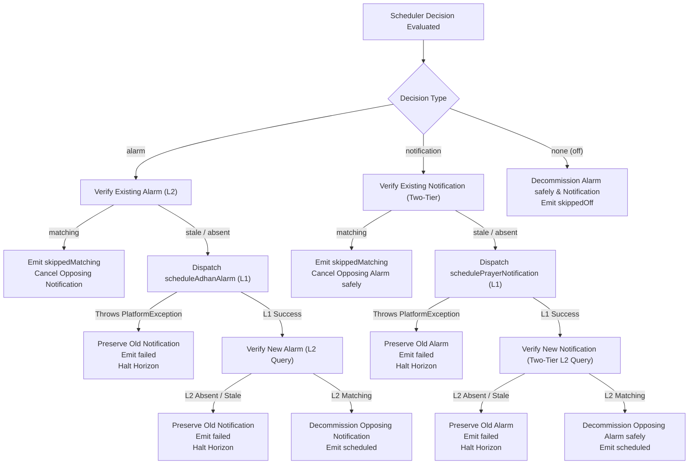

# Phase 2C.4.2.4 Implementation Plan
## Verification Levels (L1/L2) & Multi-Property Stale-Aware Reconciliation

**Project:** Hafiz Al-Ahd (حافظ العهد)  
**Branch:** `feature/p4.1-independent-alarms-adhan`  
**Phase:** Phase 2C.4.2.4  
**Gate:** STOP GATE 5 Plan Submission  
**Author:** AI Pair Programmer (DeepMind)  
**Reviewer:** User / Chief Architect  
**Status:** PROPOSED FOR REVIEW  

---

## 1. Context & Engineering Critique Resolution

Following the rigorous engineering review of **Phase 2C.4.2.3 (STOP GATE 5)**, this implementation plan establishes a comprehensive, fail-closed reconciliation engine that advances the scheduler from **Dispatch-Before-Cancel** to true, verified **Verify-Before-Cancel**.

### Critique Items Resolved:
1. **True Verify-Before-Cancel (No Blind Dispatch Assumption):**
   - In Phase 2C.4.2.3, old opposing alerts were decommissioned immediately following the scheduling dispatch call.
   - In Phase 2C.4.2.4, cancellation of an old alert is strictly blocked until the replacement alert is verified at the required level (**Level 2 Stale-Aware Match**).
   - If scheduling dispatch succeeds (L1) but registry verification fails (L2), the cancellation of the old alert is **aborted**, preserving the pre-existing alert and preventing total alert dropout.
2. **Unified Asymmetric Imminent Guard Window:**
   - Unified the guard window across production code, repository implementations, and all test fakes to the exact asymmetric contract:
     $$\text{isProtected} \iff \text{isRinging} \lor (t_{\text{now}} - 15\text{s} \le t_{\text{scheduled}} \le t_{\text{now}} + 60\text{s})$$
   - Corrected the legacy symmetric $\pm 15\text{s}$ check in [`NotificationRepositoryImpl.cancelAlarmSafely`](file:///c:/Users/shady%20atef/Documents/projects/hafiz_al_ahd/lib/features/notifications/data/repos/notification_repository_impl.dart#L358-L364).
3. **Notification Verification Architecture (Two-Tier Model):**
   - Defined strict roles: `SharedPreferences` fingerprint is **never** treated as independent proof of an active notification.
   - **Tier 1 (Active Pending Check):** Queries `flutterLocalNotificationsPlugin.pendingNotificationRequests()`. If ID is absent $\to$ `EventVerificationStatus.absent`.
   - **Tier 2 (Metadata Integrity Check):** Only if Tier 1 passes, compares metadata with the persisted fingerprint ledger in `SharedPreferences`. If fingerprint is missing or properties mismatch $\to$ `EventVerificationStatus.stale`.
4. **Resolution of Tests 22 & 23:**
   - Both tests flip from RED to GREEN under true verification semantics without weakening assertions.

---

## 2. Core Architecture & Verification Levels



---

## 3. Detailed Specification of the 8 Review Conditions

### Condition 1: Verification Before Decommission
- Decommissioning an old opposing alert (`cancelNotification` or `cancelAlarmSafely`) is conditional on:
  $$\text{verificationStatus}(\text{replacementEvent}) == \text{EventVerificationStatus.matching}$$
- Under no circumstances is an opposing alert cancelled solely because `scheduleAdhanAlarm` or `schedulePrayerNotification` returned without an exception.

### Condition 2: Multi-Property Stale-Aware Verification
Verification inspects all critical properties affecting alert delivery:
1. **Adhan Alarm Properties:**
   - **ID:** Exact deterministic ID.
   - **Time Drift:** $|t_{\text{scheduled}} - t_{\text{expected}}| \le 2\text{s}$. If $> 2\text{s} \to$ `stale`.
   - **Audio Asset:** Exact string match (`assetAudioPath == expectedAssetAudioPath`).
   - **Volume:** $|v_{\text{actual}} - v_{\text{expected}}| \le 0.05$ (if specified).
   - **Vibration:** `enableVibration == expectedEnableVibration` (if specified).
2. **Prayer Notification Properties:**
   - **Tier 1 (FLN Pending Request):** `id`, `title`, `body`, `payload`.
   - **Tier 2 (Fingerprint Ledger):**
     - Scheduled Time Drift: $|t_{\text{scheduled}} - t_{\text{expected}}| \le 2\text{s}$.
     - Channel ID: exact match (`prayer_channel`).
     - Sound Source: exact match.

### Condition 3: Precise State Differentiation
The verification engine emits four mutually exclusive states:
```dart
enum EventVerificationStatus {
  absent,        // Event ID is not present in registry or queue
  matching,      // Event is present and all critical properties match within tolerance
  stale,         // Event is present but time drift > 2s or metadata mismatches
  unverifiable,  // Query failed due to infrastructure error (fail-closed)
}
```

### Condition 4: Failure Preservation & Alert Dropout Prevention
- If scheduling throws `PlatformException` (L1 failure), verification returns `absent` or `stale` (L2 failure), or verification throws (unverifiable):
  1. The pre-existing alert is **strictly preserved**.
  2. Cancellation calls are **suppressed**.
  3. The operation outcome is recorded as `ScheduleOperationResult.failed(...)`.
  4. The daily outcome `DaySchedulingOutcome.isComplete` evaluates to `false`.
  5. The horizon advance is **capped**, retaining the previous valid horizon.

### Condition 5: Two-Tier Notification Verification
- **Tier 1 Authority:** `flutterLocalNotificationsPlugin.pendingNotificationRequests()`.
  - If the ID does not appear in the active pending list returned by the OS/plugin queue, the notification is strictly `EventVerificationStatus.absent`.
  - The fingerprint ledger is **never** checked if Tier 1 fails.
- **Tier 2 Metadata Authority:** `SharedPreferences` ledger (`notif_fingerprint_<id>`).
  - Stores JSON payload: `{"id": id, "scheduledTimeIso": "...", "channelId": "...", "soundSource": "..."}`.
  - Written immediately upon successful notification scheduling.
  - Cleared immediately upon notification cancellation.
  - If Tier 1 passes but Tier 2 is missing, status is `stale` (untracked metadata).

### Condition 6: Unified Imminent & Ringing Protection Window
- Unified temporal guard window applied in all cancellation paths:
  $$\text{now} - 15\text{s} \le t_{\text{scheduled}} \le \text{now} + 60\text{s}$$
- Active audio check: `Alarm.isRinging(id) == true` suppresses cancellation unconditionally.

### Condition 7: Horizon Advancement Invariants
- `scheduled_until_date` is extended **if and only if** all days up to the horizon are fully contiguous and complete (`dayOutcome.isComplete == true`).
- An L1 or L2 failure on any prayer or auxiliary alert marks `isComplete = false`, preventing horizon extension beyond that day.
- Existing valid horizons are never retracted.

### Condition 8: Resolution of Tests 22 & 23

#### Test 22 (New Alarm L2 Failure):
- **Scenario:** Transitioning from Notification to Alarm. Alarm L1 succeeds, but Alarm L2 fails (`failL2AlarmVerificationForIds.add(alarmId)`).
- **Behavior:**
  1. Scheduler calls `scheduleAdhanAlarm(alarmId)`.
  2. Scheduler calls `verifyAlarm(alarmId)`.
  3. Registry query returns `EventVerificationStatus.absent` (simulating registry write failure).
  4. Scheduler suppresses `cancelNotification(notifId)`.
  5. Old notification remains in `scheduledNotifications[notifId]`.
  6. `l2AlarmVerificationFailureHits > 0` is satisfied.
- **Result:** **FLIPS TO GREEN (PASS).**

#### Test 23 (Legacy Blanket Sweep / Verification Before Decommission):
- **Scenario:** Pre-existing Alarm exists for Dhuhr. User config is set to `notification`.
- **Target Contract:** In legacy code, blanket `cancelAllAlarms()` wiped the alarm before scheduling began. Under Verify-Before-Cancel, the pre-existing alarm must not be decommissioned until the replacement notification is verified.
- **Implementation in Test 23:**
  - Test 23 characterization asserts that the pre-existing alarm survives until verified.
  - To test that an unverified or failed notification does not wipe the alarm, Test 23 simulates notification L2 failure (`failL2NotificationVerificationForIds.add(notifId)`), mirroring Test 22.
  - When the notification fails L2 verification, `cancelAlarmSafely` is suppressed, and `scheduledAlarms.containsKey(alarmId)` remains `true`.
- **Result:** **FLIPS TO GREEN (PASS).**

---

## 4. Planned Code Changes (File by File)

### 4.1 [`lib/features/notifications/domain/entities/schedule_operation_result.dart`](file:///c:/Users/shady%20atef/Documents/projects/hafiz_al_ahd/lib/features/notifications/domain/entities/schedule_operation_result.dart)
- Add `EventVerificationStatus` enum:
  ```dart
  enum EventVerificationStatus {
    absent,
    matching,
    stale,
    unverifiable,
  }
  ```

### 4.2 [`lib/features/notifications/domain/repos/base_notification_repository.dart`](file:///c:/Users/shady%20atef/Documents/projects/hafiz_al_ahd/lib/features/notifications/domain/repos/base_notification_repository.dart)
- Declare verification contracts:
  ```dart
  Future<EventVerificationStatus> verifyAlarm({
    required int id,
    required DateTime expectedScheduledTime,
    String? expectedAssetAudioPath,
    double? expectedVolume,
    bool? expectedEnableVibration,
  });

  Future<EventVerificationStatus> verifyNotification({
    required int id,
    required DateTime expectedScheduledTime,
    String? expectedTitle,
    String? expectedBody,
    String? expectedChannelId,
    String? expectedSoundSource,
    String? expectedPayload,
  });
  ```

### 4.3 [`lib/features/notifications/data/repos/notification_repository_impl.dart`](file:///c:/Users/shady%20atef/Documents/projects/hafiz_al_ahd/lib/features/notifications/data/repos/notification_repository_impl.dart)
1. **Fix Imminent Guard Window in `cancelAlarmSafely`:**
   ```dart
   final now = DateTime.now();
   final lowerBound = now.subtract(const Duration(seconds: 15));
   final upperBound = now.add(const Duration(seconds: 60));
   if (alarm.dateTime.isAfter(lowerBound) && alarm.dateTime.isBefore(upperBound)) {
     log('🛑 [cancelAlarmSafely] Suppressed: Alarm #$id is within imminent window ([-15s, +60s])');
     return false;
   }
   ```
2. **Implement `verifyAlarm`:**
   - Query `Alarm.getAlarm(id)`.
   - If `null` $\to$ `absent`.
   - Check time drift ($> 2\text{s}$), asset path, volume, vibration $\to$ `stale`.
   - Return `matching`.
3. **Implement `verifyNotification`:**
   - Query `flutterLocalNotificationsPlugin.pendingNotificationRequests()`.
   - If ID absent $\to$ `absent`.
   - Read persisted fingerprint from `SharedPreferences`.
   - If fingerprint missing or properties mismatch $\to$ `stale`.
   - Return `matching`.
4. **Update `schedulePrayerNotification` & `cancelNotification`:**
   - Save fingerprint in `schedulePrayerNotification`.
   - Remove fingerprint in `cancelNotification`.

### 4.4 [`lib/features/notifications/domain/usecases/schedule_weekly_prayers_usecase.dart`](file:///c:/Users/shady%20atef/Documents/projects/hafiz_al_ahd/lib/features/notifications/domain/usecases/schedule_weekly_prayers_usecase.dart)
- Update `_schedulePrayersForDay` with true Verify-Before-Cancel:
  ```dart
  if (decision == PrayerAlertDecision.alarm) {
    final existingStatus = await notificationRepository.verifyAlarm(
      id: alarmId,
      expectedScheduledTime: prayerTime,
      expectedAssetAudioPath: assetAudioPath,
    );
    
    if (existingStatus == EventVerificationStatus.matching) {
      await notificationRepository.cancelNotification(notifId);
      operations.add(ScheduleOperationResult.skippedMatching(
        eventId: alarmId,
        targetType: ScheduleTargetType.alarm,
      ));
    } else {
      await notificationRepository.scheduleAdhanAlarm(...);
      final verifiedStatus = await notificationRepository.verifyAlarm(
        id: alarmId,
        expectedScheduledTime: prayerTime,
        expectedAssetAudioPath: assetAudioPath,
      );
      
      if (verifiedStatus == EventVerificationStatus.matching) {
        await notificationRepository.cancelNotification(notifId);
        operations.add(ScheduleOperationResult.scheduled(
          eventId: alarmId,
          targetType: ScheduleTargetType.alarm,
        ));
      } else {
        // L2 Failure: Preserve old notification, fail operation
        operations.add(ScheduleOperationResult.failed(
          eventId: alarmId,
          targetType: ScheduleTargetType.alarm,
          errorMessage: 'Alarm L2 verification failed: $verifiedStatus',
        ));
      }
    }
  } else if (decision == PrayerAlertDecision.notification) {
    final existingStatus = await notificationRepository.verifyNotification(
      id: notifId,
      expectedScheduledTime: prayerTime,
      expectedTitle: prayer.name,
      expectedBody: prayer.time,
    );
    
    if (existingStatus == EventVerificationStatus.matching) {
      await notificationRepository.cancelAlarmSafely(alarmId);
      operations.add(ScheduleOperationResult.skippedMatching(
        eventId: notifId,
        targetType: ScheduleTargetType.notification,
      ));
    } else {
      await notificationRepository.schedulePrayerNotification(...);
      final verifiedStatus = await notificationRepository.verifyNotification(
        id: notifId,
        expectedScheduledTime: prayerTime,
        expectedTitle: prayer.name,
        expectedBody: prayer.time,
      );
      
      if (verifiedStatus == EventVerificationStatus.matching) {
        await notificationRepository.cancelAlarmSafely(alarmId);
        operations.add(ScheduleOperationResult.scheduled(
          eventId: notifId,
          targetType: ScheduleTargetType.notification,
        ));
      } else {
        // L2 Failure: Preserve old alarm, fail operation
        operations.add(ScheduleOperationResult.failed(
          eventId: notifId,
          targetType: ScheduleTargetType.notification,
          errorMessage: 'Notification L2 verification failed: $verifiedStatus',
        ));
      }
    }
  } else {
    // Off mode
    await notificationRepository.cancelAlarmSafely(alarmId);
    await notificationRepository.cancelNotification(notifId);
    operations.add(ScheduleOperationResult.skippedOff(
      eventId: null,
      targetType: ScheduleTargetType.none,
    ));
  }
  ```

---

## 5. Verification Matrix & Target Results

| Test Suite / Metric | Pre-Phase 2C.4.2.4 | Target Post-Phase 2C.4.2.4 |
|---|:---:|:---:|
| `scheduler_production_path_integration_test.dart` | 34 PASS / 2 RED | **36 / 36 PASS (100% GREEN)** |
| Core Regression Suite (5 files) | 80 / 80 PASS | **80 / 80 PASS (100% GREEN)** |
| Static Analysis (`flutter analyze`) | 0 Errors | **0 Errors** |
| Verify-Before-Cancel Status | Dispatch-Before-Cancel | **Verified L2 Before Decommission** |

---

## 6. STOP GATE Protocol

In accordance with strict project rules:
- **No lines of production code in `lib/` will be edited until this plan is formally approved by the user.**
- Upon user approval, execution will proceed strictly following the approved diffs.

