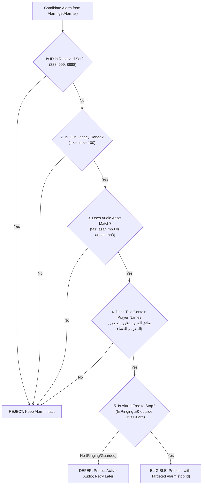
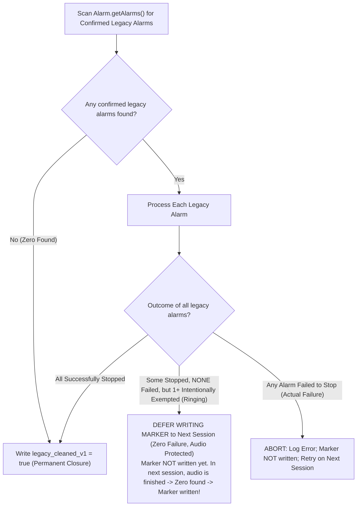

# P4.1-B.3 Phase 2A.1 — Legacy Cleanup Contract
**Project:** Hafiz Al-Ahd (حافظ العهد)  
**Branch:** `feature/p4.1-independent-alarms-adhan`  
**Phase:** P4.1-B.3 — Phase 2A.1  
**Document ID:** Deliverable H (`Phase_2A.1_Legacy_Cleanup_Contract.md`)  
**Status:** Frozen Contract — Architectural Specification  

---

## 1. Objective & Scope

This document specifies the safety invariants, heuristic qualification criteria, execution semantics, and crash recovery mechanics for migrating away from legacy sequential alarm IDs (`1..100`). It enforces the Conservative Ownership Heuristic and mandates that cleanup markers are only written upon complete, verified success.

---

## 2. Conservative Ownership Heuristic Criteria (H1)

Under no circumstances may an alarm be stopped simply because its ID is below `10,000`. To be eligible for legacy cleanup, an alarm instance retrieved from `Alarm.getAlarms()` must satisfy **all five** of the following independent criteria:



---

## 3. Atomic Completion Marker Semantics & Ringing Exemption Policy (H2)

The persistent flag in SharedPreferences:
```dart
const String kLegacyPrayerAlarmsCleanedKey = 'legacy_prayer_alarms_cleaned_v1';
```

### 3.1. Tripartite Classification of Legacy Alarm States:
When evaluating candidate legacy alarms (`id in 1..100`), each alarm concludes in exactly one of three states:

1. **منبه تم إلغاؤه بنجاح (Successfully Stopped):**
   - Alarm is in the future and not ringing (`!isRinging` and outside $\pm 15$s guard).
   - `Alarm.stop(id)` succeeds.
2. **منبه تم استثناؤه عمداً لحماية الرنين (Intentionally Exempted for Active Ringing):**
   - Alarm is actively playing Adhan audio (`isRinging == true`) or is within the $\pm 15$s temporal guard.
   - **Crucial Distinction:** This is **NOT a failure** of the cleanup engine. It is an intentional, safety-critical protection of active user audio.
   - The alarm has already triggered; it is playing ephemeral audio that will self-terminate upon completion ($\le 3$ minutes) and will never re-arm.
3. **منبه فشلت عملية إلغائه (Actual Cancellation Failure):**
   - An IPC error, platform channel exception, or OS timeout prevented `Alarm.stop(id)` from completing on a non-ringing future alarm.
   - This represents a true failure requiring recovery.

### 3.2. Strict Decision Logic for Writing `legacy_prayer_alarms_cleaned_v1`:


### 3.3. Key Guarantees:
- **No False Failure:** An actively ringing alarm is logged as `🛡️ Legacy alarm #$id is actively ringing; intentionally exempted from cancellation`. It does NOT trigger error alerts or rollback.
- **Verification Closure:** Because writing the marker is deferred until the active ringing concludes, the next app session (or DST / location check) automatically observes that the alarm has completed, confirms that zero legacy alarms remain, and permanently writes `legacy_prayer_alarms_cleaned_v1 = true`.
- **Zero Orphaned Legacy Alarms:** No future legacy alarm is ever left behind.

---

## 4. Crash Recovery & Partial Cleanup Convergence (H3)

### 4.1. Recovery Across Interrupted Runs:
| Scenario | Immediate State | Impact on Marker | Next Session Action |
|---|---|---|---|
| **Clean Run:** 5 legacy alarms stopped successfully | All 5 removed | `legacy_cleaned_v1 = true` written | Cleanup skipped permanently |
| **Partial Interruption:** 3 stopped, process killed | 3 removed, 2 remain in AlarmManager | Marker NOT written | Next session finds remaining 2, stops them, writes marker |
| **Active Adhan:** 4 stopped, 1 actively ringing | 4 removed, ringing audio preserved | Marker NOT written | Next session sees playback finished, stops last alarm, writes marker |
| **IPC Failure:** `Alarm.stop(id)` throws exception | Error logged | Marker NOT written | Next session retries stopping failed alarm |

### 4.2. Global Wipe Prohibition:
- Calling `Alarm.stopAll()` is **strictly forbidden** in legacy cleanup.
- Cleanup is performed strictly on an individual, ID-by-ID basis.

