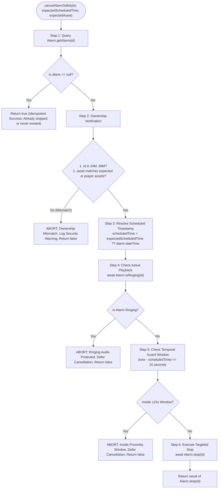

# P4.1-B.3 Phase 2A.1 — Notification Ownership & Cancellation Contract
**Project:** Hafiz Al-Ahd (حافظ العهد)  
**Branch:** `feature/p4.1-independent-alarms-adhan`  
**Phase:** P4.1-B.3 — Phase 2A.1  
**Document ID:** Deliverable B (`Phase_2A.1_Notification_Ownership_and_Cancellation.md`)  
**Status:** Frozen Contract — Architectural Specification  

---

## 1. Objective & Scope

This document defines the strict ownership boundaries, cancellation mechanics, and backend boundaries between `package:alarm` and `flutter_local_notifications`. It resolves the architectural status of broad-sweep cancellation methods, mandates Targeted Cancellation, and defines policies for legacy notifications.

---

## 2. Review of Existing Cancellation APIs & Platform Limits (B1)

### 2.1. `package:alarm` (Version 5.12.0)
- **Primary APIs:**
  - `Alarm.set({required AlarmSettings alarmSettings}) -> Future<bool>`
  - `Alarm.stop(int id) -> Future<bool>`
  - `Alarm.stopAll() -> Future<void>`
  - `Alarm.isRinging(int id) -> Future<bool>`
  - `Alarm.getAlarm(int id) -> AlarmSettings?`
  - `Alarm.getAlarms() -> List<AlarmSettings>`
- **Platform Reality (Android):**
  - Manages scheduling through Android's `AlarmManager` via `PendingIntent`.
  - When triggered, it spawns an Android Foreground Service (`AndroidAlarmService`) that hosts an active `MediaPlayer` and displays a full-screen or heads-up alarm interface.
  - Calling `Alarm.stop(id)` sends a platform channel call to kill the native MediaPlayer and release the wake lock.
  - Calling `Alarm.stopAll()` terminates **all** registered and ringing alarms indiscriminately.

### 2.2. `flutter_local_notifications` (Version 21.0.0)
- **Primary APIs:**
  - `zonedSchedule(int id, ..., tzScheduledTime, ...)`
  - `cancel({required int id, String? tag}) -> Future<void>`
  - `cancelAll() -> Future<void>`
  - `pendingNotificationRequests() -> Future<List<PendingNotificationRequest>>`
  - `getActiveNotifications() -> Future<List<ActiveNotification>>`
- **Platform Reality (Android):**
  - Manages local notifications through `NotificationManager` and exact schedules via `AlarmManager`.
  - Notifications are short-lived system chime alerts; they do not hold persistent audio locks or wake locks.
  - Calling `cancel(id)` clears the pending AlarmManager trigger and dismisses the status bar notification.

### 2.3. Boundary Independence Invariant
- **The two systems are 100% physically decoupled:**
  - An integer ID in `package:alarm` has **zero** relationship to the same integer ID in `flutter_local_notifications`.
  - Cancelling an ID in one backend does not affect the other.
  - System lifecycles, persistent storage, and platform channels do not cross over.

---

## 3. Comprehensive Contract for `cancelAlarmSafely` (B2)

### 3.1. Detailed Method Signature
```dart
abstract class BaseNotificationRepository {
  /// Safely cancels a specific prayer alarm with ownership verification,
  /// active ringing protection, and temporal proximity guard.
  /// Returns `true` if cancelled or already nonexistent; `false` if deferred due to active playback/guard or ownership mismatch.
  Future<bool> cancelAlarmSafely(
    int id, {
    DateTime? expectedScheduledTime,
    String? expectedAssetAudioPath,
  });
}
```

### 3.2. Step-by-Step Execution Contract
The function does **NOT** blindly stop any alarm matching the ID. It executes the following 6-step verification pipeline:



### 3.3. Formal Answers to Contract Questions:
1. **Source of Scheduled Timestamp (`scheduledAt`):**
   - Primary: `expectedScheduledTime` passed by caller if known from prayer calculations.
   - Fallback / Verification: `alarm.dateTime` retrieved directly from `Alarm.getAlarm(id)`.
   - If both are present, they are compared: if `(expectedScheduledTime.difference(alarm.dateTime)).inSeconds.abs() > 60`, an anomaly warning is logged.
2. **Does the ID alone prove ownership?**
   - **NO.** ID must be in the deterministic prayer range ($24,010,100 \le \text{id} \le 99,123,149$), AND `alarm.assetAudioPath` must match a valid prayer audio asset (`assets/sounds/fajr_azan.mp3` or `assets/sounds/adhan.mp3`).
3. **What happens if `getAlarm(id)` returns `null`?**
   - It means no alarm is currently registered with this ID in `package:alarm`.
   - The method returns `true` (idempotent success; the desired outcome of "no alarm running" is already satisfied).
4. **What happens if alarm data does not match expected event?**
   - If an alarm exists with ID `#26110800` but has an audio asset that does not belong to prayer alerts (e.g. third-party or custom sound from an unrelated source), **cancellation is aborted** and returns `false`. We never cancel an alarm whose ownership is suspect.
5. **What happens on failure?**
   - If `Alarm.stop(id)` throws an exception, the error is logged and returns `false`.
   - The scheduler treats `false` as "cancellation deferred/failed" and does not mark the day complete if cancellation was a required cleanup.

---

## 4. Comprehensive Cancellation Ownership Contract (B3)

| Event Type | Event ID Formula | Backend | Ownership Verification | State Pre-Check | Cancellation API | Active Protection | Failure Handling |
|---|---|---|---|---|---|---|---|
| **Adhan Alarm** | `...00, ...10, ...20, ...30, ...40` | `package:alarm` | Deterministic ID pattern + audio asset match | `getAlarm(id) != null` ➡️ verify asset ➡️ `!isRinging(id)` ➡️ outside $\pm 15$s | `cancelAlarmSafely(id, ...)` | **Mandatory:** If ringing or in $\pm 15$s guard, stop is aborted | Log failure; keep existing alarm; mark day incomplete |
| **Adhan Notification** | `...01, ...11, ...21, ...31, ...41` | FLN | Deterministic ID pattern + payload prefix `adhan_` | Query `pendingNotificationRequests()` | `flutterLocalNotificationsPlugin.cancel(id)` | Non-ringing system notification; safe to cancel immediately | Log failure; retry in next session |
| **Iqama Notification** | `...02, ...12, ...22, ...32, ...42` | FLN | Deterministic ID pattern + payload prefix `iqama_` | Check if within pending requests | `flutterLocalNotificationsPlugin.cancel(id)` | Safe to cancel | Log failure; day marked incomplete if Iqama was required |
| **Post-Prayer Azkar** | `...03, ...13, ...23, ...33, ...43` | FLN | Deterministic ID pattern + payload `azkar_after_prayer` | Check if within pending requests | `flutterLocalNotificationsPlugin.cancel(id)` | Safe to cancel | Log failure; day marked incomplete |
| **Morning Azkar** | `...04` (Fajr only) | FLN | Deterministic ID pattern + payload `azkar_morning` | Check if within pending requests | `flutterLocalNotificationsPlugin.cancel(id)` | Safe to cancel | Log failure; day marked incomplete |
| **Evening Azkar** | `...25` (Asr only) | FLN | Deterministic ID pattern + payload `azkar_evening` | Check if within pending requests | `flutterLocalNotificationsPlugin.cancel(id)` | Safe to cancel | Log failure; day marked incomplete |
| **Legacy Alarms** | `1 .. 100` | `package:alarm` | `LegacyAlarmCleanupFilter` 5-point heuristic | `!await Alarm.isRinging(id)` | `Alarm.stop(id)` | If ringing, preserve audio; retry next session | Abort cleanup; do NOT write `legacy_cleaned` flag |

---

## 5. Concrete Evidence & Resolution of Legacy FLN Notifications Across Reboot (B4)

### 5.1. Verified AndroidManifest Configuration:
Inspection of `android/app/src/main/AndroidManifest.xml` confirms the exact receivers and permissions declared:
```xml
<uses-permission android:name="android.permission.RECEIVE_BOOT_COMPLETED" />
<uses-permission android:name="android.permission.SCHEDULE_EXACT_ALARM" />
<uses-permission android:name="android.permission.USE_EXACT_ALARM" />

<receiver android:exported="false"
    android:name="com.dexterous.flutterlocalnotifications.ScheduledNotificationReceiver" />
<receiver android:exported="false"
    android:name="com.dexterous.flutterlocalnotifications.ScheduledNotificationBootReceiver">
    <intent-filter>
        <action android:name="android.intent.action.BOOT_COMPLETED" />
        <action android:name="android.intent.action.MY_PACKAGE_REPLACED" />
        <action android:name="android.intent.action.QUICKBOOT_POWERON" />
        <action android:name="com.htc.intent.action.QUICKBOOT_POWERON" />
    </intent-filter>
</receiver>
```

### 5.2. Native FLN 21.0.0 Reboot Mechanics:
1. **Persistent Backing Store:** FLN serializes scheduled notification requests to Android `SharedPreferences` under key `flutter_local_notifications_plugin`.
2. **Reboot Wakeup:** On `BOOT_COMPLETED` or `MY_PACKAGE_REPLACED`, Android OS wakes `ScheduledNotificationBootReceiver`.
3. **Automatic Purge of Past Notifications:**
   - The boot receiver iterates all persisted requests.
   - For any notification where `scheduledDate <= currentTimeMillis`: FLN **automatically discards it and deletes it from SharedPreferences**. It is NEVER re-armed.
4. **Re-arming of Future Notifications:**
   - For notifications where `scheduledDate > currentTimeMillis`: FLN invokes `AlarmManager.setExactAndAllowWhileIdle()` to re-arm the exact alarm.

### 5.3. Payload Conventions in Hafiz Al-Ahd Legacy Scheduler:
Traced directly from `ScheduleWeeklyPrayersUseCase` (lines 138–201):
- Adhan Notification: `payload: 'adhan_simple_${prayer.key}'`
- Iqama Notification: `payload: 'iqama_${currentId}_${prayer.name}'`
- Post-Prayer Azkar: `payload: 'azkar_after_prayer'`
- Morning Azkar: `payload: 'azkar_morning'`
- Evening Azkar: `payload: 'azkar_evening'`

### 5.4. Targeted Legacy FLN Cleanup Capability:
Unlike blind `cancelAll()` which would destroy persistent widgets, countdown notifications, and user reminders, the scheduler can cleanly query and target legacy FLN notifications:
```dart
Future<void> cleanupLegacyFlnNotifications() async {
  final pending = await flutterLocalNotificationsPlugin.pendingNotificationRequests();
  for (final req in pending) {
    final payload = req.payload ?? '';
    final isLegacyPrayerPayload = payload.startsWith('adhan_simple_') ||
        payload.startsWith('iqama_') ||
        payload.startsWith('azkar_');
        
    // Legacy IDs are strictly sequential integers < 1000
    if (req.id < 1000 && isLegacyPrayerPayload) {
      await flutterLocalNotificationsPlugin.cancel(req.id);
      log('🧹 Cancelled legacy FLN notification #${req.id} ($payload)');
    }
  }
}
```

### 5.5. Official Classification: Residual Legacy Behavior:
- **Maximum Lifespan:** The legacy scheduler scheduled at most 5 days in advance. Therefore, all uncleaned legacy notifications expire naturally within $\le 5$ calendar days.
- **After Reboot:** Any expired legacy notification is automatically purged by `ScheduledNotificationBootReceiver`.
- **Targeted Purge:** Any future legacy notification matching the known payload prefixes is explicitly cancelled during migration without using `cancelAll()`.
- **Residual Risk:** Classified as **Zero Risk to Audio / Low Risk of Duplicate Heads-Up Chime during first 5 days post-migration**, fully mitigated by targeted payload cleanup.

