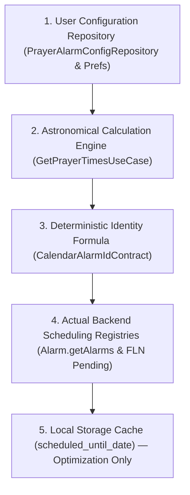

# P4.1-B.3 Phase 2A.1 — Reconciliation & Partial Failure Recovery Contract
**Project:** Hafiz Al-Ahd (حافظ العهد)  
**Branch:** `feature/p4.1-independent-alarms-adhan`  
**Phase:** P4.1-B.3 — Phase 2A.1  
**Document ID:** Deliverable F (`Phase_2A.1_Reconciliation_and_Recovery_Contract.md`)  
**Status:** Frozen Contract — Architectural Specification  

---

## 1. Formal Definition of Idempotent Reconciliation (F1)

**Reconciliation** is the deterministic process of transitioning the actual device alarm/notification state from whatever state it is currently in (including dirty, partial, or corrupted states from interrupted runs) to match the user's latest configured intent.

### Core Convergence Invariants:
1. **Convergence:** Executing the scheduler once, twice, or ten times with identical inputs results in the **exact same final state**.
2. **Zero Duplication:** No duplicate alarms or notifications are ever spawned.
3. **Non-Destructive on Failure:** An existing valid alert is **never** cancelled if the new replacement fails to schedule or verify.
4. **Cache Independence:** The scheduler treats the cache (`scheduled_until_date`) strictly as a horizon threshold, **never** as a substitute for verifying backend state.

---

## 2. Comprehensive Partial Failure Recovery Matrix (F2)

| Failure Point | System State at Failure | Impact on Current Day | Immediate Action | State of Existing Events | Recovery on Next Session |
|---|---|---|---|---|---|
| **1. Prayer times calculation fails** (`Left(failure)`) | No times available for Day $D$ | Day $D$ marked **Incomplete** | Contiguous loop terminates | All existing registered events untouched | Re-fetches times; resumes from Day $D$ |
| **2. Fajr succeeds, Dhuhr scheduling fails** | Partial day scheduled (Fajr active, Dhuhr missing) | Day $D$ marked **Incomplete** | Contiguous loop terminates | Fajr remains safely registered; no rollback | Reconciles Dhuhr; refreshes Fajr in-place |
| **3. New event succeeds, old cancellation fails** | Both new and old events temporarily exist | Day $D$ marked **Incomplete** (pending full cleanup) | Logs warning; proceeds | User has alert coverage (no missing alert) | Next session detects obsolete event and retries targeted cancellation |
| **4. New event fails to schedule** | Replacement not created | Day $D$ marked **Incomplete** | **Aborts cancellation of old event** | Valid old event remains active and protecting user | Retries scheduling replacement |
| **5. Notification verification fails** | Level 2 registry check fails | Day $D$ marked **Incomplete** | Aborts transition; keeps old event | Old event preserved | Re-schedules notification |
| **6. Alarm verification fails** | `Alarm.getAlarm(id)` returns null or wrong time | Day $D$ marked **Incomplete** | Aborts transition; keeps old event | Old event preserved | Re-schedules alarm |
| **7. Iqama scheduling fails** | Adhan succeeded, Iqama failed | Day $D$ marked **Incomplete** (if Iqama enabled) | Logs error; breaks contiguous chain | Adhan alarm remains active | Next session retries Iqama scheduling |
| **8. Azkar scheduling fails** | Adhan succeeded, Azkar failed | Day $D$ marked **Incomplete** (if Azkar enabled) | Logs error; breaks contiguous chain | Adhan alarm remains active | Next session retries Azkar scheduling |
| **9. Session invalidated** (`_scheduleSessionId` changed) | Newer session started mid-run | Discarded | Previous session exits immediately | Newer session assumes total ownership | Newer session completes schedule |
| **10. App process terminated mid-day** (OS Kill / Battery dead) | Partial state in Android AlarmManager | Day $D$ marked **Incomplete** | No cache written | Android preserves what was scheduled | On restart, scheduler reconciles against Source of Truth |

---

## 3. Strict Idempotency Rules (F3)

To guarantee idempotency across all scheduling operations:
1. **Deterministic Identity:** Every event ID is mathematically derived from its date, prayer index, and type offset. No random, UUID, or sequential counter IDs are permitted.
2. **In-Place Mutation:** Calling `Alarm.set()` or `zonedSchedule()` with an existing deterministic ID replaces the trigger parameters in Android OS without generating a second event.
3. **Targeted Decommissioning:** Cancelling an event is performed strictly by its discrete deterministic ID, avoiding broad `cancelAll()` side effects.
4. **Monotonic Convergence:** Each reconciliation pass either moves an unaligned event into alignment or preserves valid state; it never regresses state.

---

## 4. Strict Hierarchy of Sources of Truth (F4)

When determining the desired and actual state during scheduling, the engine must consult data sources strictly in this prioritized hierarchy:

### Explanation of Tiers:
1. **Tier 1 (User Configuration):** The supreme authority. If user config says Fajr is `notification`, no previous alarm state can override this intent.
2. **Tier 2 (Prayer Times Calculation):** The exact timestamps calculated for coordinates and dates.
3. **Tier 3 (Deterministic Identity):** Defines the exact integer ID representing each event.
4. **Tier 4 (Actual Backend State):** The verifiable registration state in `package:alarm` and `flutter_local_notifications`.
5. **Tier 5 (Cache: `scheduled_until_date`):** **Never proof of backend reality.** It serves solely as a throttle check to avoid redundant background calculations when the app awakens and the horizon is already fully covered.

