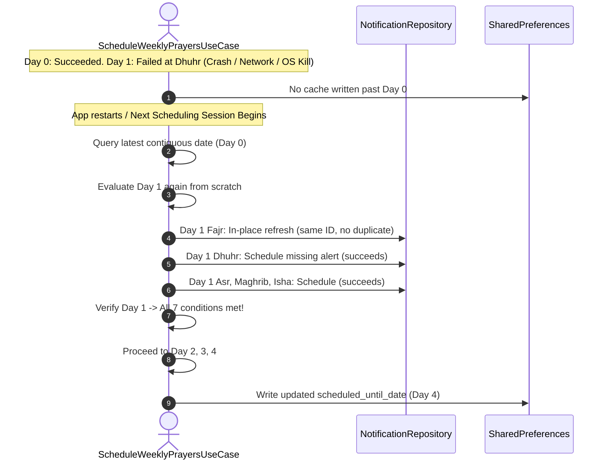

# P4.1-B.3 Phase 2A.1 — `scheduled_until_date` Contract
**Project:** Hafiz Al-Ahd (حافظ العهد)  
**Branch:** `feature/p4.1-independent-alarms-adhan`  
**Phase:** P4.1-B.3 — Phase 2A.1  
**Document ID:** Deliverable G (`Phase_2A.1_Scheduled_Until_Date_Contract.md`)  
**Status:** Frozen Contract — Architectural Specification  

---

## 1. Final Formal Definition (G1)

> **`scheduled_until_date`** represents the **latest contiguous calendar date** for which all required prayer alerts, iqama reminders, and azkar notifications have been fully scheduled, reconciled, and verified without any intervening day failures.

It is **strictly prohibited** to define `scheduled_until_date` as `DateTime.now().add(Duration(days: 5))` or to write a date merely because a loop iteration concluded.

---

## 2. Five Mandatory Day Completion Requirements (G2)

A calendar day $D_k$ is classified as **Fully Complete** if and only if **all five** of the following conditions are met:

1. **نجاح حساب المواقيت (Astronomical Calculation):** `GetPrayerTimesUseCase` returned `Right(prayerTimes)` with valid timestamps.
2. **مصالحة الصلوات الخمس وفق إعداد كل صلاة (Five-Prayer Reconciliation):** Every daily prayer (Fajr, Dhuhr, Asr, Maghrib, Isha) was reconciled against its specific active `PrayerAlarmConfig`:
   - If config is `alarm`: Adhan alarm created and verified (Level 1+2); obsolete notification (if any) cancelled.
   - If config is `notification`: Adhan notification created and verified (Level 1+2); obsolete alarm (if any) cancelled safely.
   - If config is `off`: Existing alerts decommissioned via targeted cancellation; **zero new alerts created**.
   *(Note: A day with Fajr `off`, Dhuhr `alarm`, Asr `notification`, Maghrib `off`, Isha `alarm` is 100% complete when all 5 match their configs. It does NOT require 5 alarms!)*
3. **إنشاء والتحقق من كل الأحداث المطلوبة فعلياً (Required Event Verification):** Every event required by user configuration has been created and verified at Level 1 (API success) and Level 2 (plugin registry state).
4. **معالجة الإقامات والأذكار المفعلة (Enabled Subsystems):**
   - If `isIqamaEnabled == true`: Non-negative Iqama delays scheduled and verified.
   - If `isAzkarReminderEnabled == true`: Post-prayer Azkar, Morning Azkar (Fajr), and Evening Azkar (Asr) scheduled and verified.
   - If disabled: Respective events are skipped/decommissioned.
5. **عدم وجود أي فشل غير معالج (Zero Unhandled Failures):** The entire execution for Day $D_k$ completed without swallowed errors or unresolved failures.

---

## 3. Contiguous Horizon Mathematical Specification (G3)

Let $D_0, D_1, D_2, D_3, D_4$ be the sequence of 5 target days, and let $C(D_j) \in \{\text{true}, \text{false}\}$ be the boolean completion predicate.

$$\text{Horizon} = \begin{cases} 
\text{null (or retain previous valid cache)}, & \text{if } C(D_0) = \text{false} \\
\max \{ D_k \mid \forall j \le k, \, C(D_j) = \text{true} \}, & \text{if } C(D_0) = \text{true}
\end{cases}$$

### Behavioral Rules:
1. **First Day Failure ($C(D_0) = \text{false}$):**
   - **No new completion date is written to SharedPreferences.**
   - If a previous valid future `scheduled_until_date` exists in storage, it is **preserved** (not erased).
2. **Intermediate Day Failure (e.g. $D_0$ OK, $D_1$ OK, $D_2$ FAILS):**
   - The contiguous sequence **breaks immediately at $D_2$**.
   - Even if $D_3$ or $D_4$ were subsequently evaluated and succeeded, `scheduled_until_date` **must be capped strictly at $D_1$**.
3. **Storage Commit Timing:**
   - SharedPreferences is updated **at most once per session**, at the conclusion of the 5-day cycle, recording the exact ISO-8601 string of the contiguous horizon end date.
4. **Cache is Never Proof of Event Existence:**
   - The presence of a date in `scheduled_until_date` is strictly an optimization to prevent redundant daily re-scheduling.
   - It is **never** used by the scheduler as proof that individual events actually exist in Android `AlarmManager`.
   - If a session fails mid-day after scheduling Fajr and Dhuhr, the subsequent session starts reconciliation against actual device state, refreshing existing partial events without duplicating.

---

## 4. Partial Day Recovery Workflow (G4)

### Self-Healing Guarantees:
- **No Orphaned Alarms:** The deterministic ID scheme ensures that any events registered before the interruption are cleanly updated in-place or reused.
- **No False Horizon Expansion:** The system will never assume that prayers were scheduled if a failure occurred mid-day.

