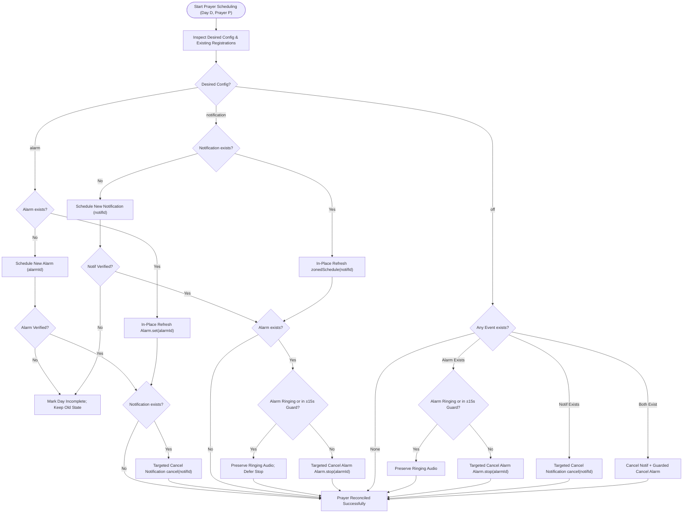

# P4.1-B.3 Phase 2A.1 — Scheduling Decision Matrix
**Project:** Hafiz Al-Ahd (حافظ العهد)  
**Branch:** `feature/p4.1-independent-alarms-adhan`  
**Phase:** P4.1-B.3 — Phase 2A.1  
**Document ID:** Deliverable A (`Phase_2A.1_Scheduling_Decision_Matrix.md`)  
**Status:** Frozen Contract — Architectural Specification  

---

## 1. Objective & Scope

This document formally specifies the complete, deterministic decision matrix and transition mechanics for prayer scheduling in Hafiz Al-Ahd. It resolves ambiguities and directional misnomers from Phase 2A, covers all 12 operational states, and defines exact reconciliation rules for non-ideal or dirty runtime states.

---

## 2. Correct Transition Directions (A1)

When the user modifies a prayer's configuration or when reconciling divergent states, the transition nomenclature represents moving from the **Existing System State** to the **Desired Config State**:

| Desired (New) Config | Existing Registered Event | Correct Transition Nomenclature | Operational Principle |
|---|---|---|---|
| `alarm` | `notification` | **Notification ➡️ Alarm** | Schedule new Alarm ➡️ Verify ➡️ Targeted cancel old Notification |
| `notification` | `alarm` | **Alarm ➡️ Notification** | Schedule new Notification ➡️ Verify ➡️ Targeted cancel old Alarm (if not ringing) |
| `alarm` | `alarm` | **Alarm ➡️ Alarm (In-Place Refresh)** | Update `Alarm.set()` in-place with identical deterministic ID |
| `notification` | `notification` | **Notification ➡️ Notification (In-Place Refresh)** | Overwrite `zonedSchedule()` in-place with identical deterministic ID |
| `off` | `alarm` | **Alarm ➡️ Off (Targeted Decommission)** | Verify not ringing ➡️ Targeted cancel Alarm |
| `off` | `notification` | **Notification ➡️ Off (Targeted Decommission)** | Targeted cancel Notification via `cancel(id)` |

---

## 3. Complete 12-State Scheduling Matrix (A2)

The system state for a given prayer on a given calendar day is evaluated across three dimensions:
- **Desired Config:** `{alarm, notification, off}`
- **Existing Alarm:** `{absent, present}` (in `package:alarm`)
- **Existing Notification:** `{absent, present}` (in `flutter_local_notifications`)

### Full Specification of the 12 States:

| Case | Desired Config | Existing Alarm | Existing Notification | 1. New Created? | 2. Existing Updated? | 3. Old Event to Cancel? | 4. Cancellation Timing | 5. On Scheduling Failure | 6. If Alarm is Ringing | 7. If in Temporal Guard (±15s) | 8. Idempotent? |
|:---:|:---:|:---:|:---:|:---:|:---:|:---:|:---:|:---:|:---:|:---:|:---:|
| **1** | `alarm` | absent | absent | **Yes** (Alarm) | No | None | N/A | Abort; day incomplete; keep absent | N/A (absent) | Cannot occur (new future event) | **Yes** |
| **2** | `alarm` | present | absent | No | **Yes** (In-place `Alarm.set`) | None | N/A | Keep existing Alarm intact; flag day incomplete | Preserved (audio keeps playing; trigger refreshed) | Preserved; bypass immediate stop | **Yes** |
| **3** | `alarm` | absent | present | **Yes** (Alarm) | No | **Yes** (Notification) | **Post-Verification** (after Alarm verified) | Do NOT cancel Notification; flag day incomplete | N/A (Alarm was absent) | If Notification time $\le$ now, FLN handles delivery; Alarm scheduled | **Yes** |
| **4** | `alarm` | present | present *(Dirty)* | No | **Yes** (In-place `Alarm.set`) | **Yes** (Stray Notification) | **Post-Verification ONLY** (after refreshed Alarm verified Level 1+2) | Keep stray Notification intact; flag day incomplete | Alarm preserved; defer Notification cancellation | Preserve ringing Alarm; do NOT cancel until Alarm verified | **Yes** |
| **5** | `notification` | absent | absent | **Yes** (Notif) | No | None | N/A | Abort; day incomplete; keep absent | N/A | Cannot occur | **Yes** |
| **6** | `notification` | present | absent | **Yes** (Notif) | No | **Yes** (Alarm) | **Post-Verification** (after Notif verified Level 1+2) | Do NOT cancel Alarm; flag day incomplete | **Preserve Ringing**; defer Alarm cancellation until audio stops | **Preserve Alarm**; do not stop inside $\pm 15$s window | **Yes** |
| **7** | `notification` | absent | present | No | **Yes** (In-place `zonedSchedule`) | None | N/A | Keep existing Notif; flag day incomplete | N/A | Overwrite takes effect in Android AlarmManager | **Yes** |
| **8** | `notification` | present | present *(Dirty)* | No | **Yes** (In-place `zonedSchedule`) | **Yes** (Stray Alarm) | **Post-Verification ONLY** (after refreshed Notif verified Level 1+2) | Keep stray Alarm intact; flag day incomplete | **Preserve Ringing**; defer Alarm stop | **Preserve Alarm**; do not stop inside $\pm 15$s window | **Yes** |
| **9** | `off` | absent | absent | No | No | None | N/A | N/A (No-op) | N/A | N/A | **Yes** |
| **10** | `off` | present | absent | No | No | **Yes** (Alarm) | **Immediate Targeted Cancel** | Keep Alarm; retry next session | **Preserve Ringing**; do NOT stop active audio | **Preserve Alarm**; do NOT stop inside $\pm 15$s window | **Yes** |
| **11** | `off` | absent | present | No | No | **Yes** (Notif) | **Immediate Targeted Cancel** | Keep Notif; retry next session | N/A | Cancel via `cancel(id)` immediately | **Yes** |
| **12** | `off` | present | present *(Dirty)* | No | No | **Yes** (Both) | **Immediate Targeted Cancel** | Keep remaining; retry next session | **Preserve Ringing Alarm**; cancel Notification immediately | **Preserve Alarm**; cancel Notification | **Yes** |

---

## 4. Reconciliation Rules for Dirty and Degraded Runtime States (A3)

The scheduler must converge the real system state to the desired state under all real-world disruptions:

### 4.1. Dirty Dual-Existence State (Cases 4, 8, 12)
- **Root Cause:** A prior transition (e.g. Notification ➡️ Alarm or Alarm ➡️ Notification) succeeded in scheduling the new event, but the app crashed, was terminated by Android OS, or lost battery before targeted cancellation of the superseded event completed.
- **Resolution Strategy — Strict Verify-Before-Cancel:**
  1. The event matching the **Desired Config** is refreshed via `Alarm.set()` or `zonedSchedule()`.
  2. The refreshed event is verified (Level 1 API success + Level 2 registry presence with matching ID and timestamp).
  3. **ONLY AFTER verification succeeds:** The obsolete counterpart ID is targeted for cancellation.
  4. **IF verification fails:** The obsolete counterpart event is **strictly preserved** (keeping both intact) and the day is marked **incomplete**, guaranteeing the user never loses alert coverage.
  5. If the obsolete event is an `Alarm`, the active audio check (`!await Alarm.isRinging(id)`) and the Temporal Guard ($\pm 15\text{s}$) are enforced before calling `Alarm.stop(id)`.
  6. If the obsolete event is a `Notification`, `flutterLocalNotificationsPlugin.cancel(id)` is invoked after verified refresh.

### 4.2. Time Drift or DST Shift on Existing Event
- **Scenario:** The event already exists with the correct deterministic ID, but the calculated prayer time has changed (e.g. user traveled $> 10\text{ km}$, astronomical angle updated, or Daylight Saving Time transition occurred).
- **Resolution Strategy:**
  - In `package:alarm`: Calling `Alarm.set()` with the existing ID updates the `AlarmSettings` and the Android `AlarmManager` `PendingIntent` with `FLAG_UPDATE_CURRENT`. It does not create a duplicate.
  - In `flutter_local_notifications`: Calling `zonedSchedule()` with the existing ID replaces the scheduled intent in the Android system.
  - Zero duplicate IDs are created.

### 4.3. Config Change Mid-Cycle
- **Scenario:** The user changes a prayer from `alarm` to `notification` while scheduling is active.
- **Resolution Strategy:**
  - The scheduler loads `prayerAlarmConfigRepository.getConfigs()` fresh at the beginning of each scheduling session.
  - Any subsequent session bumps `_scheduleSessionId`, causing any currently executing session to abort safely at the next day boundary without writing stale cache.

### 4.4. Failed Scheduling Recovery
- **Invariant:** **Never cancel a valid existing event if the replacement event fails to schedule.**
- If scheduling the desired event throws an exception or fails verification:
  - The legacy/existing event is left alive.
  - The current day is marked **incomplete**.
  - `scheduled_until_date` is not advanced past the preceding complete day.

---

## 5. Visual Flow of Transition States

