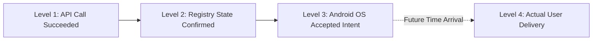

# P4.1-B.3 Phase 2A.1 — Scheduling Verification Contract
**Project:** Hafiz Al-Ahd (حافظ العهد)  
**Branch:** `feature/p4.1-independent-alarms-adhan`  
**Phase:** P4.1-B.3 — Phase 2A.1  
**Document ID:** Deliverable D (`Phase_2A.1_Scheduling_Verification_Contract.md`)  
**Status:** Frozen Contract — Architectural Specification  

---

## 1. Objective & Scope

This document specifies the precise verification semantics for prayer scheduling across both `package:alarm` and `flutter_local_notifications`. It rigorously delineates what can and cannot be proven by each API level and establishes explicit criteria for confirming that an event was successfully registered.

---

## 2. Deep Dive: Backend Verification APIs (D1, D2)

### 2.1. `package:alarm` (v5.12.0) Verification Reality
- **API Signature:** `Alarm.set({required AlarmSettings alarmSettings}) -> Future<bool>`
- **Internal Verification Mechanics:**
  - `Alarm.set()` calls the Android platform channel method `setAlarm`.
  - On the Android native side, it schedules an exact alarm using `AlarmManager.setExactAndAllowWhileIdle()` via a `PendingIntent`.
  - It writes the `AlarmSettings` JSON into the plugin's local preferences storage.
  - Returns `true` if the platform channel and native call completed without throwing an exception.
- **Secondary Query API:** `Alarm.getAlarm(int id) -> AlarmSettings?`
  - Queries the plugin's registered alarm storage. If present and matching the target `dateTime`, it confirms registration.
- **Critical Distinction:**
  - `Alarm.getAlarm(id)` confirms plugin-level registration.
  - Android OS provides **no public API** to inspect the kernel-level `AlarmManager` queue for security and sandbox isolation reasons.

### 2.2. `flutter_local_notifications` (v21.0.0) Verification Reality
- **API Signature:** `zonedSchedule(..., scheduledDate, ...)` returns `Future<void>`.
- **Query API:** `flutterLocalNotificationsPlugin.pendingNotificationRequests() -> Future<List<PendingNotificationRequest>>`
- **Internal Verification Mechanics:**
  - Queries the list of pending notification requests persisted by FLN in Android SharedPreferences.
  - Inspecting `pendingNotificationRequests()` for an entry matching `id == targetId` confirms that FLN successfully registered and scheduled the event.

---

## 3. The Four Tiers of Verification Semantics (D3)

It is architecturally mandatory never to conflate the four tiers of scheduling verification:



| Verification Tier | Meaning | Verification API | What It Proves | What It Does NOT Prove |
|---|---|---|---|---|
| **Level 1: API Call Succeeded** | Method invocation returned without exception | `await Alarm.set(...) == true`<br>`await zonedSchedule(...)` completes | Dart-to-native IPC platform channel succeeded | Does not prove persistent presence in registry |
| **Level 2: Registry State Confirmed** | Record exists in plugin persistent store | `Alarm.getAlarm(id) != null`<br>`pendingRequests.any((r) => r.id == id)` | Event is recognized by the plugin and survives app restart | Does not prove Android kernel execution |
| **Level 3: Android OS Accepted Intent** | OS scheduled the `PendingIntent` without error | Lack of `SecurityException` / Exact Alarm permission check | Android system accepted the exact alarm trigger | Does not guarantee wake if phone is dead |
| **Level 4: Actual User Delivery** | Audio played / notification rendered on screen | `AdhanScreen.initState()` or notification response tap | User actually experienced the alert | **Cannot be proven at scheduling time** |

---

## 4. Verification Contract for Phase 2 Implementation

### 4.1. Contract for Alarm Scheduling:
```dart
Future<bool> verifyAlarmScheduled(int id, DateTime expectedTime) async {
  // Level 1: API call must complete returning true
  // Level 2: Query Alarm.getAlarm(id)
  final alarm = Alarm.getAlarm(id);
  if (alarm == null) return false;
  
  // Verify ID and scheduled timestamp match within 1-second margin
  final diff = (alarm.dateTime.difference(expectedTime)).inSeconds.abs();
  return diff <= 1;
}
```

### 4.2. Contract for Notification Scheduling:
```dart
Future<bool> verifyNotificationScheduled(int id) async {
  // Level 1: zonedSchedule completed without exception
  // Level 2: pendingNotificationRequests query
  final pending = await flutterLocalNotificationsPlugin.pendingNotificationRequests();
  return pending.any((req) => req.id == id);
}
```

### 4.3. Standard for Transition Completion:
- An old event may **only** be cancelled after the new event has attained **Level 1 + Level 2 verification**.
- If verification fails, the transition is aborted, the existing event is preserved, and the day is marked **incomplete**.

