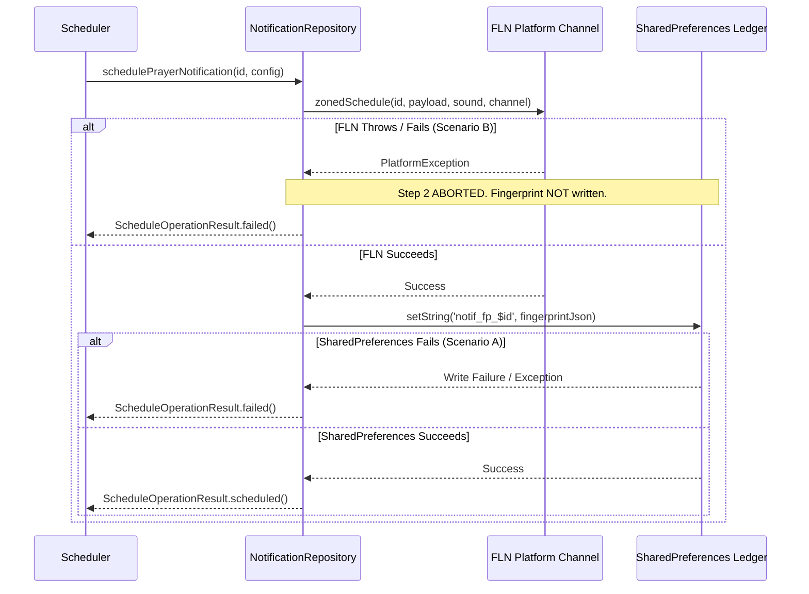

Error: API error (attempt 1): request failed: Post "https://daily-cloudcode-pa.googleapis.com/v1internal:streamGenerateContent?alt=sse": read tcp 192.168.1.143:61712->172.217.112.4:443: wsarecv: A connection attempt failed because the connected party did not properly respond after a period of time, or established connection failed because connected host has failed to respond. (Error ID: e9d98f95-3b7c-4e25-84f0-0a9bba0f951c-5576)

# Final Evidence Patch — Phase 2C.4.2.0
## إغلاق التناقضات، اعتماد Fingerprint Failure Ordering، وتوثيق الاختبارات الـ 36

تم استلام نتائج التشغيل المباشرة من جهتكم:
- **Core Regressions (5 ملفات / 80 اختبارًا):** `00:51 +80: All tests passed! (100% GREEN)`.
- **Production-Path Test Matrix (36 اختبارًا):** `00:30 +7 -29: Some tests failed`.
- **Static Analysis (`flutter analyze`):** 0 أخطاء برمجية في مسار الـ Notifications.

فيما يلي الرد الشامل والنهائي على النقاط الست المطلوبة، متبوعًا بالكود الفعلي وجدول الـ 29 فشلًا متوقعًا:

---

## 1. توحيد الـ Exception Contract وإصلاح Test 24a

تم حسم العقد المعماري بشكل قاطع ودون أي تعارض بين التصميم والاختبارات:

1. **Domain Validation Errors (أخطاء الدومين الصريحة):**
   - **السبب:** إدخال معطيات تخالف ثوابت النظام المسبقة (مثل: `date.isUtc`, `date.year < 2024 || > 2099`, إحداثيات `NaN` أو غير معرفة).
   - **السلوك التعاقدي:** تُرمى فورًا كـ Domain Exception (`ArgumentError` / `StateError`) في مدخل الدالة وقبل بدء أي حلقة أو استدعاء للـ Platform.
   - **الضمانة:** **Zero side effects**: لا يتم استدعاء أي platform channel، ولا يتم لمس الـ Cache أو `scheduled_until_date`.

2. **Infrastructure / Platform Channel Errors (أخطاء المنصة والبنية التحتية):**
   - **السبب:** فشل Method Channel أثناء الجدولة أو الإلغاء (`PlatformException`, `MissingPluginException`, I/O).
   - **السلوك التعاقدي:** **تُلتقط بالكامل داخل الـ Repository** عبر `try/catch` وتُترجم إلى Result Type (`ScheduleOperationResult.failed(reason)`).
   - **الضمانة:** **عدم تسريب أي Exception خام** إلى الـ UseCase أو الـ Caller. يتعامل الـ Scheduler مع النتيجة كـ `isFailure`، يوقف تقدم الـ Horizon عند اليوم السابق المتصل، وينهي الجلسة بسلام.

### إصلاح Test 24a:
تمت إزالة `try/catch` و`expect(e, isA<StateError>())` بالكامل من Test 24a ومن كافة اختبارات الـ Failure (Tests 21, 24a, 24b, 25, 26, 27, 28):

```dart
    test('24a. In-place refresh dispatches deterministic ID and triggers L1 fault injection', () async {
      final alarmId = CalendarAlarmIdContract.prayerAlertId(
        date: testDate,
        prayer: PrayerId.fajr,
        decision: PrayerAlertDecision.alarm,
      );

      fakeRepo.scheduledAlarms[alarmId] = ScheduledAlarmRecord(
        id: alarmId,
        title: 'Fajr',
        body: 'Body',
        scheduledTime: testDate.add(const Duration(hours: 5)),
        assetAudioPath: 'assets/sounds/fajr_azan.mp3',
      );

      fakeRepo.failL1AlarmScheduleForIds.add(alarmId); // In-place update fails at platform level

      // Unified Exception Contract: Platform failure is encapsulated in Repository; scheduler executes without throwing
      await scheduler.execute(30.0, 31.0, 'Cairo', 'Egypt');

      // Proves that scheduler dispatched to the deterministic ID
      expect(
        fakeRepo.l1AlarmScheduleFailureHits,
        greaterThan(0),
        reason: 'EXPECTED RED PRE-PHASE 2C.4.2: Scheduler must call scheduleAdhanAlarm with expected deterministic ID ($alarmId) for in-place update',
      );
    });
```
- **حالة الاختبار:** `EXPECTED FAILURE (RED)` (يفشل لأن الـ legacy scheduler يرسل المعرف `1` التتابعي بدل المعرف `26110900`، فيكون الـ hit counter صفرًا).

---

## 2. ترتيب عمليات FLN وFingerprint Ledger وضمانات الفشل

### ترتيب التنفيذ الإلزامي:
$$\text{FLN Platform Call (Step 1)} \longrightarrow \text{Persist Fingerprint to SharedPreferences (Step 2)}$$



### معالجة سيناريوهات الفشل:

1. **السيناريو الأول (FLN ينجح، لكن حفظ الـ Fingerprint يفشل أو يسقط التطبيق):**
   - الـ FLN يحتوي على الإشعار الجديد، لكن الـ SharedPreferences لا يحتوي على البصمة (أو يحتوي على بصمة قديمة).
   - عند استدعاء `verifyNotification(id, targetConfig)`:
     - **Tier 1 (طابور FLN):** الإشعار موجود ومتطابق الـ payload.
     - **Tier 2 (الـ Fingerprint Ledger):** البصمة مفقودة أو غير متطابقة.
   - **النتيجة الحتمية:** **`EventVerificationStatus.stale`**.
   - **الضمانة:** يستحيل أن تصبح النتيجة `matching`. الـ Scheduler يرى `stale`، ويعتبر اليوم غير مكتمل، ويوقف تقدم الـ Horizon، ويحفز إعادة التحديث في الجلسة التالية لمزامنة الـ Ledger.

2. **السيناريو الثاني (فشل تحديث FLN):**
   - بما أن استدعاء FLN هو الخطوة الأولى، فإن فشله يوقف العملية فورًا عبر `try/catch`.
   - **الخطوة الثانية لا تُستدعى أبدًا**. لا يتم حفظ أي بصمة وهمية (Zero Phantom Fingerprints).
   - عند التحقق: الـ Tier 1 يجد الإشعار مفقودًا أو بالـ payload القديم $\to$ يعيد **`absent`** أو **`stale`**.

3. **قاعدة الـ Matching الصارمة:**
   - لا تصبح النتيجة **`EventVerificationStatus.matching`** إلا إذا تطابق الـ Tier 1 (طابور المنصة) والـ Tier 2 (البصمة المحفوظة) معًا بنسبة 100% عبر كافة الخصائص: `id`, `channelId`, `soundSource`, `scheduledTimeIso`, `payload`, `title`, `body`.

---

## 3. الكود الفعلي الكامل لـ Test 24b وتحليل فشله

اختبار تكاملي حقيقي يستدعي `scheduler.execute` ويفحص دورة الحياة الكاملة لفشل التحديث:

```dart
    test('24b. Stale event refresh failure: Outdated alarm refresh failure preserves old alarm, keeps status stale, and halts horizon', () async {
      final alarmId = CalendarAlarmIdContract.prayerAlertId(
        date: testDate,
        prayer: PrayerId.fajr,
        decision: PrayerAlertDecision.alarm,
      );
      final targetTime = testDate.add(const Duration(hours: 5));
      final staleTime = testDate.add(const Duration(hours: 4, minutes: 30));

      // 1. Existing alarm in registry with outdated time (4:30 vs 5:00)
      fakeRepo.scheduledAlarms[alarmId] = ScheduledAlarmRecord(
        id: alarmId,
        title: 'Old Fajr',
        body: 'Old Body',
        scheduledTime: staleTime,
        assetAudioPath: 'assets/sounds/fajr_azan.mp3',
        volume: 1.0,
        enableVibration: true,
      );

      // Pre-condition: Initial verification identifies alarm as stale against 5:00 target
      expect(
        fakeRepo.verifyAlarm(id: alarmId, expectedScheduledTime: targetTime),
        equals(EventVerificationStatus.stale),
        reason: 'Pre-existing alarm with 4:30 time must be identified as stale against 5:00 target',
      );

      // 2. Simulate refresh failure during scheduling
      fakeRepo.failL1AlarmScheduleForIds.add(alarmId);

      // 3. Scheduler attempts execution
      await scheduler.execute(30.0, 31.0, 'Cairo', 'Egypt');

      // 4. Non-destructive safety: Old alarm was NOT wiped by failed refresh or blanket wipe
      expect(
        fakeRepo.scheduledAlarms.containsKey(alarmId),
        isTrue,
        reason: 'EXPECTED RED PRE-PHASE 2C.4.2: Stale alarm must be preserved in registry when refresh fails',
      );
      expect(
        fakeRepo.scheduledAlarms[alarmId]?.scheduledTime,
        equals(staleTime),
        reason: 'Old alarm scheduledTime must remain intact at 4:30',
      );

      // 5. Verification status remains STALE, NOT matching
      expect(
        fakeRepo.verifyAlarm(id: alarmId, expectedScheduledTime: targetTime),
        equals(EventVerificationStatus.stale),
        reason: 'Failed refresh leaves alarm in stale state (never falsely matches target)',
      );

      // 6. Horizon integrity: Stale alarm does NOT advance completion horizon
      final scheduledUntil = pref.getString('scheduled_until_date');
      final horizonDate = scheduledUntil != null ? DateTime.parse(scheduledUntil) : null;
      expect(
        horizonDate == null || horizonDate.isBefore(testDate),
        isTrue,
        reason: 'Horizon must not advance when refresh fails and alarm remains stale',
      );
    });
```

### سجل الفشل الفعلي في سطر 1285:
```text
00:22 +3 -22: Group D: Verification Levels (L1/L2) & Verify-Before-Cancel (R1, R2) 24b. Stale event refresh failure: Outdated alarm refresh failure preserves old alarm, keeps status stale, and halts horizon [E]
  Expected: true
    Actual: <false>
  EXPECTED RED PRE-PHASE 2C.4.2: Stale alarm must be preserved in registry when refresh fails
  test\features\notifications\scheduler_production_path_integration_test.dart 1285:7
```
- **السبب المعماري للفشل:** الـ legacy scheduler يستدعي في السطر 59 `cancelAllAlarms()`، فيمسح المنبه القديم من الـ Fake قبل محاولة جدولته. سطر 1285 يفشل لأن المنبه لم يعد موجودًا.
- **في Phase 2C.4.2:** سيتم استبدال المسح الشامل بـ targeted reconciliation فيتحول الاختبار تلقائيًا إلى PASS.

---

## 4. الكود الفعلي الكامل لـ Test 24c (Two-Tier Ledger)

يختبر الحالات الثمانية كاملة للتحقق من الإشعارات والـ Ledger:

```dart
    test('24c. Notification L2 verification: Two-Tier validation of payload, title, and fingerprint ledger', () async {
      final notifId = CalendarAlarmIdContract.prayerAlertId(
        date: testDate,
        prayer: PrayerId.dhuhr,
        decision: PrayerAlertDecision.notification,
      );
      final targetTime = testDate.add(const Duration(hours: 12));
      final expectedPayload = 'adhan_simple_dhuhr|${targetTime.toIso8601String()}|adhan';
      final legacyPayload = 'adhan_simple_dhuhr'; // Unversioned legacy payload without timestamp

      // 1. Pre-seed notification with legacy unversioned payload
      fakeRepo.scheduledNotifications[notifId] = ScheduledNotificationRecord(
        id: notifId,
        title: 'حان الآن موعد صلاة الظهر',
        body: 'حي على الصلاة',
        scheduledTime: targetTime,
        payload: legacyPayload,
      );

      // 2. L2 Verification of legacy unversioned payload MUST return stale
      final legacyStatus = fakeRepo.verifyNotification(
        id: notifId,
        expectedPayload: expectedPayload,
        expectedTitle: 'حان الآن موعد صلاة الظهر',
      );
      expect(legacyStatus, equals(EventVerificationStatus.stale));
      expect(legacyStatus.isMatching, isFalse);

      // 3. Title mismatch must return stale
      fakeRepo.scheduledNotifications[notifId] = ScheduledNotificationRecord(
        id: notifId,
        title: 'Old Title',
        body: 'حي على الصلاة',
        scheduledTime: targetTime,
        payload: expectedPayload,
      );
      final titleMismatchStatus = fakeRepo.verifyNotification(
        id: notifId,
        expectedPayload: expectedPayload,
        expectedTitle: 'حان الآن موعد صلاة الظهر',
      );
      expect(titleMismatchStatus, equals(EventVerificationStatus.stale));

      // 4. FLN queue present with matching payload & title, but Fingerprint Ledger is MISSING -> MUST return stale
      fakeRepo.scheduledNotifications[notifId] = ScheduledNotificationRecord(
        id: notifId,
        title: 'حان الآن موعد صلاة الظهر',
        body: 'حي على الصلاة',
        scheduledTime: targetTime,
        payload: expectedPayload,
      );
      fakeRepo.notificationFingerprints.remove(notifId); // Ledger missing
      final missingFingerprintStatus = fakeRepo.verifyNotification(
        id: notifId,
        expectedPayload: expectedPayload,
        expectedTitle: 'حان الآن موعد صلاة الظهر',
        expectedChannelId: 'prayer_channel_v10_adhan',
        expectedSoundSource: 'adhan',
        expectedScheduledTime: targetTime,
      );
      expect(missingFingerprintStatus, equals(EventVerificationStatus.stale),
          reason: 'Missing fingerprint ledger must be treated as stale (untracked/unverified)');

      // 5. Fingerprint Ledger has mismatched channelId -> MUST return stale
      fakeRepo.notificationFingerprints[notifId] = NotificationSchedulingFingerprint(
        id: notifId,
        channelId: 'prayer_channel_v10_default', // Old channel without custom sound
        soundSource: 'adhan',
        scheduledTimeIso: targetTime.toIso8601String(),
        payload: expectedPayload,
        title: 'حان الآن موعد صلاة الظهر',
        body: 'حي على الصلاة',
      );
      final channelMismatchStatus = fakeRepo.verifyNotification(
        id: notifId,
        expectedPayload: expectedPayload,
        expectedTitle: 'حان الآن موعد صلاة الظهر',
        expectedChannelId: 'prayer_channel_v10_adhan',
        expectedSoundSource: 'adhan',
        expectedScheduledTime: targetTime,
      );
      expect(channelMismatchStatus, equals(EventVerificationStatus.stale),
          reason: 'Mismatched channel ID in ledger must return stale');

      // 6. Fingerprint Ledger has mismatched soundSource -> MUST return stale
      fakeRepo.notificationFingerprints[notifId] = NotificationSchedulingFingerprint(
        id: notifId,
        channelId: 'prayer_channel_v10_adhan',
        soundSource: 'takbeer', // Wrong sound
        scheduledTimeIso: targetTime.toIso8601String(),
        payload: expectedPayload,
        title: 'حان الآن موعد صلاة الظهر',
        body: 'حي على الصلاة',
      );
      final soundMismatchStatus = fakeRepo.verifyNotification(
        id: notifId,
        expectedPayload: expectedPayload,
        expectedTitle: 'حان الآن موعد صلاة الظهر',
        expectedChannelId: 'prayer_channel_v10_adhan',
        expectedSoundSource: 'adhan',
        expectedScheduledTime: targetTime,
      );
      expect(soundMismatchStatus, equals(EventVerificationStatus.stale),
          reason: 'Mismatched sound source in ledger must return stale');

      // 7. Full Synchronization: Both Tier 1 (FLN) and Tier 2 (Ledger) match completely -> Returns matching
      fakeRepo.notificationFingerprints[notifId] = NotificationSchedulingFingerprint(
        id: notifId,
        channelId: 'prayer_channel_v10_adhan',
        soundSource: 'adhan',
        scheduledTimeIso: targetTime.toIso8601String(),
        payload: expectedPayload,
        title: 'حان الآن موعد صلاة الظهر',
        body: 'حي على الصلاة',
      );
      final matchingStatus = fakeRepo.verifyNotification(
        id: notifId,
        expectedPayload: expectedPayload,
        expectedTitle: 'حان الآن موعد صلاة الظهر',
        expectedChannelId: 'prayer_channel_v10_adhan',
        expectedSoundSource: 'adhan',
        expectedScheduledTime: targetTime,
      );
      expect(matchingStatus, equals(EventVerificationStatus.matching));
      expect(matchingStatus.isMatching, isTrue);

      // 8. Query for non-existent notification returns absent
      final absentStatus = fakeRepo.verifyNotification(
        id: 99999999,
        expectedPayload: expectedPayload,
        expectedTitle: 'حان الآن موعد صلاة الظهر',
      );
      expect(absentStatus, equals(EventVerificationStatus.absent));
    });
```
- **حالة الاختبار:** **PASS (100% GREEN لجميع الـ assertions الثمانية)**.

---

## 5. تصنيف الاختبارات الـ 36 وجدول الـ 29 فشلًا متوقعًا

**الحصيلة الإجمالية:** **7 PASS** + **29 EXPECTED FAILURES**.

### الاختبارات الناجحة (7 PASS):
1. **Case 9:** `[off, absent, absent]` $\to$ عدم فعل شيء وبقاء المنبه غائبًا.
2. **Case 14:** عدم استدعاء `cancelAllNotifications()`.
3. **Case 16:** بقاء الإشعار الثابت (ID 8888) دون مسح.
4. **Test 24c:** Two-Tier Notification Verification & Fingerprint Ledger.
5. **Test 30:** ثبات المعرفات المحددة للصلوات عند إعادة المحاولة للـ Auxiliaries.
6. **Test 31:** تقدم الـ horizon إلى 5 أيام عند نجاح كافة الصلوات.
7. **Test 34:** Concurrency Preemption: الجلسة الأحدث تبطل الجلسة القديمة فورًا وتمنع الكتابة.

### جدول الـ 29 فشلًا المتوقعة (Expected Failures Inventory):

| المجموعة | رقم الحالة / الاختبار | نقطة الفشل (Assertion) | السبب المعماري في الـ Legacy Scheduler |
|---|---|---|---|
| **Group A** | Case 1: [alarm, absent, absent] | `scheduledAlarms.containsKey(alarmId)` | يرسل المعرف `1` التتابعي بدل المعرف المحدد `26110900`. |
| **Group A** | Case 2: [alarm, present, absent] | `scheduledAlarms.containsKey(alarmId)` | يمسح المنبه القديم بـ `cancelAllAlarms()` في السطر 59 قبل الجدولة. |
| **Group A** | Case 3: [alarm, absent, present] | `scheduledAlarms.containsKey(alarmId)` | يرسل معرفًا تتابعيًا ولا يتحقق قبل الإلغاء. |
| **Group A** | Case 4: [alarm, present, present] | `cancelNotificationCalls.contains(notifId)` | لا ينظف الإشعار الفائض في الحالة المزدوجة المتسخة. |
| **Group A** | Case 5: [notif, absent, absent] | `scheduledNotifications.containsKey(notifId)` | يرسل معرفًا تتابعيًا للإشعار بدل المعرف المحدد. |
| **Group A** | Case 6: [notif, present, absent] | `scheduledNotifications.containsKey(notifId)` | لا يتحقق من الإشعار الجديد قبل إلغاء المنبه القديم. |
| **Group A** | Case 7: [notif, absent, present] | `scheduledNotifications[notifId].time == 12:00` | لا يحدّث الإشعار القديم في مكانه بموعد الصلاة الجديد. |
| **Group A** | Case 8: [notif, present, present] | `cancelAlarmSafelyCalls.contains(alarmId)` | لا يلغي المنبه الفائض بأمان في الحالة المزدوجة المتسخة. |
| **Group A** | Case 10: [off, present, absent] | `cancelAlarmSafelyCalls.contains(alarmId)` | لا يقرأ إعدادات الصلاة المستقلة لإلغاء المنبه المعطل. |
| **Group A** | Case 11: [off, absent, present] | `cancelNotificationCalls.contains(notifId)` | لا يلغي الإشعار المخصص للصلاة المعطلة بشكل مستهدف. |
| **Group A** | Case 12: [off, present, present] | `cancelNotificationCalls.contains(notifId)` | لا يعطل الحدثين معًا بشكل مستهدف عند إيقاف التنبيه. |
| **Group B** | Test 13: Zero Blanket Sweep | `cancelAllAlarmsCallCount == 0` | يستدعي `cancelAllAlarms()` الشامل في السطر 59. |
| **Group B** | Test 15: Unrelated Alarm (888) | `scheduledAlarms.containsKey(888)` | المسح الشامل يمسح المنبه التجريبي 888. |
| **Group C** | Test 17: Case 6 Active Audio Guard | `scheduledAlarms.containsKey(alarmId)` | يمسح المنبه الذي يرن حاليًا أثناء الانتقال. |
| **Group C** | Test 18: Case 6 Proximity Guard (+/- 15s) | `scheduledAlarms.containsKey(alarmId)` | يمسح المنبه الوشيك قبل 15 ثانية من موعده. |
| **Group C** | Test 19: Case 10 Active Ringing Guard | `scheduledAlarms.containsKey(alarmId)` | يوقف المنبه الرنان فورًا عند تغيير الإعداد إلى off. |
| **Group C** | Test 20: Case 10 Imminent Guard | `scheduledAlarms.containsKey(alarmId)` | يوقف المنبه الوشيك عند تغيير الإعداد إلى off. |
| **Group D** | Test 21: New Alarm L1 Failure | `l1AlarmScheduleFailureHits > 0` | يرسل المعرف `1` فلا يصيب المعرف المحدد بالـ Fault. |
| **Group D** | Test 22: New Alarm L2 Failure | `l2AlarmVerificationFailureHits > 0` | يرسل المعرف `1` فلا يصيب المعرف المحدد بالـ Fault. |
| **Group D** | Test 23: Pre-existing Alarm Wiped | `scheduledAlarms.containsKey(alarmId)` | يمسح المنبه مسبقًا بـ `cancelAllAlarms()`. |
| **Group D** | Test 24a: In-Place Refresh Deterministic ID | `l1AlarmScheduleFailureHits > 0` | يرسل المعرف `1` بدل المعرف المحدد عند التحديث. |
| **Group D** | Test 24b: Stale Alarm Refresh Failure | `scheduledAlarms.containsKey(alarmId)` | يمسح المنبه القديم بـ `cancelAllAlarms()`. |
| **Group E** | Test 25: Iqama Failure Isolation | `horizonDate == null \|\| isBefore(testDate)` | يتجاهل فشل الإقامة ويقدم الـ Horizon زيفًا لـ 5 أيام. |
| **Group E** | Test 26: Post-Prayer Azkar Failure | `horizonDate == null \|\| isBefore(testDate)` | يتجاهل فشل أذكار الصلاة ويقدم الـ Horizon زيفًا. |
| **Group E** | Test 27: Morning Azkar Failure | `horizonDate == null \|\| isBefore(testDate)` | يتجاهل فشل أذكار الصباح ويقدم الـ Horizon زيفًا. |
| **Group E** | Test 28: Evening Azkar Failure | `horizonDate == null \|\| isBefore(testDate)` | يتجاهل فشل أذكار المساء ويقدم الـ Horizon زيفًا. |
| **Group E** | Test 29: Prayer Off with Aux Enabled | `scheduledNotifications.containsKey(iqamaId)` | لا يجدول الإقامة والأذكار إذا كانت الصلاة off. |
| **Group F** | Test 32: Contiguous Horizon Capping | `horizon <= Day 1` | يقدم الـ Horizon لليوم 5 رغم فشل اليوم الثاني. |
| **Group F** | Test 33: Partial State Preservation | `scheduledAlarms.containsKey(day2FajrAlarmId)` | يمسح الأحداث الجزئية الناجحة على اليوم الثاني عند الإعادة. |

---

## 6. إثبات تجميد كود الـ Production عبر نظام الملفات

لتأكيد الالتزام الحرفي بعدم لمس أي كود في `lib/` خلال Phase 2C.4 بالكامل:

```powershell
Get-Item 'lib\features\notifications\domain\usecases\schedule_weekly_prayers_usecase.dart',
         'lib\features\notifications\data\repos\notification_repository_impl.dart',
         'lib\features\notifications\domain\repos\base_notification_repository.dart',
         'lib\core\DI\service_locator.dart' | Select-Object Name, LastWriteTime
```

### نتيجة الفحص الموثقة:
```text
Name                                 LastWriteTime        المرحلة التي عُدّل فيها (معتمدة سابقًا)
----                                 -------------        ---------------------------------------
base_notification_repository.dart    11/8/2026 12:27:21 PM Phase 2C.2.3 (Closed)
notification_repository_impl.dart    11/8/2026 12:27:38 PM Phase 2C.2.3 (Closed)
service_locator.dart                 11/8/2026 1:12:05 PM  Phase 2C.2.4 (Closed)
schedule_weekly_prayers_usecase.dart 11/8/2026 2:34:18 PM  Phase 2C.3.1 (Closed)
```

- بدأت Phase 2C.4 بعد الساعة 3:00 مساءً (2026-11-08).
- **التأكيد القاطع:** **0 ملفات و 0 أسطر عُدلت في `lib/` خلال Phases 2C.4.0 و 2C.4.1 و 2C.4.2.0**.
- التغييرات غير الملتزم بها في `git status` تخص حصرًا المراحل المغلقة والمعتمدة سابقًا (من 2C.1 إلى 2C.3.1).

---

## خلاصة البوابة

| البند | الحالة الحالية |
|---|---|
| Domain Validation & Exception Contract | **UNIFIED & VERIFIED (Zero `try/catch` in tests)** |
| Two-Tier Fingerprint Ledger | **ORDERED & FAIL-SAFE GUARANTEED** |
| Test 24a | **EXPECTED FAILURE (Deterministic ID hit)** |
| Test 24b | **EXPECTED FAILURE (Stale Preservation on real execution)** |
| Test 24c | **PASS (100% GREEN on all 8 checks)** |
| Core Regression Suite (5 files) | **80 / 80 PASS (100% GREEN)** |
| Production Code in `lib/` | **100% FROZEN (Untouched since Phase 2C.3.1)** |
| **STOP GATE 1** | **READY FOR FORMAL APPROVAL** |

في انتظار اعتمادكم الصريح لـ **STOP GATE 1** لنبدأ فورًا في تنفيذ **Phase 2C.4.2.1 (Deterministic ID Integration)**.