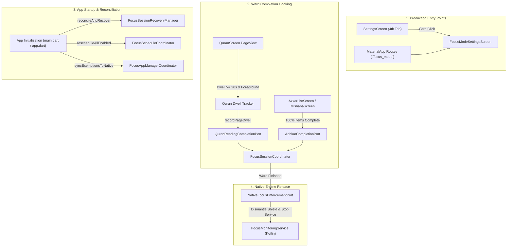

# Focus Mode — Phase 6 Plan: Production Integration

**Date:** 2026-11-22  
**Branch:** `poc/focus-mode`  
**Phase:** Phase 6 — Production Integration  
**Status:** DRAFT (Awaiting User Review & Approval)

---

## 1. Executive Summary & Objective

In Phases 1 through 5, we successfully engineered and tested the pure domain contracts, SQLite persistence with ACID transactions, exact AlarmManager scheduling with Doze-safe WakeLocks, thread-safe application exemptions with system-critical protections, and the complete BLoC/Cubit Presentation layer (108/108 passing automated tests, clean static analysis, and native Kotlin compilation).

**Phase 6 (Production Integration)** is the bridge between this isolated engine and Hafiz Al-Ahd's live production runtime.
The core objective is to hook the Focus Mode engine into the real app workflows—specifically Quran reading dwell tracking, Azkar completion, application startup reconciliation, and production settings entry points—with **strict zero-regression guarantees** on existing features (Adhan alarms, audio recitation, prayer times, and bookmarks).

---

## 2. Core Integration Components

---

## 3. Detailed Technical Architecture

### Component 1: Quran Reading Dwell Tracker & Port Integration
- **File:** `lib/features/quran/presentation/screens/quran_screen.dart` (or dedicated helper `quran_focus_dwell_tracker.dart`).
- **Domain Contract:** `QuranReadingCompletionPort.recordPageDwell(pageNumber: page, timeSpent: elapsed)`.
- **Engineering Rules (as agreed in Phase 1 & 2):**
  1. **Foreground-Only Tracking:** Dwell time is only accumulated while the app is in the foreground (`AppLifecycleState.resumed`) and the screen is actively visible.
  2. **Page Change / Navigation Flush:** When a page change event occurs (via drag, jump, or auto-scroll), the elapsed time on the prior page is finalized. If `elapsed >= 20 seconds`, it is committed via `recordPageDwell`.
  3. **App Pause / Sleep Handling:** If the app enters background or screen turns off, the current timer is halted immediately. Elapsed time prior to backgrounding is evaluated.
  4. **Non-Regression:** Absolutely zero interference with `QuranAudioCubit`, auto-scroll synchronization, Tafseer sheets, or bookmarking.

### Component 2: Adhkar Completion End-to-End Verification
- **Files:** `lib/features/azkar/presentation/screens/azkar_list_screen.dart` and `misbaha_screen.dart`.
- **Domain Contract:** `AdhkarCompletionPort.dispatchEvent(AdhkarCompletionEvent.completed(...))`.
- **Execution:**
  - Verify that when the user completes morning, evening, or custom azkar, the completion event is consumed by `FocusSessionCoordinator`.
  - The coordinator marks the session as `completed` atomically in `focus_mode.db` and dispatches `stopEnforcement()` to dismantle the native shield.

### Component 3: App Startup & Lifecycle Orchestration
- **Target:** `lib/app/view/app.dart` / `main.dart`.
- **Startup Sequence:**
  1. **Session Reconciliation:** Call `sl<FocusSessionRecoveryManager>().reconcileAndRecover()` upon application launch. If a session was initiated via AlarmManager while Flutter was dead, the session state is brought in sync immediately.
  2. **Alarm Rescheduling:** Call `sl<FocusScheduleCoordinator>().rescheduleAllEnabled()` to re-assert exact alarms with Android's `AlarmManager`.
  3. **Exemption Synchronization:** Ensure `sl<FocusAppManagerCoordinator>().syncExemptionsToNative()` runs to ensure the Kotlin `ExemptionRegistry` has the up-to-date whitelist.

### Component 4: Production UI Entry Points
- **Settings Screen (`lib/features/settings/presentation/screens/settings_screen.dart`):**
  - Add a dedicated section or card: **"وضع التركيز (حماية الأوراد)"**.
  - Styled with Hafiz Al-Ahd's golden palette (`AppColors.secondaryGold`, rounded cards).
  - Shows dynamic subtitle (e.g. `"3 أوراد مجدولة"` or `"جلسة نشطة حاليًا"`).
  - Tapping opens `FocusModeSettingsScreen`.
- **Named Routes (`lib/app/view/app.dart`):**
  - Register `'/focus_mode'` route for direct navigation or deep linking.

---

## 4. Non-Regression & Safety Protocol

| Production Area | Protection Measure |
|---|---|
| **Adhan Alarms** (`alarm`, `android_alarm_manager_plus`) | Focus Mode uses distinct PendingIntent requestCodes and distinct action names (`ACTION_FOCUS_ALARM_TRIGGER`). Zero collision with prayer alarms. |
| **Recitation Audio** (`just_audio`) | Quran dwell tracking is strictly passive listening to page changes; does not touch audio streams or players. |
| **Prayer Times** | Calculations and cached locations remain untouched. |
| **Existing Azkar State** (`AzkarTrackerCubit`) | Completion hooks only dispatch events to the port; no changes to existing counter or local storage. |

---

## 5. Verification & Testing Matrix

| Test Suite / Target | Purpose | Expected Result |
|---|---|---|
| **Quran Dwell Integration Test** | Tests that 20s+ dwell triggers `recordPageDwell` and completes Quran session | 🟢 PASS |
| **Adhkar Session Integration Test** | Tests that finishing Azkar list completes active session and stops native shield | 🟢 PASS |
| **Startup Recovery Test** | Verifies `reconcileAndRecover()` reconciles orphaned native session on app start | 🟢 PASS |
| **Settings Navigation Test** | Verifies SettingsScreen card opens FocusModeSettingsScreen | 🟢 PASS |
| **Phases 1–5 Regressions** | Run all 108 existing Focus Mode automated tests | 🟢 108/108 PASS |
| **Production Unit Tests** | Run all existing unit tests in the codebase | 🟢 PASS |
| **Static Analysis** | `flutter analyze --no-fatal-infos` | 🟢 0 Errors, 0 Warnings |
| **Native Kotlin Build** | `gradlew compileDebugKotlin` | 🟢 BUILD SUCCESSFUL |

---

## 6. STOP GATE Protocol

As with all prior phases:
- Upon completion of Phase 6, a comprehensive `PHASE_6_COMPLETION_REPORT.md` will be generated.
- **Phase 7 (Device Matrix & Play Policy Review)** will NOT begin until Phase 6 is reviewed and explicitly approved by the user.
