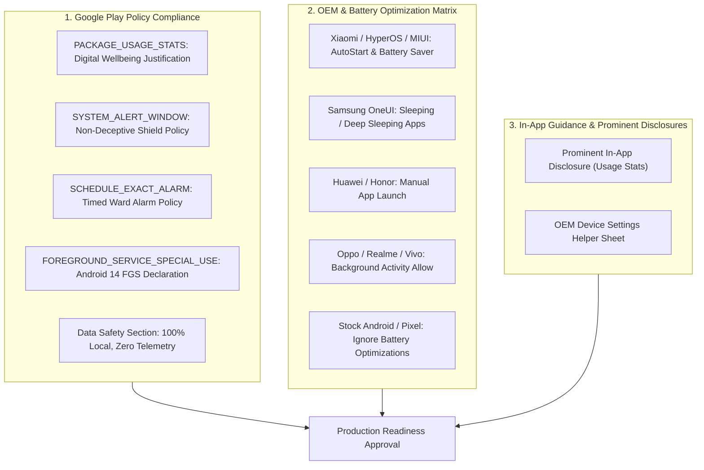

# Focus Mode — Phase 7 Plan: Device Matrix & Play Policy Review

**Date:** 2026-11-22  
**Branch:** `poc/focus-mode`  
**Phase:** Phase 7 — Device Matrix & Play Policy Review  
**Status:** DRAFT (Awaiting User Review & Approval)

---

## 1. Executive Summary & Objective

In Phases 1 through 6, we designed, implemented, and verified the complete Focus Mode feature—from domain contracts, atomic SQLite persistence, exact AlarmManager scheduling, app exemption management, to settings UI and production integration into Hafiz Al-Ahd (115/115 passing tests, 0 analyzer errors, clean Gradle builds).

**Phase 7 (Device Matrix & Play Policy Review)** is the final pre-release engineering phase.
Its primary objective is to guarantee **Google Play Store compliance** and **OEM device resilience**:
1. Formulate formal Google Play Console policy justifications and in-app disclosures for all sensitive permissions (`PACKAGE_USAGE_STATS`, `SYSTEM_ALERT_WINDOW`, `SCHEDULE_EXACT_ALARM`, and `FOREGROUND_SERVICE_SPECIAL_USE`).
2. Implement a targeted OEM workaround guide and in-app helper for aggressive battery-saving manufacturers (Xiaomi/HyperOS, Samsung OneUI, Huawei, Oppo/Realme, Vivo).
3. Validate Android API version compatibility (Android 8.0 / API 26 through Android 14+ / API 34).
4. Verify package visibility (`<queries>`) to avoid the heavily penalized `QUERY_ALL_PACKAGES` permission.

---

## 2. Core Pillars of Phase 7

---

## 3. Detailed Technical Specifications

### Pillar 1: Google Play Store Policy Justifications
1. **`PACKAGE_USAGE_STATS`:**
   - **Play Console Classification:** Digital Wellbeing / Habit & Worship Focus.
   - **Prominent Disclosure Requirement:** User must see an explicit in-app dialogue explaining *why* access is needed before system settings open.
   - **Privacy Guarantee:** 100% on-device evaluation; zero transmission of app usage telemetry.
2. **`SYSTEM_ALERT_WINDOW` (Overlay):**
   - **Play Console Compliance:** Must not obstruct emergency services or system controls; easily dismissible via snooze/cancel within Hafiz Al-Ahd.
   - **System-Critical Invariant:** Dialer, Launcher, Emergency dialer, and Hafiz Al-Ahd are permanently unshielded.
3. **`SCHEDULE_EXACT_ALARM` & `USE_EXACT_ALARM`:**
   - Declared for user-scheduled spiritual habits (Morning/Evening Azkar and Quran reading alarms).
4. **Android 14+ Foreground Service (`specialUse`):**
   - Update `PROPERTY_SPECIAL_USE_FGS_SUBTYPE` in `AndroidManifest.xml` from PoC text to production text:
     `"Focus mode monitoring to prevent digital distractions during daily Quran and Azkar worship sessions"`.
5. **Package Visibility Compliance:**
   - Add `<intent><action android:name="android.intent.action.MAIN"/><category android:name="android.intent.category.LAUNCHER"/></intent>` to `<queries>` in `AndroidManifest.xml`, ensuring we NEVER request `QUERY_ALL_PACKAGES`.

### Pillar 2: OEM Workaround Architecture & Matrix
Aggressive OEM task killers (MIUI, OneUI, EMUI) terminate background poller services unless configured properly.
We will deliver:
1. **`OEM_DEVICE_MATRIX.md`:** Comprehensive engineering guide for top manufacturers.
2. **`OEMGuidanceHelper` (Dart):**
   - Detects device manufacturer (via `device_info_plus` or platform channel).
   - Generates manufacturer-specific instructions in Arabic.
3. **In-App Device Helper UI (`FocusOEMGuideSheet`):**
   - Accessible via a button in `FocusModeSettingsScreen`: *"إرشادات تثبيت الخدمة لأجهزة شاومي وسامسونج وغيرها"*.
   - Provides step-by-step guidance for Autostart, Battery Saver, and Lock in Recents.

### Pillar 3: In-App Prominent Disclosures
- Implement `FocusProminentDisclosureDialog` in `FocusPermissionsCard` when requesting Usage Access:
  - Clear Arabic statement emphasizing that Hafiz Al-Ahd checks active apps locally solely to protect worship sessions and never tracks, collects, or sends user activity.

---

## 4. Deliverables & Artifacts

1. **`docs/focus_mode/PLAY_POLICY_DECLARATION.md`:** Formal policy justification document ready for submission in Google Play Console.
2. **`docs/focus_mode/OEM_DEVICE_MATRIX.md`:** Detailed OEM compatibility reference guide.
3. **Code Enhancements:**
   - Update `AndroidManifest.xml` (FGS subtype & queries).
   - Add `FocusProminentDisclosureDialog` and `FocusOEMGuideSheet` in presentation layer.
4. **Automated Tests:**
   - Unit and widget tests for prominent disclosures and OEM helper dialog.
5. **`docs/focus_mode/PHASE_7_COMPLETION_REPORT.md`:** Final completion report for Phase 7.

---

## 5. Verification Matrix

| Verification Item | Target | Expected Result |
|---|---|---|
| **Manifest Audit** | `AndroidManifest.xml` queries & permissions | Zero `QUERY_ALL_PACKAGES`, valid FGS subtype |
| **Disclosure Dialog Test** | Prominent disclosure renders before intent launch | 🟢 PASS |
| **OEM Helper Test** | Manufacturer guidance renders appropriate steps | 🟢 PASS |
| **All Focus Mode Tests** | Full test suite regression | 🟢 100% PASS |
| **Static Analysis** | `flutter analyze --no-fatal-infos` | 🟢 0 Errors, 0 Warnings |
| **Native Kotlin Build** | `gradlew compileDebugKotlin` | 🟢 BUILD SUCCESSFUL |

---

## 6. STOP GATE Protocol
- Phase 7 is the final phase of the Focus Mode roadmap.
- Once Phase 7 is completed and reviewed, a final sign-off report will be submitted to the user for pre-merge approval into `main`.
