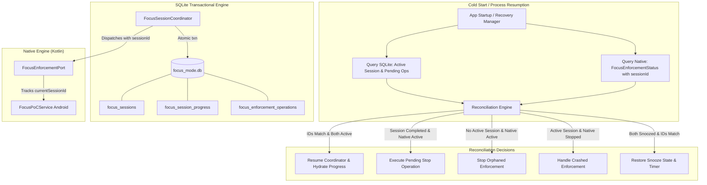

# خطة تنفيذ المرحلة الثانية (المعدلة — Rev 2)
## دورة حياة الجلسة والاستدامة ومصالحة الحالة
### Phase 2 Rev 2 — Session Lifecycle, SQLite Persistence & Crash Consistency

**Document ID:** `FOCUS_MODE_PHASE_2_PLAN_REV2`  
**Branch:** `poc/focus-mode` (معزول تماماً عن الإنتاج)  
**Parent Study:** `FOCUS_MODE_R1` to `R9`  
**Preceding Approved Artifacts:** [PHASE_1_COMPLETION_REPORT.md](file:///C:/Users/shady%20atef/.gemini/antigravity/brain/7bc0d8aa-a026-46ef-a6b6-73a7522c3a9c/PHASE_1_COMPLETION_REPORT.md) | [PHASE_1_VERIFICATION_ADDENDUM.md](file:///C:/Users/shady%20atef/.gemini/antigravity/brain/7bc0d8aa-a026-46ef-a6b6-73a7522c3a9c/PHASE_1_VERIFICATION_ADDENDUM.md)  
**Status:** PROPOSED REVISION — AWAITING USER APPROVAL  

---

## 1. التقييم الهندسي وأهداف التعديل (Rev 2 Objectives)

بناءً على المراجعة النقدية العميقة للخطة السابقة، تم إعادة تصميم بنية التخزين ودورة الحياة لمعالجة الثغرات التشغيلية المحتملة:

1. **التحول إلى التخزين الذري (SQLite Transactions):** التخلي عن `SharedPreferences` كمصدر لحالة الجلسة، واعتماد `sqflite` (الموجود بالفعل في المشروع) لتنفيذ عمليات الحفظ والأرشفة كوحدة ذرية لا تقبل التجزئة (ACID Transactions).
2. **سجل العمليات المعلقة (Pending Enforcement Operations):** تسجيل أوامر بدء وإيقاف الحماية ككيانات مستقلة قابلة للاسترجاع وإعادة المحاولة عند الفشل أو الانهيار.
3. **مصالحة الحالة الشاملة (Deep State Reconciliation):** توسيع عقد المحرك الأصلي ليعيد كائن `FocusEnforcementStatus` متضمناً `sessionId` وحالة الخدمة الفعلية، بدلاً من مجرد قيمة منطقية `true/false`.
4. **حذف قاعدة الانتهاء التلقائي للوقت (No Auto-Expiration):** الالتزام بمبدأ أن الورد ينتهي بالإتمام وليس بمرور ساعات، وفصل مفهوم `Process Death` عن `Session Expiration`.
5. **التقاط كامل لمعطيات التقدم (Comprehensive Progress Snapshot):** حفظ المعرفات المطلوبة والمكتملة، وهدف القرآن الأصلي، وتجميد زمن القراءة أثناء إغلاق التطبيق.

---

## 2. الهيكل المعماري الشامل (Architecture & Crash Consistency)



---

## 3. تفاصيل البنية والمكونات الجديدة

### 3.1 قاعدة البيانات المحلية والمعاملات الذرية (`SQLite Engine`)
قاعدة بيانات مخصصة `focus_mode.db` عبر `sqflite`:

#### أ. جدول الجلسات `focus_sessions`:
* `session_id TEXT PRIMARY KEY`
* `ward_type TEXT NOT NULL`
* `status TEXT NOT NULL` (`active`, `snoozed`, `completed`, `cancelled`, `interrupted`)
* `start_time INTEGER NOT NULL`
* `end_time INTEGER`
* `snooze_count INTEGER NOT NULL DEFAULT 0`
* `max_snooze_count INTEGER NOT NULL DEFAULT 2`
* `interruption_reason TEXT`
* `is_active INTEGER NOT NULL DEFAULT 1` (1 للجلسة الحالية، 0 للمؤرشفة)
* `created_at INTEGER NOT NULL`
* `updated_at INTEGER NOT NULL`

#### ب. جدول تقدم الورد `focus_session_progress`:
* `session_id TEXT PRIMARY KEY`
* `required_item_keys TEXT NOT NULL` (JSON array)
* `completed_item_keys TEXT NOT NULL` (JSON array)
* `read_quran_pages TEXT NOT NULL` (JSON array of int)
* `accumulated_quran_duration_ms INTEGER NOT NULL DEFAULT 0`
* `last_completed_page INTEGER`
* `quran_goal_snapshot_json TEXT` (Snapshot كامل للهدف عند بدء الجلسة لمنع تأثره بتغيير الإعدادات لاحقاً)
* `session_version INTEGER NOT NULL DEFAULT 1`
* `updated_at INTEGER NOT NULL`
* `FOREIGN KEY (session_id) REFERENCES focus_sessions(session_id) ON DELETE CASCADE`

#### ج. جدول العمليات المعلقة `focus_enforcement_operations`:
* `operation_id TEXT PRIMARY KEY`
* `session_id TEXT NOT NULL`
* `operation_type TEXT NOT NULL` (`start`, `stop`, `snooze`)
* `status TEXT NOT NULL` (`pending`, `executing`, `completed`, `failed`)
* `retry_count INTEGER NOT NULL DEFAULT 0`
* `created_at INTEGER NOT NULL`
* `last_attempt_at INTEGER`
* `last_error TEXT`

> [!TIP]
> **ضمان المعاملة الذرية (Atomic Commit):**  
> عند اكتمال الورد، يتم تنفيذ الاستعلام في Transaction واحدة:
> 1. تحديث `focus_sessions` إلى `status = completed`, `is_active = 0`.
> 2. إدراج عملية معلقة في `focus_enforcement_operations` بنوع `stop` وحالة `pending`.  
> في حالة انهيار التطبيق قبل استدعاء Native، لن تضيع العملية وستنفذ فور إعادة التشغيل.

---

### 3.2 كيان وسجل العمليات المعلقة (`FocusEnforcementOperation`)
* يمثل أمراً صادراً للمحرك الأصلي:
  ```dart
  enum EnforcementOperationType { start, stop, snooze }
  enum EnforcementOperationStatus { pending, executing, completed, failed }

  class FocusEnforcementOperation {
    final String operationId;
    final String sessionId;
    final EnforcementOperationType operationType;
    final EnforcementOperationStatus status;
    final int retryCount;
    final DateTime createdAt;
    final DateTime? lastAttemptAt;
    final String? lastError;
  }
  ```

---

### 3.3 توسيع عقد المحرك الأصلي (`FocusEnforcementStatus`)
* توسيع [focus_enforcement_port.dart](file:///c:/Users/shady%20atef/Documents/projects/hafiz_al_ahd/lib/features/focus_mode/domain/ports/focus_enforcement_port.dart):
  ```dart
  enum NativeEnforcementState { stopped, starting, active, snoozed, stopping, error }

  class FocusEnforcementStatus {
    final bool isRunning;
    final String? sessionId;
    final String? wardTitle;
    final NativeEnforcementState state;
    final int snoozeRemaining;
    final DateTime? startedAt;
    final String? lastError;

    const FocusEnforcementStatus({
      required this.isRunning,
      this.sessionId,
      this.wardTitle,
      this.state = NativeEnforcementState.stopped,
      this.snoozeRemaining = 2,
      this.startedAt,
      this.lastError,
    });
  }
  ```
* تحديث `startEnforcement({required String sessionId, required String wardTitle})`.
* دعم تمرير وحفظ `sessionId` داخل `FocusPoCService.kt` في أندرويد لتمكين التحقق الثنائي من الهوية.

---

### 3.4 مصفوفة المصالحة والتعافي (`Reconciliation Matrix`)

يطبق `FocusSessionRecoveryManager` جدول المصالحة الصارم التالي عند بدء التشغيل:

| Persisted Session (SQLite) | Native State (Android) | Pending Operations | القرار والإجراء الهندسي |
|---|---|---|---|
| **Active (ID: A)** | **Active (ID: A)** | None | **Resume:** استعادة الجلسة والتقدم وإعادة ربط المنافذ. |
| **Active (ID: A)** | **Active (ID: B)** | Any | **Conflict Resolution:** إيقاف الخدمة القديمة B، وفحص الجلسة A وإعادة تفعيل الحماية لها. |
| **Active (ID: A)** | **Stopped** | None | **Preserve & Evaluate:** الجلسة لم تنتهِ لكن الخدمة قُتلت؛ لا نرفع الحماية تلقائياً بل نعيد إطلاق خدمة الحماية للجلسة A أو نطلب تأكيد المستخدم. |
| **Completed (ID: A)** | **Active (ID: A)** | Pending Stop | **Retry Stop:** تنفيذ أمر الإيقاف المعلق فوراً لفك الدرع ومنع حبس المستخدم. |
| **No Active Session** | **Active (ID: B)** | Any | **Stop Orphaned:** درع نشط بدون جلسة في التطبيق؛ استدعاء `stopEnforcement()` فوراً. |
| **Snoozed (ID: A)** | **Snoozed (ID: A)** | None | **Restore Snooze:** استعادة عداد الغفوة والمؤقت المتبقي. |
| **Active (ID: A)** | **Error** | Any | **Log & Retry:** الحفاظ على بيانات الجلسة وإعادة محاولة إصلاح الحماية. |

---

### 3.5 سياسة انتهاء الصلاحية والتوقيت (No Auto-Expiration Policy)
* **استبعاد قاعدة الـ 4 ساعات أو انقضاء اليوم:** لا يتم إيقاف الحماية أو إلغاء الجلسة تلقائياً لمجرد مرور الوقت.
* **التعامل مع زمن تلاوة القرآن عند الإغلاق:**
  - يتم تخزين `accumulatedQuranDuration` فقط للجلسات المكتملة الفترات أثناء تشغيل الواجهة.
  - إذا أُغلق التطبيق وكان المستخدم في الصفحة 3، **لا يُحتسب الوقت الذي قضاه الهاتف خارج التطبيق إطلاقاً** ضمن زمن القراءة.

---

## 4. مصفوفة الاختبارات الموسعة (Testing Matrix — 11+ Scenarios)

سيتم كتابة اختبارات تكامل ووحدة شاملة باستخدام قاعدة بيانات SQLite حقيقية (عبر `sqflite_common_ffi` في بيئة الاختبار):

1. **انهيار التطبيق قبل تفعيل Native Engine:** تخزين الجلسة والعملية كـ Pending Start ثم محاكاة الانهيار $\to$ تنفيذ Start عند التعافي.
2. **انهيار التطبيق بعد الإتمام وقبل `stopEnforcement()`:** وجود عملية Pending Stop $\to$ تنفيذ الإيقاف فور إعادة التشغيل وتحديث حالة العملية إلى `completed`.
3. **تعارض المعرفات (Session ID Mismatch):** وجود خدمة نشطة بـ ID مختلف عن الجلسة المخزنة $\to$ فض النزاع وإيقاف الخدمة الشاردة.
4. **تكرار تنفيذ العملية المعلقة (Idempotency):** تكرار تنفيذ أمر الإيقاف دون التسبب في أخطاء أو حالات شاذة.
5. **معاملات SQLite الذرية (Transaction Atomicity):** محاكاة فشل في منتصف الكتابة والتأكد من حدوث Rollback وعدم وجود بيانات غير متسقة.
6. **استعادة جلسة Snoozed بعد القتل:** الحفاظ على عدد مرات الغفوة (Max 2) واستعادة المؤقت الصحيح.
7. **عزل هدف القرآن (`quranGoalSnapshot`):** تغيير إعدادات التطبيق العامة أثناء الجلسة والتأكد من التزام الجلسة بهدفها الأصلي المحفوظ في Snapshot.
8. **منع احتساب وقت الـ Background في القرآن:** محاكاة انهيار أثناء فتح صفحة والتأكد من عدم احتساب ساعات الإغلاق ضمن زمن التلاوة.
9. **التعامل مع تلف البيانات (Corrupted Storage):** وجود بيانات تالفة مع خدمة Native نشطة $\to$ فك الدرع لحماية المستخدم وعدم انهيار التطبيق.
10. **استعادة جلسة قديمة دون إلغاء تلقائي:** بقاء الجلسة نشطة ومحمية بعد مضي 6 ساعات طالما لم يتم إتمام الورد أو إلغاؤه من المستخدم.
11. **اختبارات تكامل دورة الحياة الكاملة:** تشغيل سيناريو واقعي كامل: (Start $\to$ Dwell $\to$ Kill $\to$ Recover $\to$ Complete $\to$ Stop).

---

## 5. مخرجات المرحلة الثانية (Deliverables)

1. كود الدومين والبيانات في `lib/features/focus_mode/`:
   - `domain/entities/focus_session_progress.dart`
   - `domain/entities/focus_enforcement_operation.dart`
   - `domain/entities/focus_enforcement_status.dart`
   - `domain/repositories/focus_session_repository.dart`
   - `domain/services/focus_session_recovery_manager.dart`
   - `data/datasources/focus_database.dart` (SQLite schema & migrations)
   - `data/datasources/focus_session_local_data_source.dart`
   - `data/repositories/focus_session_repository_impl.dart`
   - `data/ports/native_focus_enforcement_port.dart` (محدث بـ `FocusEnforcementStatus`)
2. تحديث المحرك الأصلي في أندرويد (`FocusPoCService.kt` و `FocusPoCChannelHandler.kt`) لدعم حفظ واسترجاع `sessionId`.
3. تسجيل الخدمات في `service_locator.dart`.
4. مصفوفة اختبارات SQLite التكاملية في `test/features/focus_mode/`.
5. تقرير توثيقي `docs/focus_mode/PHASE_2_COMPLETION_REPORT.md`.

---

## 6. بوابة التوقف الصارمة (STOP GATE)

> [!IMPORTANT]
> **قاعدة عدم التجاوز (STOP GATE):**  
> لن يبدأ تنفيذ الكود إلا بعد اعتمادك الصريح لوثيقة `FOCUS_MODE_PHASE_2_PLAN_REV2.md`.  
> وعند الانتهاء من تنفيذ المرحلة واجتياز كافة الاختبارات بنسبة 100%، سيتوقف الوكيل تماماً ولن يبدأ في المرحلة الثالثة إلا بعد اعتماد تقرير المرحلة الثانية.
