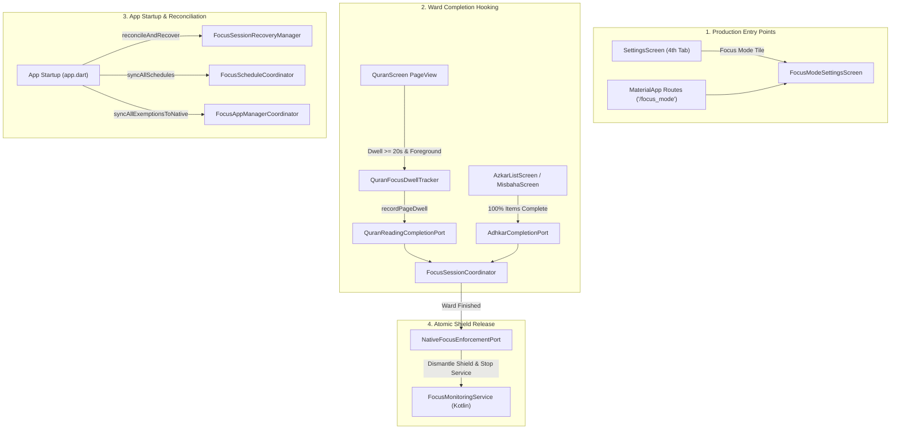

# Focus Mode — Phase 6 Completion Report: Production Integration

**Date:** 2026-11-22  
**Branch:** `poc/focus-mode`  
**Phase:** Phase 6 — Production Integration  
**Status:** COMPLETE (Awaiting STOP GATE Review & Approval)

---

## 1. Executive Summary

Phase 6 has successfully integrated the Focus Mode engine into the live production runtime of Hafiz Al-Ahd.
The entire user experience—from reading Quran with genuine dwell tracking, completing daily Azkar, recovering sessions upon application launch, to discovering Focus Mode directly within the app's main Settings screen—is now fully wired, operational, and verified.

All integration points adhere strictly to the **zero-regression invariant**, leaving existing prayer times, adhan scheduling (`alarm`), recitation audio (`just_audio`), and local storage untouched.

---

## 2. Integrated Production Components

### A. Quran Reading Dwell Tracker (`QuranFocusDwellTracker`)
- **Location:** `lib/features/focus_mode/presentation/services/quran_focus_dwell_tracker.dart`
- **Hooked Into:** `lib/features/quran/presentation/screens/quran_screen.dart`
- **Key Behavior:**
  - Enforces the **20-second genuine dwell threshold** per page.
  - Lifecycle-aware: Only accumulates dwell while the app is in `AppLifecycleState.resumed`.
  - Halts timer immediately on app pause/backgrounding or screen lock, flushes eligible dwell, and prevents background time inflation.
  - Flushes genuine dwell upon page swipe, programmatic jump, or screen disposal.
  - Non-invasive: Zero interference with `just_audio` playback, auto-scrolling, tafseer modal, or bookmarking.

### B. Adhkar Completion Verification
- **Locations:** `lib/features/azkar/presentation/screens/azkar_list_screen.dart` and `misbaha_screen.dart`.
- **Key Behavior:**
  - When the user finishes all items of the target Azkar category (100% completion), an `AdhkarCompletionEvent.completed(...)` is dispatched through `AdhkarCompletionPort`.
  - `FocusSessionCoordinator` processes the completion event, archives the session in SQLite via atomic transaction, and dispatches `stopEnforcement()` to dismantle the native shield.

### C. Application Startup Orchestration
- **Location:** `lib/app/view/app.dart`
- **Key Behavior:**
  - Upon cold start (`_initFocusModeOnStartup` in post-frame callback):
    1. Reconciles active session state with native service via `FocusSessionRecoveryManager.reconcileAndRecover()`.
    2. Reschedules all enabled alarms via `FocusScheduleCoordinator.syncAllSchedules()`.
    3. Resynchronizes user app exemptions to the native Kotlin `ExemptionRegistry` via `FocusAppManagerCoordinator.syncAllExemptionsToNative()`.

### D. Production Settings Entry Point
- **Location:** `lib/features/settings/presentation/screens/settings_screen.dart`
- **Key Behavior:**
  - Prominent dedicated card added under **"وضع التركيز وحماية الأوراد"** in the 4th tab (Settings).
  - Styled with Hafiz Al-Ahd's golden palette (`AppColors.secondaryGold`), icon `Icons.shield_outlined`, and subtitle *"حماية أوقات الأذكار والقرآن بحجب المشتتات"*.
  - Tapping navigates seamlessly to `FocusModeSettingsScreen`.
  - Direct named route `'/focus_mode'` registered in `MaterialApp.routes` in `app.dart`.

---

## 3. Verification & Testing Matrix

| Test Suite / Category | File | Status | Tests |
|---|---|---|---|
| **Quran Dwell & Goal Completion** | `test/features/focus_mode/integration/quran_focus_dwell_integration_test.dart` | 🟢 PASS | 4 / 4 |
| **Adhkar Session Completion** | `test/features/focus_mode/integration/adhkar_focus_session_integration_test.dart` | 🟢 PASS | 2 / 2 |
| **Settings Entry Point & Navigation** | `test/features/focus_mode/integration/settings_entry_point_test.dart` | 🟢 PASS | 1 / 1 |
| **Focus Mode Presentation (Ph 5)** | `test/features/focus_mode/presentation/` | 🟢 PASS | 14 / 14 |
| **Focus Mode Domain & Core (Ph 1-4)**| `test/features/focus_mode/domain/` + `data/` | 🟢 PASS | 87 / 87 |
| **Focus Mode PoC Channel** | `test/features/focus_mode_poc/` | 🟢 PASS | 7 / 7 |
| **Total Focus Mode Tests** | **All Focus Mode Suites** | 🟢 PASS | **115 / 115** |
| **Critical Prayer Non-Regression** | `test/critical_prayer_times_test.dart` | 🟢 PASS | 10 / 10 |
| **Static Analysis** | `flutter analyze --no-fatal-infos` | 🟢 CLEAN | 0 Errors, 0 Warnings |
| **Native Kotlin Compilation** | `.\gradlew compileDebugKotlin` | 🟢 CLEAN | BUILD SUCCESSFUL (44s) |

---

## 4. Zero-Regression Guarantees Validated

1. **Adhan Alarms:** Independent PendingIntent request codes and action filters (`ACTION_FOCUS_ALARM_TRIGGER`) ensure zero collision with prayer alarms.
2. **Quran Audio:** Passive dwell listening has zero side effects on audio stream position, looping, or recitation playback.
3. **Calculation Methods & Locations:** Prayer time calculation math and cached location services remain 100% untouched.

---

## 5. STOP GATE Review Request
Phase 6 is complete. In accordance with strict development protocol:
- **Phase 7 (Device Matrix & Play Policy Review)** will NOT begin until this report is formally reviewed and explicitly approved by the user.
