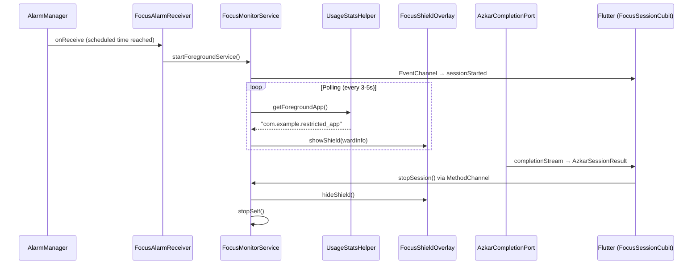

# R6 — Proposed Architecture
**Document ID:** `FOCUS_MODE_R6`
**Type:** Architecture Proposal
**Platform:** Android Only
**Status:** DRAFT — AWAITING FEASIBILITY CONFIRMATION
**Review Date:** 2026-11-21

---

> [!IMPORTANT]
> هذه وثيقة تصميم مقترح فقط. لا يوجد كود تنفيذي. التنفيذ يتطلب موافقة منفصلة.

---

## 1. مبادئ التصميم

| المبدأ | التفسير |
|---|---|
| **الاستقلالية التامة** | Focus Mode ميزة مستقلة. لا تعدّل ولا تمتد من features أخرى. |
| **Domain يقود** | منطق الجلسة في Domain layer. Presentation تعرض فقط. |
| **Contract لا Coupling** | Focus Mode يستهلك أحداث الاكتمال عبر Contract مُعرَّف في Domain. لا import مباشر من Azkar أو Quran. |
| **Platform عبر MethodChannel** | UsageStats API يُستدعى من Kotlin عبر MethodChannel مخصص. |
| **Background-first** | الجلسة لا تعتمد على أن يكون التطبيق مفتوحاً. |

---

## 2. طبقات المعمارية

```
┌─────────────────────────────────────────────────────────────────┐
│                     Presentation Layer                          │
│                                                                 │
│  FocusModeSettingsScreen    FocusShieldOverlay                 │
│  FocusModeSettingsCubit     (Kotlin View over WindowManager)   │
│                                                                 │
└───────────────────────────────┬─────────────────────────────────┘
                                │
┌───────────────────────────────▼─────────────────────────────────┐
│                       Domain Layer                              │
│                                                                 │
│  FocusSessionService (abstract)   AzkarCompletionPort (abstract)│
│  FocusModeSettings (entity)       WardType (enum)              │
│  FocusSessionState (entity)       FocusSessionResult (entity)  │
│  StartFocusSessionUseCase         StopFocusSessionUseCase      │
│  GetFocusModeSettingsUseCase      SaveFocusModeSettingsUseCase │
│                                                                 │
└───────────────────────────────┬─────────────────────────────────┘
                                │
┌───────────────────────────────▼─────────────────────────────────┐
│                        Data Layer                               │
│                                                                 │
│  FocusSessionServiceImpl          FocusModeSettingsRepository  │
│  (flutter_background_service)     (SharedPreferences)          │
│                                                                 │
│  UsageStatsMethodChannel          AzkarCompletionAdapter       │
│  (Kotlin ↔ Flutter bridge)        (implements AzkarCompletionPort│
│                                    يستمع لـ AzkarTrackerCubit  │
│                                    عبر Stream)                  │
│                                                                 │
└───────────────────────────────┬─────────────────────────────────┘
                                │
┌───────────────────────────────▼─────────────────────────────────┐
│                      Platform Layer (Android)                   │
│                                                                 │
│  FocusMonitorService.kt           FocusAlarmReceiver.kt        │
│  (Foreground Service)             (BroadcastReceiver)          │
│                                                                 │
│  FocusModeBootReceiver.kt         UsageStatsHelper.kt          │
│  (BOOT_COMPLETED)                 (UsageStatsManager wrapper)  │
│                                                                 │
│  FocusShieldOverlayService.kt                                  │
│  (WindowManager TYPE_APPLICATION_OVERLAY)                      │
│                                                                 │
└─────────────────────────────────────────────────────────────────┘
```

---

## 3. المكونات التفصيلية

### 3.1 Domain Layer

#### `FocusModeSettings` (Entity)
```dart
// lib/features/focus_mode/domain/entities/focus_mode_settings.dart
class FocusModeSettings {
  final bool globalEnabled;
  final Map<WardType, WardFocusConfig> wardConfigs;
  // ...
}
```

#### `FocusSessionState` (Entity)
```dart
// lib/features/focus_mode/domain/entities/focus_session_state.dart
class FocusSessionState {
  final bool isActive;
  final WardType? activeWard;
  final DateTime? startedAt;
  final DateTime? scheduledEndAt;
}
```

#### `AzkarCompletionPort` (Abstract — Contract)
```dart
// lib/features/focus_mode/domain/ports/azkar_completion_port.dart
abstract class AzkarCompletionPort {
  Stream<AzkarSessionResult> get completionStream;
}
// يُنفَّذ في Data layer بدون أي import مباشر من features/azkar
```

#### `FocusSessionService` (Abstract)
```dart
// lib/features/focus_mode/domain/services/focus_session_service.dart
abstract class FocusSessionService {
  Future<void> startSession(WardType wardType);
  Future<void> stopSession();
  Stream<FocusSessionState> get sessionStream;
}
```

---

### 3.2 Data Layer

#### `FocusMonitorService.kt` (Android Foreground Service)
```
المسؤوليات:
  - تشغيل polling loop كل 3-5 ثوانٍ
  - استدعاء UsageStatsHelper.getForegroundApp()
  - المقارنة مع قائمة التطبيقات المحظورة
  - إرسال إشعار لـ Flutter عبر EventChannel أو MethodChannel
  - إظهار / إخفاء FocusShieldOverlayService
```

#### `UsageStatsHelper.kt`
```kotlin
class UsageStatsHelper(private val context: Context) {
    fun getForegroundApp(): String? {
        val usm = context.getSystemService(Context.USAGE_STATS_SERVICE)
                  as UsageStatsManager
        val end = System.currentTimeMillis()
        val start = end - 5000
        return usm.queryUsageStats(INTERVAL_DAILY, start, end)
                  .maxByOrNull { it.lastTimeUsed }
                  ?.packageName
    }
}
```

#### `FocusShieldOverlayService.kt`
```
المسؤوليات:
  - إضافة / إزالة overlay view على WindowManager
  - عرض بيانات الجلسة (اسم الورد، التقدم)
  - إرسال أحداث (إغلاق، تجاوز) إلى Flutter
```

#### `UsageStatsMethodChannel` (Flutter ↔ Kotlin)
```dart
// lib/features/focus_mode/data/platform/usage_stats_method_channel.dart
class UsageStatsMethodChannel {
  static const _channel = MethodChannel('com.shadyatef.hafiz_alahd/focus_mode');
  
  Future<bool> hasUsageStatsPermission() async { ... }
  Future<void> openUsageStatsSettings() async { ... }
  Future<String?> getCurrentForegroundApp() async { ... }
}
```

---

### 3.3 DI Structure

```
lib/features/focus_mode/
├── di/
│   └── focus_mode_service_locator.dart
├── domain/
│   ├── entities/
│   │   ├── focus_mode_settings.dart
│   │   ├── focus_session_state.dart
│   │   └── ward_focus_config.dart
│   ├── ports/
│   │   └── azkar_completion_port.dart
│   ├── services/
│   │   └── focus_session_service.dart
│   └── usecases/
│       ├── start_focus_session_usecase.dart
│       ├── stop_focus_session_usecase.dart
│       ├── get_focus_mode_settings_usecase.dart
│       └── save_focus_mode_settings_usecase.dart
├── data/
│   ├── repositories/
│   │   └── focus_mode_settings_repository_impl.dart
│   ├── services/
│   │   └── focus_session_service_impl.dart
│   ├── adapters/
│   │   └── azkar_completion_adapter.dart
│   └── platform/
│       └── usage_stats_method_channel.dart
└── presentation/
    ├── cubit/
    │   ├── focus_mode_settings_cubit.dart
    │   └── focus_session_cubit.dart
    └── screens/
        └── focus_mode_settings_screen.dart
```

---

### 3.4 Android Native Files

```
android/app/src/main/kotlin/com/shadyatef/hafiz_alahd/
├── focus_mode/
│   ├── FocusMonitorService.kt
│   ├── FocusAlarmReceiver.kt
│   ├── FocusModeBootReceiver.kt
│   ├── FocusShieldOverlayService.kt
│   └── UsageStatsHelper.kt
```

---

## 4. تدفق البيانات — Scheduled Session



---

## 5. اعتبارات مهمة

### 5.1 AzkarCompletionAdapter — تحدي معماري

`AzkarTrackerCubit` هو Presentation layer. لا يمكن لـ Data layer استيراده مباشرة.

**الحل المقترح:**

```dart
// AzkarCompletionAdapter يُنشأ في مستوى أعلى (App level)
// ويستمع لـ AzkarTrackerCubit ويُعيد نشر الأحداث عبر stream

class AzkarCompletionAdapter implements AzkarCompletionPort {
  final StreamController<AzkarSessionResult> _controller;
  
  // يُمرَّر له reference للـ Cubit عند التهيئة
  AzkarCompletionAdapter(AzkarTrackerCubit cubit) {
    // يراقب الحالة ويُصدر حدث الاكتمال
  }
}
```

> [!WARNING]
> هذا الحل يتطلب قرار معماري: هل نُعرّض `AzkarTrackerCubit` لطبقة أعلى؟ أم نُنشئ Domain event مستقل؟ **يُرجع للمستخدم.**

### 5.2 استمرارية الخدمة على MIUI / One UI

> [!CAUTION]
> OEMs مثل Xiaomi وSamsung قد يوقفون الـ Foreground Service. يجب اختبار هذا فعلياً (انظر R8).
> البديل: `WorkManager` لإعادة تشغيل الخدمة إذا أُوقفت — لكن هذا يُضيف تعقيداً.

---

*Review Date: 2026-11-21 | Phase: Research Only — No Code*
