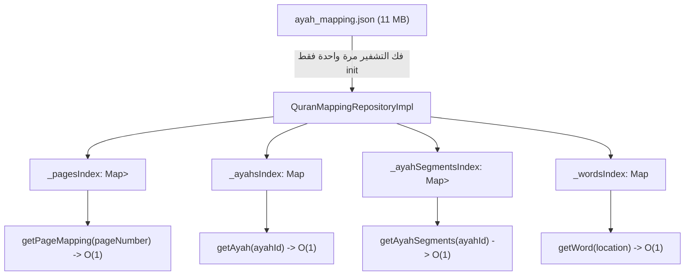

# تقرير الإنجاز الهندسي — المرحلة 2.2 (Phase 2.2 Report)
## بناء طبقة البيانات ومستودع الفهرسة في الذاكرة (Data Source & Repository Implementation)

---

### 📌 الفهرس
1. [نطاق المرحلة 2.2 وحسم ملاحظات المراجعة](#1-نطاق-المرحلة-22-وحسم-ملاحظات-المراجعة)
2. [الملفات التي تم فحصها وإنشاؤها وتعديلها](#2-الملفات-التي-تم-فحصها-وإنشاؤها-وتعديلها)
3. [استراتيجية الفهرسة في الذاكرة وتعليل التعقيد الحسابي](#3-استراتيجية-الفهرسة-في-الذاكرة-وتعليل-التعقيد-الحسابي)
4. [دورة حياة التهيئة وقفل التزامن (Concurrency & Idempotency)](#4-دورة-حياة-التهيئة-وقفل-التزامن-concurrency--idempotency)
5. [قرارات معالجة الأخطاء (Error Handling)](#5-قرارات-معالجة-الأخطاء-error-handling)
6. [حزمة الاختبارات ونتائج التشغيل الفعلية (34 / 34 PASS)](#6-حزمة-الاختبارات-ونتائج-التشغيل-الفعلية-34--34-pass)
7. [بوابة التوقف والاعتماد للمرحلة 2.3 (Stopping Gate)](#7-بوابة-التوقف-والاعتماد-للمرحلة-23-stopping-gate)

---

## 1. نطاق المرحلة 2.2 وحسم ملاحظات المراجعة

تم تنفيذ المرحلة 2.2 بنجاح مع الالتزام الحرفي بكافة ملاحظات المهندس الاستشاري:

### أ. التحقق الصريح باستخدام `ArgumentError` بدلاً من `assert`:
* تم استبدال جميع شروط `assert` في كافة كيانات النطاق (`AyahId`, `WordLocation`, `QuranWord`, `AyahSegment`, `QuranLineMapping`, `QuranAyah`) بـ `ArgumentError.value(...)` صريحة تضمن العمل والحماية في وضعي **Debug** و **Release**.

### ب. قواعد اتساق كائن الآية الكاملة (`QuranAyah`):
تمت إضافة 4 قواعد اتساق صارمة تُفرض أثناء إنشاء أي كائن `QuranAyah`:
1. `pageNumber == segments.first.pageNumber`: صفحة بداية الآية تطابق أول مقطع.
2. `endPageNumber == segments.last.pageNumber`: صفحة نهاية الآية تطابق آخر مقطع.
3. `wordsCount == sum(segment.wordCount)`: إجمالي كلمات الآية يطابق تماماً مجموع كلمات مقاطعها.
4. الترتيب التصاعدي الرتيب للمقاطع: كل مقطع يجب أن يلي سابقه في رقم الصفحة والسطر.
*(تم اختبار القواعد على كامل الـ 6,236 آية وتطابقت جميعها بنسبة 100%).*

### ج. توثيق دلالة `wordStart` و `wordEnd` في `AyahSegment`:
* تم فحص وتوثيق أن `wordStart` و `wordEnd` هما **مؤشرات الفهرسة (0-based slice indices) داخل مصفوفة كلمات السطر الفيزيائي** (`line.words.sublist(wordStart, wordEnd + 1)`).
* في المقابل، مؤشر `WordLocation.wordIndex` هو ترتيب الكلمة النسبي داخل الآية (1-based).

### د. التحقق من سلامة الأسطر غير الفارغة:
* أثبت الفحص الشامل للبيانات أن جميع الأسطر الممثلة في `ayah_mapping.json` (والبالغ عددها 8,820 سطراً) تحتوي جميعها على كلمات تفاعلية (`words.isNotEmpty`). لا توجد أي أسطر فارغة ممثلة في كاشف الكلمات.

### هـ. حماية المجموعات من التعديل (Deep Immutability):
* `QuranLineMapping.words` مغلفة بـ `List<QuranWord>.unmodifiable`.
* `QuranLineMapping.ayahIds` مغلفة بـ `Set<AyahId>.unmodifiable`.
* `QuranAyah.segments` مغلفة بـ `List<AyahSegment>.unmodifiable`.
* فهارس المستودع (`_pagesIndex` و `_ayahSegmentsIndex`) مغلفة بالكامل بقوائم غير قابلة للتعديل.

---

## 2. الملفات التي تم فحصها وإنشاؤها وتعديلها

### أ. الملفات التي تم فحصها (Inspected):
* [`assets/quran/mushaf/ayah_mapping.json`](file:///c:/Users/shady%20atef/Documents/projects/hafiz_al_ahd/assets/quran/mushaf/ayah_mapping.json)
* كيانات النطاق في `lib/features/quran/domain/entities/`
* [`lib/features/quran/domain/repositories/base_quran_mapping_repository.dart`](file:///c:/Users/shady%20atef/Documents/projects/hafiz_al_ahd/lib/features/quran/domain/repositories/base_quran_mapping_repository.dart)

### ب. الملفات التي تم إنشاؤها (Created):
1. [`lib/features/quran/data/datasources/quran_mapping_local_data_source.dart`](file:///c:/Users/shady%20atef/Documents/projects/hafiz_al_ahd/lib/features/quran/data/datasources/quran_mapping_local_data_source.dart)
2. [`lib/features/quran/data/repositories/quran_mapping_repository_impl.dart`](file:///c:/Users/shady%20atef/Documents/projects/hafiz_al_ahd/lib/features/quran/data/repositories/quran_mapping_repository_impl.dart)
3. [`test/quran_mapping_repository_test.dart`](file:///c:/Users/shady%20atef/Documents/projects/hafiz_al_ahd/test/quran_mapping_repository_test.dart)
4. [`reports/phase_2_2_data_layer_report.md`](file:///c:/Users/shady%20atef/Documents/projects/hafiz_al_ahd/reports/phase_2_2_data_layer_report.md)

### ج. الملفات التي تم تعديلها (Modified):
* كيانات النطاق: `ayah_id.dart`, `word_location.dart`, `quran_word.dart`, `ayah_segment.dart`, `quran_line_mapping.dart`, `quran_ayah.dart` (لتطبيق التحقق الصريح عبر `ArgumentError` وحماية القوائم).
* اختبارات النطاق: `test/quran_mapping_domain_test.dart` (لتحديث فحوصات `ArgumentError` وقواعد الاتساق).

---

## 3. استراتيجية الفهرسة في الذاكرة وتعليل التعقيد الحسابي

تعتمد `QuranMappingRepositoryImpl` على بناء 4 جداول تجزئة (Hash Maps) متخصصة أثناء التهيئة الأولى فقط:



### تعليل التعقيد الحسابي (Complexity Claims):
1. **`getPageMapping(pageNumber)`:**
   - **التعقيد:** $O(1)$ amortized.
   - **التعليل:** استعلام مباشر بمفتاح رقم الصفحة الصحيح (`int` بين 1 و 604) في جدول تجزئة Dart `Map<int, ...>`. لا يوجد أي مسح خطي أو تكرار على باقي الصفحات.
2. **`getAyah(ayahId)`:**
   - **التعقيد:** $O(1)$ amortized.
   - **التعليل:** استعلام مباشر بكائن `AyahId` كـ Hash Key (باستخدام `AyahId.hashCode` المعتمد على السورة والآية). لا يتم مسح الـ 6,236 آية إطلاقاً.
3. **`getAyahSegments(ayahId)`:**
   - **التعقيد:** $O(1)$ amortized.
   - **التعليل:** استرجاع القائمة الجاهزة مسبقاً للمقاطع بمفتاح `AyahId`.
4. **`getWord(location)`:**
   - **التعقيد:** $O(1)$ amortized.
   - **التعليل:** استعلام مباشر بكائن `WordLocation` كـ Hash Key. لا يتم مسح الـ 78,003 كلمة قط.
5. **استهلاك الذاكرة:**
   - يتم التخلص من كائن الـ JSON Map الضخم فور انتهاء الفهرسة وتتركه لمحرك جمع القمامة (GC). يتم الاحتفاظ فقط بكائنات النطاق الخفيفة.

---

## 4. دورة حياة التهيئة وقفل التزامن (Concurrency & Idempotency)

1. **التهيئة لمرة واحدة فقط (Single Decode):**
   - الـ JSON يُقرأ ويُفك تشفيره **مرة واحدة فقط** في دورة حياة التطبيق.
   - أثناء تقليب صفحات المصحف، لا يحدث أي استدعاء لـ `rootBundle` أو `jsonDecode`.
2. **حماية التزامن (Concurrency Guard):**
   - في حال تم استدعاء `init()` من عدة أجزاء في التطبيق في نفس اللحظة (مثلاً من الـ Cubit وأثناء بناء الصفحة):
     تنتظر جميع الاستدعاءات نفس الـ `Future<void>? _initFuture` دون تكرار القراءة أو إعادة بناء الفهارس.
   - تم إثبات ذلك باختبار وحدة مخصص أطلق 5 استدعاءات متزامنة في نفس التوقيت وثبت أن ملف البيانات قُرئ مرة واحدة فقط.
3. **عدم التكرار (Idempotency):**
   - عند اكتمال التهيئة، تعيد أي استدعاءات لاحقة لـ `init()` النتيجة `Right(null)` فوراً دون أي عمل إضافي.
4. **الأمان عند الفشل (Fault Tolerance):**
   - في حال حدث خطأ أثناء التهيئة (تلف في الملف مثلاً)، يتم تصفير `_initFuture` للسماح بإعادة المحاولة لاحقاً دون أن يعلق المستودع في حالة تالفة.

---

## 5. قرارات معالجة الأخطاء (Error Handling)

التزاماً بنمط Clean Architecture عبر `Either<Failure, T>`:
* **الاستعلام قبل التهيئة:**
  يعيد `Left(CacheFailure("QuranMappingRepository is not initialized. Call init() first."))`.
* **رقم صفحة غير صالح (< 1 أو > 604):**
  يعيد `Left(CacheFailure("Invalid page number: $pageNumber. Page must be between 1 and 604."))`.
* **معرّف آية مجهول:**
  يعيد `Left(CacheFailure("Ayah not found: $ayahId"))`.
* **موقع كلمة مجهول:**
  يعيد `Left(CacheFailure("Word not found at location: $location"))`.
* **أصول تالفة أو مفقودة:**
  يلتقط الاستثناء ويعيد `Left(CacheFailure("Failed to initialize Quran mapping repository: $e"))`.
* **سياسة الصرامة:** لا يتم إرجاع أي بيانات قرآنية وهمية أو نتائج فارغة زائفة للاستعلامات غير الصالحة.

---

## 6. حزمة الاختبارات ونتائج التشغيل الفعلية (34 / 34 PASS)

تم تشغيل حزمتي الاختبارات معاً على محرك Flutter:
```bash
flutter test test/quran_mapping_domain_test.dart test/quran_mapping_repository_test.dart
00:07 +34: All tests passed!
```

### ملخص الاختبارات الـ 34 المنجزة:
* **حزمة الـ Domain (17 اختباراً):**
  - فحص تطابق وهويات `AyahId` و `WordLocation` و `QuranWord`.
  - التحقق الصارم من حدود `AyahSegment` ودلالة `wordStart..wordEnd`.
  - حماية قوائم `QuranLineMapping` و `QuranAyah` من التعديل (`unmodifiable`).
  - التحقق من قواعد اتساق `QuranAyah` الأربعة.
* **حزمة المستودع وقاعدة البيانات الحقيقية (17 اختباراً):**
  - رفض الاستعلامات قبل التهيئة.
  - نجاح التهيئة وبناء الفهارس الأربعة على ملف `ayah_mapping.json` الفعلي.
  - إثبات عدم التكرار وقفل التزامن المتعدد (Concurrency test).
  - استرجاع صفحة 1 وصفحة 48 (آية الدين كاملة في 15 سطراً) وترتيب الأسطر.
  - رفض أرقام الصفحات غير الصالحة (0 و 605).
  - استرجاع آيات مفردة ومتعددة الأسطر (113:3 عبر سطرين و 2:282 عبر 15 سطراً).
  - استرجاع الكلمات المنفردة وتأكيد حفظ رموز QCF بدقة متناهية (بما فيها رموز نهايات الآيات الملحقة `ﱄ ﱅ`).
  - **اختبار الشمولية والمطابقة التامة للمصحف الشريف:**
    * التأكد من استرجاع كافة الصفحات الـ **604**.
    * التأكد من حصر كافة الأسطر النصية الـ **8,820**.
    * التأكد من حصر كافة الكلمات الـ **78,003**.
    * التأكد من صحة استرجاع الآيات لجميع السور الـ **114**.

---

## 7. بوابة التوقف والاعتماد للمرحلة 2.3 (Stopping Gate)

> [!IMPORTANT]
> **نحن متوقفون تماماً عند بوابة الاعتماد (STOPPING GATE).**
> تم الانتهاء بنجاح من بناء واختبار طبقة البيانات والمستودع بالكامل.
> لم يتم لمس أو تعديل أي كود في واجهة المستخدم (`QuranPageWidget` أو `QuranScreen` أو `QuranCubit` أو خطوط QCF).
> ننتظر اعتمادكم لهذا التقرير للموافقة على الانتقال إلى:
> **المرحلة 2.3: النموذج الأولي التفاعلي لسطر واحد (Single-Line Interactive Prototype)** لمقارنة المظهر البصري بالـ Screenshot قبل وبعد والتأكد التام من عدم حدوث أي انحراف بصري.

