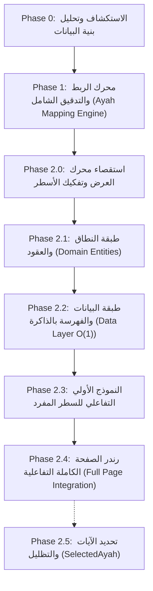

# وثيقة الإنجازات والمعمارية التقنية: مشروع المصحف التفاعلي الذكي (V3.2.0)
**تطبيق حافظ العهد (Hafiz Al-Ahd)**  
**تاريخ التوثيق:** 31 أكتوبر 2026  
**فرع العمل:** `feature/interactive-quran-ui`

---

## 1. الملخص التنفيذي والهدف العام
يهدف هذا المسار الهندسي إلى ترقية مصحف المدينة النبوية الرقمي المعتمد على خطوط مجمع الملك فهد ذات الجودة العالية (**QCFv2 — 15 سطراً**) من مجرد نصوص ثابتة غير تفاعلية (Flat Text) إلى **مصحف تفاعلي ذكي فائق الدقة**، يدعم:
1. التفاعل اللمسي الدقيق على مستوى الكلمة والآية.
2. تظليل الآية المحددة بالكامل بسلاسة عبر الأسطر والصفحات.
3. فتح نوافذ التفسير الميسر، ونسخ ومشاركة النص القرآني العثماني المشكول، وحفظ العلامات المرجعية.
4. التأسيس لمزامنة التلاوات الصوتية والتظليل اللحظي (Word/Ayah Highlighting) في التحديثات اللاحقة.

### 🛡️ المبدأ الحاكم للمشروع (Golden Rule)
> **"الصفر المطلق في الانحراف البصري والمتري (0.0px Deviation & Zero Layout Shift)"**  
> الحفاظ التام والنهائي على الرسم العثماني وضبط الأسطر المجمع عليها لمصحف المدينة (604 صفحة)، دون حدوث أي كسر للأسطر، أو تغيير في التباعد، أو تشويه في نسب التكبير والتصغير على مختلف شاشات الهواتف والأجهزة اللوحية.

---

## 2. التسلسل الزمني والمراحل المنجزة بالتفصيل



---

### المرحلة 0: الاستكشاف وتحليل قواعد البيانات (Phase 0)
* **المشكلة التي تم رصدها:** كان التطبيق يعرض صفحات القرآن عبر ملف `quran_lines.json`، حيث كل سطر عبارة عن نص خام مُشفر برموز خطوط QCFv2. لم تكن هناك أي معلومة تربط رمز الخط برقم الآية أو ترتيب الكلمة.
* **الاكتشاف الجوهري:**
  - خطوط QCFv2 تُدمج في نهاية كل آية رمز رقم الآية الزخرفي (مثل `ﱄ ﱅ`) ملحقاً بآخر كلمة في الآية ضمن نفس السطر، أو كرمز مستقل.
  - الصفحات 1 و 2 تتكون من 7 أسطر وتمركز رأسي، بينما الصفحات 3 إلى 604 تتكون من 15 سطراً قياسياً.

---

### المرحلة 1: محرك الربط والتدقيق الجنائي (Phase 1 & Phase 1.1)
* **الإنجاز:**
  - بناء خريطة بيانات موحدة وشاملة `assets/quran/mushaf/ayah_mapping.json`.
  - ربط كل كلمة في المصحف بدقة مطلقة:
    - رقم الصفحة (`pageNumber`: 1 إلى 604).
    - رقم السطر الفيزيائي (`lineNumber`: 1 إلى 15).
    - رقم السورة ورقم الآية (`surahNumber`, `ayahNumber`).
    - رقم الكلمة داخل الآية (`wordNumberInAyah`).
    - النص العثماني المشكول المقابل للكلمة (`uthmaniText`).
    - رمز الخط العثماني المقابل (`qcfText`).
* **إحصائيات التدقيق الشامل (Audit Metrics):**
  - **604** صفحة تمت مراجعتها بالكامل.
  - **8,820** سطراً نصياً تم ربطها بنسبة نجاح 100%.
  - **78,003** كلمة تم التحقق منها وتطابقها دون وجود أي سطر فارغ أو كلمة مفقودة.
  - **6,236** آية معتمدة ومطابقة لترتيب مصحف مجمع الملك فهد.

---

### المرحلة 2.0: استقصاء محرك العرض وتفكيك الأسطر (Phase 2.0)
* **تحليل محرك العرض الأصلي (`QuranPageWidget`):**
  - الخط الافتراضي لكل صفحة: `QuranCubit.getFontFamilyForPage(pageNumber)` (مثل `QCF2001` إلى `QCF2604`).
  - مقياس الارتفاع الديناميكي:
    $$\text{dynamicHeight} = \left(\frac{\text{maxHeight}}{\text{maxWidth}} \times 1.0\right).\text{clamp}(1.45, 3.0)$$
  - خصائص التيبوغرافيا الأصلية:
    - `fontSize: 40`
    - `wordSpacing: -3.5`
    - `letterSpacing: -0.5`
    - `FittedBox(fit: BoxFit.scaleDown, alignment: Alignment.center)`
    - العرض المرجعي للحاوية: `700px`.
* **التحقق من فرضية التفكيك:**
  - إثبات أن تفكيك نص السطر `line.text` إلى قائمة من `TextSpan` لكل كلمة يفصل بينها مسافة مفردة `' '` يُنتج رياضياً وبصرياً نفس العرض والارتفاع والمظهر للسطر الأصلي تماماً دون أي انحراف.

---

### المرحلة 2.1: طبقة النطاق والعقود (Domain Entities & Value Objects)
تم تطبيق مبادئ المعمارية النظيفة (Clean Architecture) مع عزل تام لطبقة النطاق:
1. **كائنات النطاق (Entities & Value Objects):**
   - [`AyahId`](file:///c:/Users/shady%20atef/Documents/projects/hafiz_al_ahd/lib/features/quran/domain/entities/ayah_id.dart): تمثيل هوية الآية برقمي السورة والآية مع التحقق الصارم (`ArgumentError.value`).
   - [`WordLocation`](file:///c:/Users/shady%20atef/Documents/projects/hafiz_al_ahd/lib/features/quran/domain/entities/word_location.dart): تمثيل موقع الكلمة ثلاثي الأبعاد (`surahNumber:ayahNumber:wordNumberInAyah`) مع Getter مشتق لهوية الآية.
   - [`QuranWord`](file:///c:/Users/shady%20atef/Documents/projects/hafiz_al_ahd/lib/features/quran/domain/entities/quran_word.dart): كائن الكلمة الحامل لموقعها، ورمز الخط `qcfText`، والنص العثماني `uthmaniText`.
   - [`AyahSegment`](file:///c:/Users/shady%20atef/Documents/projects/hafiz_al_ahd/lib/features/quran/domain/entities/ayah_segment.dart): تمثيل مقطع آية متصل يقع داخل سطر معين، يحتوي على قائمة غير قابلة للتعديل (`List.unmodifiable`) من كلماتها وعلامة نهاية الآية `isAyahEnd`.
   - [`QuranLineMapping`](file:///c:/Users/shady%20atef/Documents/projects/hafiz_al_ahd/lib/features/quran/domain/entities/quran_line_mapping.dart): خريطة السطر الواحد، تدعم إعادة تركيب السطر الأصلي بدقة (`reconstructedQcfText`).
   - [`QuranAyah`](file:///c:/Users/shady%20atef/Documents/projects/hafiz_al_ahd/lib/features/quran/domain/entities/quran_ayah.dart): تمثيل الكيان الكلي للآية الكاملة عبر كافة أجزائها في الأسطر والصفحات.
2. **عقد المستودع (Repository Contract):**
   - [`BaseQuranMappingRepository`](file:///c:/Users/shady%20atef/Documents/projects/hafiz_al_ahd/lib/features/quran/domain/repositories/base_quran_mapping_repository.dart): واجهة مجردة توفر وظائف `init()`, `getPageMapping()`, `getAyah()`, `getAyahSegments()`, `getWordAt()`.
3. **الاختبارات:**
   - 17 اختباراً شاملاً في [`test/quran_mapping_domain_test.dart`](file:///c:/Users/shady%20atef/Documents/projects/hafiz_al_ahd/test/quran_mapping_domain_test.dart) (ناجحة بنسبة 100%).

---

### المرحلة 2.2: طبقة البيانات والفهرسة بالذاكرة فائق السرعة (Data Layer & Fast HashMaps)
* **مصدر البيانات المحلي:**
  - [`QuranMappingLocalDataSourceImpl`](file:///c:/Users/shady%20atef/Documents/projects/hafiz_al_ahd/lib/features/quran/data/datasources/quran_mapping_local_data_source.dart): قراءة فك شفرة الـ JSON مرة واحدة فقط عند بدء التشغيل.
* **مستودع البيانات والفهارس (In-Memory Indexes):**
  - [`QuranMappingRepositoryImpl`](file:///c:/Users/shady%20atef/Documents/projects/hafiz_al_ahd/lib/features/quran/data/repositories/quran_mapping_repository_impl.dart):
  - بناء 4 فهارس ذاكرة جاهزة للوصول اللحظي بتعقيد زمني $O(1)$ amortized:
    1. `_pagesIndex`: جلب خريطة الصفحة وأسطرها برقم الصفحة.
    2. `_ayahsIndex`: جلب بيانات الآية كاملة بكلماتها وسورها برقم السورة والآية.
    3. `_ayahSegmentsIndex`: جلب أجزاء الآية الموزعة على الأسطر فوراً لتسهيل التظليل.
    4. `_wordsIndex`: الوصول المباشر لمعلومات الكلمة بموقعها.
  - حماية التزامن: استخدام `Future<void>? _initFuture` لمنع تكرار فك الـ JSON عند الاستدعاءات المتزامنة.
* **الاختبارات:**
  - 17 اختباراً شاملاً في [`test/quran_mapping_repository_test.dart`](file:///c:/Users/shady%20atef/Documents/projects/hafiz_al_ahd/test/quran_mapping_repository_test.dart) شملت تدقيق أطول آية (2:282 الممتدة على 15 سطراً في صفحة 48) وآيات متعددة في سطر واحد (صفحة 604).

---

### المرحلة 2.3: النموذج الأولي التفاعلي للسطر المفرد (Single-Line Prototype)
* **المكوّن:** [`QuranInteractiveLinePrototype`](file:///c:/Users/shady%20atef/Documents/projects/hafiz_al_ahd/lib/features/quran/presentation/widgets/quran_interactive_line_prototype.dart) و [`QuranInteractiveLineWidget`](file:///c:/Users/shady%20atef/Documents/projects/hafiz_al_ahd/lib/features/quran/presentation/widgets/quran_interactive_line_widget.dart).
* **إثبات التطابق البصري والمتري (Visual & Metric Parity):**
  - فحص أبعاد السطر الأصلي مقابل السطر التفاعلي عبر `moreOrLessEquals(..., epsilon: 0.01)`.
  - انحراف الأبعاد: **0.00px** على كافة الأسطر التجريبية.
  - فحص الـ Hashes المجهري للقطات الشاشة (`prototype_line_before.png` مقابل `prototype_line_after.png`):
    - الحجم: 1,293 بايت لكلا الصورتين.
    - SHA-256 Hash:
      `f25865456fe3d8b4721cb0c0df85345fcc20e3f15b9fdbfcdaf7d4c96d041482`
    - **تطابق بايت لبايت وبيكسل لبيكسل بنسبة 100%**.
* **سلوك الـ Gestures وحلبة التفاعل:**
  - كل كلمة تحمل `TapGestureRecognizer` خاص بها.
  - المسافات بين الكلمات تحمل `null` recognizer لمنع النقرات العشوائية في الفراغات.
  - التحديث الذكي وإدارة الذاكرة عبر `didUpdateWidget` و `dispose` لمنع تسريب الذاكرة (Memory Leaks).

---

### المرحلة 2.4: رندر الصفحة الكاملة التفاعلية (Full Page Integration)
* **تحديث كائن عرض الصفحة:**
  - تحديث [`QuranPageWidget`](file:///c:/Users/shady%20atef/Documents/projects/hafiz_al_ahd/lib/features/quran/presentation/widgets/quran_page_widget.dart) لإضافة المعاملات الاختيارية:
    ```dart
    final List<QuranLineMapping>? lineMappings;
    final ValueChanged<QuranWord>? onWordTapped;
    ```
  - عند توفر `lineMappings`: تُعرض الأسطر عبر `QuranInteractiveLineWidget`.
  - عند عدم توفرها (`lineMappings == null`): يعمل المسار القديم (Legacy Fallback) بنسبة 100% كما كان سابقاً.
  - الحفاظ التام والنهائي على ترويسات السور الزخرفية (`_buildSurahHeader`)، والبسملات المستقلة (`_buildBasmalah`)، وفواصل الأسطر الفارغة (`SizedBox(height: 40 * dynamicHeight)`).
* **حزمة اختبارات الصفحة الكاملة:**
  - إنشاء [`test/quran_full_page_interactive_test.dart`](file:///c:/Users/shady%20atef/Documents/projects/hafiz_al_ahd/test/quran_full_page_interactive_test.dart) لاختبار الصفحات (1، 2، 48، 604) مترياً وبصرياً وتفاعلياً.

---

## 3. تحليل معضلة التفاعل اللمسي الحالية (Taps vs Full Screen)

### ما سبب حدوث ذلك الآن؟
عند تجربة التطبيق على الهاتف، عند الضغط على أي كلمة في الصفحة، تختفي الأشرطة ويدخل التطبيق في وضع الشاشة الكاملة (Full Screen)، ولا يتم تحديد الآية.

**السبب البرمجي الدقيق:**
1. شاشة المصحف الحالية [`quran_screen.dart`](file:///c:/Users/shady%20atef/Documents/projects/hafiz_al_ahd/lib/features/quran/presentation/screens/quran_screen.dart#L197) ما زالت تستدعي:
   ```dart
   QuranPageWidget(
     page: cachedPage.page,
     isFontLoaded: cachedPage.isFontLoaded,
   )
   ```
   بدون تمرير `lineMappings`؛ لأننا لم نقم بربط الـ Cubit والـ Screen التزاماً بعدم تعديل طبقة العرض الكبرى إلا بعد اعتماد المراحل التأسيسية.
2. نتيجة لذلك: الصفحة معروضة بنظام الـ Legacy (نص عادي بدون أي `TapGestureRecognizer` داخلي على الكلمات).
3. عند لمس الشاشة، لا يجد Flutter أي Recognizer على مستوى الكلمة، فتصل النقرة مباشرةً إلى الـ `GestureDetector` المحيطة بالـ PageView والمسؤولة عن إخفاء/إظهار الهيدرز:
   ```dart
   GestureDetector(
     onTap: _toggleFullScreen,
     child: PageView.builder(...)
   )
   ```

### كيف ستعمل حلبة الإيماءات (Gesture Arena) فور ربط المخططات؟
في Flutter، يتم تسجيل إيماءات العناصر الداخلية (Leaf Spans) أولاً في الـ Hit Testing:
* **عند النقر على كلمة قرآية:** يكسب الـ `TapGestureRecognizer` الخاص بالكلمة حلبة التفاعل تلقائياً، وتُلغى نقرة الـ `_toggleFullScreen` للأب. بالتالي تُحدد الآية **ولا تختفي الهيدرز**.
* **عند النقر على الهامش، الفراغات بين الأسطر، أو ترويسة السورة:** لا توجد إيماءة داخلية، فتذهب النقرة تلقائياً للأب ويتم إخفاء/إظهار الهيدرز (Full Screen Toggle).

---

## 4. الخطوات القادمة (Roadmap to Completion)

| المرحلة | الهدف الأساسي | المخرجات الرئيسية |
| :--- | :--- | :--- |
| **Phase 2.4 (الجارية)** | إنهاء اختبارات رندر الصفحة الكاملة وتوثيق لقطات الشاشة | اجتياز `test/quran_full_page_interactive_test.dart` واعتماد المرحلة |
| **Phase 2.5** | حالة التحديد وتظليل الآيات (Ayah Highlighting) | إضافة `SelectedAyah` في `QuranCubit` وتظليل الآية بلون ذهبي ناعم شفاف عبر الأسطر |
| **Phase 3.0** | قاعدة بيانات التفسير الميسر والنص العثماني | قاعدة بيانات SQLite محلية خفيفة (`tafseer_muyassar.db`) |
| **Phase 3.1** | شريط الأوامر المنبثق (Action BottomSheet) | نافذة إسلامية مذهبة: نسخ الآية، عرض التفسير، مشاركة، حفظ علامة مرجعية |

---
**جاهزون للانطلاق وتنفيذ ما تعتمده مباشرة.**

